# APPFLOW — Application Flows and Stakeholder Workflows
**Project:** PS000195 · **Name:** PashuRakshak Botad *(provisional placeholder)* · **File:** `APPFLOW.md` · **Version:** v0.4 · **Date:** 31 October 2026
**Depends on:** `PRD.md` (BR/LC/FR/AC IDs), `STAKEHOLDER_PERMISSION_MATRIX.md`, `EDGE_CASE_CATALOGUE.md`, approved UI/UX specification v0.2.1 (screen IDs A1, F1–F8, V1–V6, W1–W10, C1–C2, D1–D5, G1, S1–S5, X1).

> This document describes **one connected real-world system**. Each workflow states who initiates, who receives, who performs the next step, what the system does, what happens on success and failure, and which stakeholder becomes responsible next. Examples use clearly labelled **[DEMO]** values. No Bharat Pashudhan API, vaccination schedule, medical rule or disease threshold is invented: schedules and thresholds are *To be configured and approved by the Department*; integration is *Pending departmental approval and authorized API access*.

## 1. How the stakeholders connect
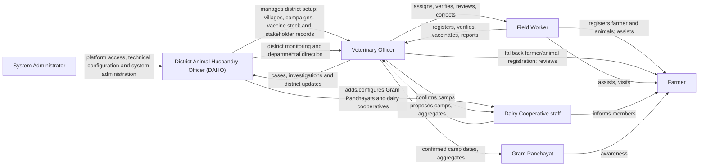
**Hand-off rule:** every action produces either an in-app notification, a work-list entry, or a dashboard change for the next responsible stakeholder; nothing depends on SMS.

### Binding registration rules (apply across every workflow, screen, API and import)

1. **Farmer account creation is staff-controlled; farmer login is allowed.** Field Worker, Veterinary Officer and System Administrator may create a farmer record. A farmer must not self-register or create their own account through public signup. After the farmer record exists, authorized staff may create/link and activate the farmer login. The farmer can then log in independently using the configured login method (including OTP only if OTP login is enabled). OTP is for login only; it must never create a new farmer record or account.
2. **Animal registration is Field Worker first.** The Field Worker assigned to the village is the primary registrar. Veterinary Officer registration is a fallback only when the Field Worker is unavailable; the system must require and audit the reason. If an assigned Field Worker is available, the system must block Veterinary Officer fallback registration.
3. **No implied Admin animal-registration permission.** System Administrator manages platform configuration/accounts but cannot register animals under the current approved rule unless a separate decision explicitly grants that permission.
4. **Enforce, do not merely describe.** Apply these rules in UI visibility, backend authorization, service/business logic, API endpoints, bulk imports, offline queues, database audit fields and automated tests. Hiding a button alone is insufficient.
5. **Availability definition is a pending decision if not yet specified.** Do not invent an attendance timeout or automatic unavailability rule. Until approved, use an explicit authorized unavailability record/reason and document the configuration decision.

## 2. Notification matrix (in-app always; SMS only when a provider is approved)
| Event | Recipient | Message key (Gujarati strings module) |
|---|---|---|
| Farmer submitted / verified / rejected | Farmer, FW/VO | `farmer.submitted`, `farmer.verified`, `farmer.rejected` |
| Animal verified / QR issued | Farmer | `animal.verified` |
| Campaign activated / cancelled | VO, FW, coop | `campaign.activated`, `campaign.cancelled` |
| Camp proposed / confirmed / rescheduled / cancelled | VO, coop, FW, panchayat | `camp.*` |
| Disease report submitted / assigned / outcome | VO, FW, farmer | `report.*` |
| Alert raised | VO, DAHO | `alert.raised` |
| Help request assigned / updated | Assignee, farmer | `help.*` |
| Reminder due / overdue | Farmer (in-app), FW list | `reminder.due`, `reminder.overdue` |
| Sync conflict / held event | VO, Admin | `sync.conflict` |

## 3. Workflows A–M
### Workflow A — Platform preparation
```mermaid
flowchart LR
  AD["System Administrator logs in"] --> U["Create staff accounts"]
  U --> R["Assign roles and permission grants"]
  R --> V["Configure villages + verified geodata"]
  V --> AS["Assign villages to staff"]
  AS --> C["Register cooperatives and staff assignments"]
  C --> S["Set offline period 7 days, flags, integration status"]
  S --> OK["System ready for campaigns"]
  OK -->|"audit"| AU[("audit_events")]
```

| Attribute | Description |
|---|---|
| Starting stakeholder | System Administrator and District Animal Husbandry Officer (DAHO) |
| Trigger | Pilot start, district onboarding, village/staff change, stock update or campaign preparation |
| Preconditions | Admin account exists; Department lists of staff and villages available (provided by the Department) |
| Input data | District and village details, verified geodata, Gram Panchayat details, dairy cooperative details and served villages, Veterinary Officer details, vaccine stock entries, campaign details, staff assignments and platform settings |
| Responsible person | System Administrator manages platform access and technical configuration. DAHO manages district operational setup: villages, Gram Panchayats, dairy cooperatives, Veterinary Officers, vaccine stock and campaigns. |
| Next stakeholder | Veterinary Officers and Field Workers for assigned operational work; Gram Panchayats and dairy cooperatives for coordination |
| Notifications | Users receive credentials through the Department’s channel; first-login password change enforced |
| Database updates | users, user_village_assignments, user_permission_grants, villages, geodata_imports, gram_panchayats, dairy_cooperatives/cooperatives, cooperative_staff_assignments, veterinary_officers, vaccine_stock, campaigns, system_settings, audit_events |
| Permission checks | System Administrator: `platform.admin`, `user.manage` for platform-level accounts and `config.manage`. DAHO: `district.setup.manage`, `village.manage`, `gram_panchayat.manage`, `cooperative.manage`, `veterinary_officer.manage`, `vaccine_stock.manage`, `campaign.manage`; district scope enforced. |
| Success outcome | District operational master data and resources are configured by DAHO; staff can log in and see only their authorised villages and permissions |
| Failure outcome | Duplicate username, missing village → 409/422 with Gujarati message |
| Alternative paths | Bulk staff creation via the import screens (Department list) |
| Recovery | Mistaken role/assignment corrected with audit; deactivation (never delete) |
| Audit | Every create/update/deactivate, permission grant, setting change |
| Acceptance criteria | AC-16, T-AUTH-001/002; System Administrator manages platform access; DAHO can add villages, Gram Panchayats, dairy cooperatives, Veterinary Officers, vaccine stock and campaigns within the district; FW sees only assigned villages |

**Step by step**

| # | Actor | Action | System processing | Result |
|---|---|---|---|---|
| 1 | System Administrator | Creates/activates the DAHO account and configures platform-level access and technical settings | Role and permission checks; district scope linked; audit event saved | DAHO can access the authorised district workspace |
| 2 | DAHO | Adds or updates villages and imports verified geodata | Validate district ownership, duplicate village codes and geodata source; audit every change | District village master is available |
| 3 | DAHO | Adds Gram Panchayats and maps them to the relevant villages | Validate names, codes and village mapping; prevent invalid/duplicate links | Gram Panchayat directory is available |
| 4 | DAHO | Adds dairy cooperatives and maps their served villages; creates/assigns cooperative staff records as permitted | Validate cooperative details, served-village scope and role permissions | Cooperative directory and coordination scope are available |
| 5 | DAHO | Adds Veterinary Officer records/accounts and assigns authorised villages | Validate officer details, role, active status and district/village scope | Veterinary Officers can access their authorised work |
| 6 | DAHO | Records and updates vaccine stock entries | Capture vaccine identity, quantity, batch/expiry details when available, storage/location and transaction history; do not invent medical rules | Stock position is available for operational planning |
| 7 | DAHO | Creates/configures vaccination campaigns using Department-approved programme/schedule information | Validate selected villages, approved schedule reference and campaign dates; audit changes | Campaign is available to authorised Veterinary Officers |
| 8 | Veterinary Officer | Reviews assigned campaign and assigns Field Workers to authorised villages/work | Enforce village scope and existing vaccinator-authorisation rules | Field work is assigned |
| 9 | System | Applies configured offline policy and displays integration status | Keep unapproved integrations disabled/simulated | System is ready for district operations |

**Responsibility boundary:** DAHO manages district operational master data and campaign/stock setup. System Administrator remains responsible for platform-level administration and technical configuration. DAHO permissions do not grant animal-registration permission or override the Field Worker-first animal-registration rule.
### Workflow B — Staff-controlled farmer registration (NO self-registration)
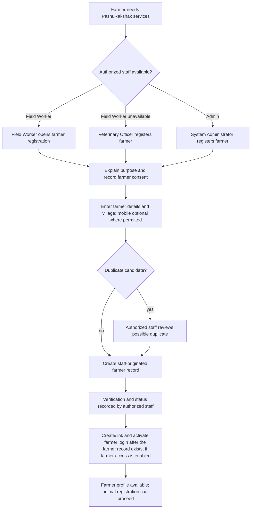

| Attribute | Description |
|---|---|
| Starting stakeholder | Field Worker; Veterinary Officer or System Administrator may also initiate registration |
| Trigger | Farmer needs to be added to the platform |
| Preconditions | Staff authenticated; role and village scope valid; farmer consent obtained; village exists |
| Input data | Farmer name, village, address/contact details as available, smartphone status, consent and approved verification details |
| Responsible person | Field Worker is the normal registration operator; Veterinary Officer and System Administrator are also expressly permitted to register farmers |
| Next stakeholder | Field Worker / Veterinary Officer for verification or correction; farmer receives access only if an account is created for them |
| Notifications | Staff receives registration result; farmer receives in-app status only if a farmer account exists; SMS only through an approved provider |
| Database updates | farmers, farmer_verifications, users (only when an account is provisioned), farmer_user_links, audit_events |
| Permission checks | `farmer.register` for Field Worker, Veterinary Officer and System Administrator; `farmer.verify` only for authorized verifier; village scope enforced |
| Success outcome | Farmer record created by authorized staff with actor, timestamp, consent and status recorded |
| Failure outcome | Unauthorized role → 403; duplicate candidate → review; missing consent/required data → validation error; invalid village/scope → reject |
| Prohibited path | No public signup, farmer self-registration or farmer-created account. Farmer login is permitted only after staff provisioning; OTP, if enabled, is login-only and cannot create an account |
| Recovery | Authorized staff corrects or resumes draft; duplicate decisions are audited; no silent duplicate creation |
| Audit | FARMER_REGISTER, FARMER_VERIFY, DUP_DECISION, FARMER_ACCOUNT_PROVISION, ACCESS_DENIED |
| Acceptance criteria | Only Field Worker, Veterinary Officer or System Administrator can create farmer records; farmer cannot access registration API/UI; staff-originated actor is recorded for every registration |

**Step by step**

| # | Actor | Action | System processing | Result |
|---|---|---|---|---|
| 1 | Field Worker / VO / Admin | Opens farmer registration from the authorized staff workspace | Authenticate role, permission and village scope | Registration form available only to permitted staff |
| 2 | Staff member | Explains purpose and records farmer consent | Consent captured with timestamp and staff actor | Consent evidence saved |
| 3 | Staff member | Enters farmer details and village | Validate required fields, contact format and assigned scope | Valid staff-entered form |
| 4 | System | Checks possible duplicates | Match candidates; do not silently merge or create duplicates | Clear result or review queue |
| 5 | Authorized staff | Resolves duplicate candidate and verifies details | Save decision, verifier, time and reason | One correctly linked farmer record |
| 6 | System | Creates farmer code and record | Store `created_by_user_id`, registration channel and audit event | Farmer profile created |
| 7 | Authorized staff | Provisions farmer login only if farmer-facing access is enabled | Link account to existing farmer; no public signup route | Farmer can log in independently using the provisioned account and configured login method; OTP, if enabled, is login-only |

**Non-smartphone, shared-mobile and no-mobile cases:** staff registration remains available; a mobile number is not to be treated as proof of identity. Do not require OTP for farmer record creation unless separately approved. Farmer may log in after staff provisions the account; no farmer self-registration fallback exists. OTP, if enabled, is used only for login.

### Workflow C — Staff-controlled animal registration, priority, verification, internal ID and QR
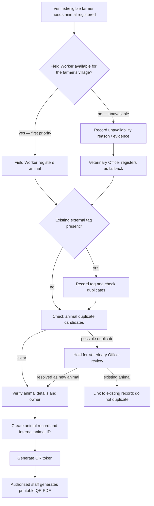

| Attribute | Description |
|---|---|
| Starting stakeholder | Field Worker is the primary registrar; Veterinary Officer is the fallback registrar only when the Field Worker is unavailable |
| Trigger | A farmer's animal needs registration |
| Preconditions | Farmer record exists; staff authenticated; village scope valid; Field Worker availability checked; consent/owner details available |
| Input data | Species, breed, sex, age/DOB, farmer, village, optional existing external tag and verification details |
| Responsible person | Field Worker first. Veterinary Officer may register only after recording why the assigned/available Field Worker could not perform the registration |
| Admin permission | System Administrator does not receive animal-registration permission under this workflow unless separately approved in a future decision |
| Next stakeholder | Veterinary Officer for duplicate review or exception; authorized staff for QR label generation/attachment |
| Notifications | Farmer receives status only if a provisioned farmer account exists; relevant Field Worker/VO receives queue or completion notice |
| Database updates | animals, animal_external_identifiers, animal_verifications, animal_qr_tokens, label_batches/items, audit_events; registration actor and fallback reason must be retained |
| Permission checks | `animal.register` for Field Worker; `animal.register.fallback` for Veterinary Officer; village scope; `animal.verify`; `label.generate` |
| Priority enforcement | Backend checks whether an assigned Field Worker is available for the village. If available, a VO fallback registration is blocked. If unavailable, VO must supply a reason and the system audits it |
| Success outcome | Animal record with internal ID and QR token after applicable validation/verification state |
| Failure outcome | Unauthorized role → 403; VO fallback attempted while Field Worker available → 409/403; duplicate/invalid tag → NEEDS_REVIEW or rejection; missing fallback reason → validation error |
| Alternative paths | Bulk import must obey the same priority rule per village/record; flock registration only if Department enables it |
| Recovery | Field Worker can complete a pending registration; VO can review duplicates; damaged QR can be reprinted with reason; no duplicate animal created silently |
| Audit | ANIMAL_REGISTER, ANIMAL_REGISTER_FALLBACK, FIELD_WORKER_UNAVAILABLE, ANIMAL_VERIFY, TAG_ADD, LABEL_BATCH, REPRINT, ACCESS_DENIED |
| Acceptance criteria | Field Worker is first priority; VO registers only when Field Worker unavailable; every VO fallback records reason; Admin/farmer cannot register animals; internal ID/QR is generated according to existing status rules |

**Step by step**

| # | Actor | Action | System processing | Result |
|---|---|---|---|---|
| 1 | Field Worker / VO | Opens animal registration for a farmer | Authenticate user and check village assignment | Registration request started |
| 2 | System | Checks whether a Field Worker is assigned and available for that village | Apply configured availability/assignment rule; record check result | Field Worker route or fallback route selected |
| 3 | Field Worker | If available, enters animal details | Validate farmer, village, species and required fields | Primary registration path |
| 4 | Veterinary Officer | Only if Field Worker unavailable, enters reason and registers animal | Enforce fallback permission; save unavailability reason and audit event | Fallback registration path |
| 5 | Registrar | Records existing Bharat Pashudhan 12-digit tag if present | Validate format and duplicate ACTIVE identifier; never generate an external tag | External identifier recorded or flagged |
| 6 | System / VO | Runs duplicate checks | Candidate match by tag and animal/farmer attributes; possible duplicates go to VO review | Clear or NEEDS_REVIEW |
| 7 | Authorized registrar/verifier | Confirms animal identity, owner and available details | Save verification actor, time and method | Registration/verification state updated |
| 8 | System | Assigns internal `animal_code` and QR token at the approved lifecycle state | Unique internal code; one active QR token | Internal ID + QR |
| 9 | Authorized staff | Downloads multi-QR PDF and attaches/scans label | Log batch and reprint reason where applicable | Physical label linked to record |

**Priority definition:** “Field Worker unavailable” must be an explicit, testable system condition (for example, no active Field Worker assignment for that village, or the assigned worker is formally marked unavailable under an approved availability process). Do not let a user simply skip the Field Worker step. If the project has not defined how availability is declared, record that as a pending decision; do not invent an automatic timeout or attendance rule.

**Individual vs flock:** all species register individually until the Department rules on goats/sheep (D-ANM-01). **Government tag:** never fabricated; only entered or imported.

### Workflow D — Vaccination planning and campaigns (government, cooperative, joint, doorstep)
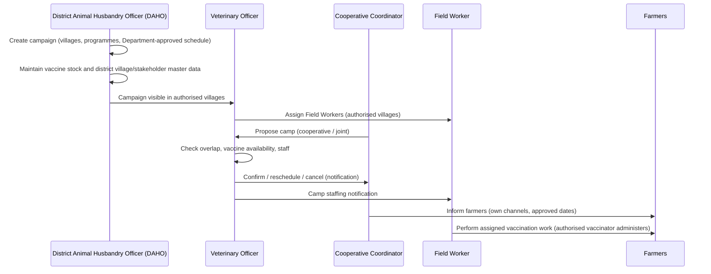

| Attribute | Description |
|---|---|
| Starting stakeholder | District Animal Husbandry Officer (DAHO) |
| Trigger | New vaccination programme cycle |
| Preconditions | Approved schedule version exists (Department); villages and staff configured |
| Input data | Campaign name/dates, villages, programmes, schedule version; camp date/place/organiser type |
| Responsible person | DAHO creates/configures campaigns and maintains district vaccine stock; VO assigns Field Workers and confirms camps; cooperative coordinator may propose a camp |
| Next stakeholder | Veterinary Officer → Field Workers → Cooperative → Farmers |
| Notifications | Assigned workers and cooperative receive in-app notices; farmers informed through cooperative/panchayat channels or SMS when approved |
| Database updates | campaigns, campaign_programmes, campaign_villages, campaign_animal_targets, campaign_assignments, camps, camp_staff, notifications, audit_events |
| Permission checks | `campaign.manage` and `vaccine_stock.manage` (DAHO, district scope), `campaign.assign_workers` + scope (VO), `camp.propose` (cooperative coordinator), `camp.manage` (VO) |
| Success outcome | Active campaign; confirmed staffed camps; assigned workers |
| Failure outcome | Activation blocked without approved schedule; camp blocked on overlap / unavailable vaccine / no staff |
| Alternative paths | Government-organised, cooperative-organised, joint, doorstep, individual visit to facility |
| Recovery | Camp rescheduled/cancelled with reason; campaign changes or cancellation by DAHO with reason and audit |
| Audit | CAMPAIGN_CREATE/ACTIVATE/CANCEL, CAMP_PROPOSE/CONFIRM/CANCEL, ASSIGNMENT |
| Acceptance criteria | AC-24, T-CAMPAIGN-001..005, T-COOP-003; DAHO creates/configures campaigns; VO assigns workers and confirms camps; cooperative cannot confirm camps or record vaccination without authorisation |

**Step by step**

| # | Actor | Action | System processing | Result |
|---|---|---|---|---|
| 1 | DAHO | Creates campaign, attaches Department-approved schedule version, selects villages/programmes and dates | Campaign DRAFT; validate approved schedule reference and required configuration | Campaign ready for activation |
| 2 | DAHO / System | Reviews vaccine stock for the planned campaign; system snapshots eligible animals using only approved rules | Stock position and `campaign_animal_targets` recorded | Planning information available |
| 3 | VO | Reviews campaign, assigns FWs in authorised villages | campaign_assignments; scope check | Workers assigned |
| 4 | Coop / VO | Proposes camp (organiser type, date, place, expected farmers) | camps PROPOSED; overlap warning 7.16 | Proposal |
| 5 | VO | Confirms: staff assigned, vaccine not UNAVAILABLE, no overlap | camps CONFIRMED (exclusion constraint) | Confirmed camp |
| 6 | System | Notifies assigned staff, cooperative, panchayat (confirmed date only) | notifications | Everyone informed |
| 7 | Coop / Panchayat | Inform farmers via their own channels | — (outside system, aggregate counts support planning) | Farmers aware |
| 8 | FW / authorised vaccinator | Perform and record vaccination (Workflow E) linked to camp_id | vaccination_details.camp_id | Progress updated |

**Variants:** see §4 (camp variants). **Organising ≠ administering:** cooperative staff never record vaccination without an approved vaccinator authorization and camp assignment (BR-COOP-002/005).

### Workflow E — Vaccination recording (online or offline)
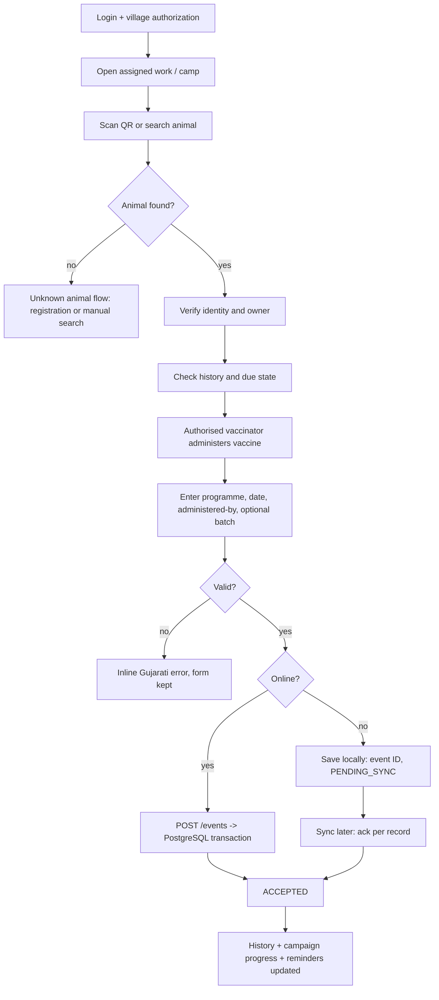

| Attribute | Description |
|---|---|
| Starting stakeholder | Field Worker / authorised vaccinator / Veterinary Officer |
| Trigger | Animal presented for vaccination |
| Preconditions | User authenticated; village assigned; animal REGISTERED/VERIFIED; approved schedule available for due logic; offline: data downloaded and offline grant valid |
| Input data | Animal, programme (approved list for species), date, administered-by, optional batch, remarks, campaign/camp |
| Responsible person | Recorder = FW/VO; administered-by = VO / authorised Government FW / approved vaccinator |
| Next stakeholder | Veterinary Officer (optional audit); Farmer (history); DAHO (aggregates) |
| Notifications | Farmer: updated history/reminder; VO: flagged items; FW: sync acknowledgements |
| Database updates | animal_events, vaccination_details, sync_receipts, reminders (regenerated), campaign progress views, audit_events |
| Permission checks | `event.create`, village/camp scope, vaccinator authorization per mode STRICT/FLAG |
| Success outcome | Event ACCEPTED/SYNCED; history updated |
| Failure outcome | Validation error; scope denied; not authorised vaccinator (STRICT); possible duplicate → NEEDS_REVIEW |
| Alternative paths | Treatment/observation events; flock events only if enabled; VO records directly |
| Recovery | Corrections via VO amend/void with reason; failed sync fixed by user |
| Audit | EVENT_CREATE, EVENT_CORRECT, REVIEW, ACCESS_DENIED |
| Acceptance criteria | AC-03..07, T-VACCINE-001..007, T-SYNC-001..004; routine entries need no approval; batch optional |

**Step by step**

| # | Actor | Action | System processing | Result |
|---|---|---|---|---|
| 1 | FW | Logs in; downloaded village data shows ‘last updated’ | Offline grant valid ≤7 days | Ready |
| 2 | FW | Opens assigned work or camp list | campaign.view_assigned | Task list |
| 3 | FW | Scans QR (local token lookup) or searches | Dexie index qrToken | Animal profile or unknown flow |
| 4 | FW | Verifies identity/owner; checks history | Stale-data banner if cache old | Confirmed target |
| 5 | Vaccinator | Administers vaccine (outside system) | — | Real-world act |
| 6 | FW | Selects programme from approved list, date, administered-by, optional batch | zod validation: no future date, list by species | Valid form |
| 7 | App | Online: submit; Offline: save with event_id in IndexedDB | 7.1 idempotent insert; or queue row | ACCEPTED or PENDING_SYNC |
| 8 | App/API | Sync: per-record ack; mark SYNCED only on ACCEPTED/ALREADY_ACCEPTED | sync_receipts | SYNCED |
| 9 | System | Updates history, regenerates reminders, refreshes coverage views | jobs; matview refresh | Dashboards current |

### Workflow F — Farmer health complaint
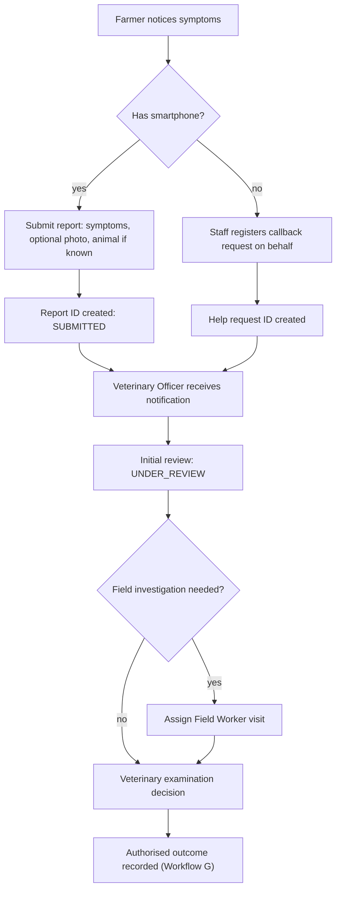

| Attribute | Description |
|---|---|
| Starting stakeholder | Farmer |
| Trigger | Sick animal observed |
| Preconditions | Farmer registered or staff-assisted; village known |
| Input data | Symptoms (checklist + text), optional photo, animal (if known), location (optional) |
| Responsible person | Farmer with provisioned account submits, or staff records report on farmer’s behalf; VO reviews; FW investigates if assigned; authorised veterinarian examines |
| Next stakeholder | Veterinary Officer → Field Worker → authorised veterinarian |
| Notifications | VO: new report; FW: assignment; Farmer: status updates (in-app) |
| Database updates | disease_reports, disease_report_attachments, help_requests, disease_reviews, notifications, audit_events |
| Permission checks | `disease.report` (provisioned farmer/FW/VO), `disease.review` (VO), assignment scope; no public/anonymous signup |
| Success outcome | Report with ID tracked to outcome |
| Failure outcome | Missing village → validation; offline → queued |
| Alternative paths | Photo optional; animal optional; callback path for no smartphone |
| Recovery | Farmer can resubmit/add info; request status visible |
| Audit | REPORT_CREATE, REVIEW, ASSIGN |
| Acceptance criteria | AC-13, AC-27, T-DISEASE-001/007; no photo or animal ID required |

**Step by step**

| # | Actor | Action | System processing | Result |
|---|---|---|---|---|
| 1 | Farmer | Submits report (or asks staff for callback) | Validation; photo MIME/size limits | Report ID / request ID |
| 2 | System | Notifies village VO; creates follow-up task for staff-assisted | notifications; follow_up_tasks | VO informed |
| 3 | VO | Opens, sets UNDER_REVIEW, may request more info or investigation | disease_reviews INITIAL_REVIEW | Review started |
| 4 | FW | Visits farm if assigned; records observation/photos | FIELD_INVESTIGATION review | Evidence |
| 5 | Authorised veterinarian | Examines animal | VETERINARY_EXAMINATION review | Assessment |
| 6 | VO / authorised | Records outcome via Workflow G | status change with basis | Outcome visible to farmer as status only |

### Workflow G — Disease surveillance
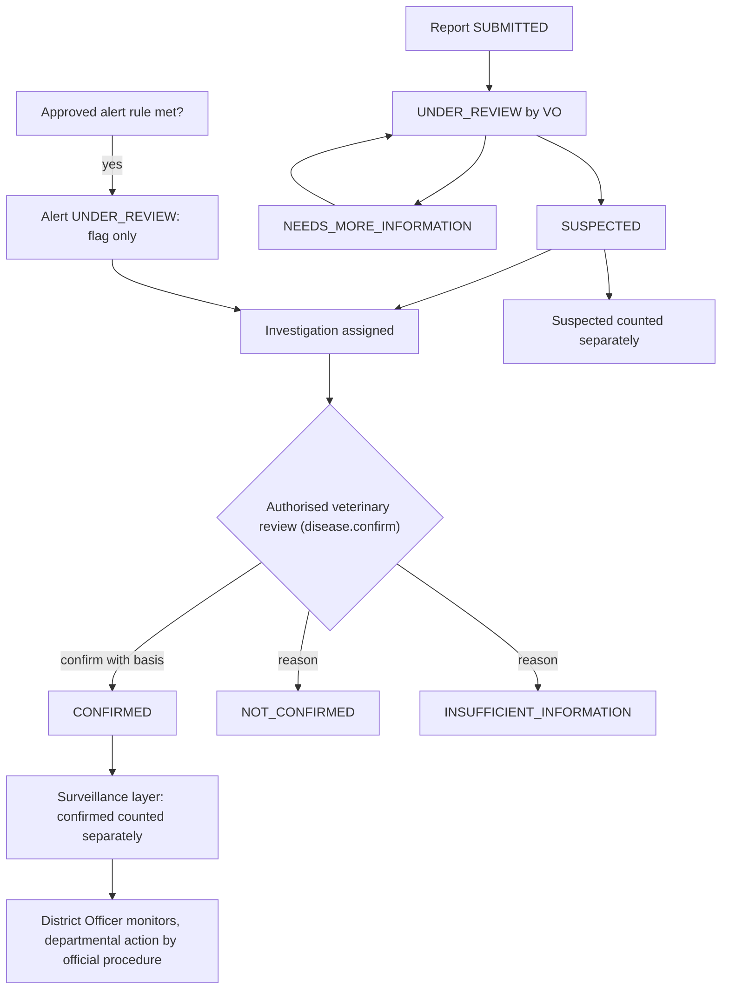

| Attribute | Description |
|---|---|
| Starting stakeholder | Farmer / Field Worker / Veterinary Officer |
| Trigger | Disease report or rule-based flag |
| Preconditions | Report exists; for alerts an APPROVED rule exists |
| Input data | Report data; review basis; rule parameters (Department) |
| Responsible person | VO reviews; **user with `disease.confirm`** decides final outcomes; DAHO adjudicates conflicts |
| Next stakeholder | Veterinary Officer → DAHO |
| Notifications | Assignee notified; DAHO sees alerts; no public outbreak declaration by the system |
| Database updates | disease_reports, disease_reviews, disease_report_status_history, disease_alerts, alert_reports, investigations, investigation_actions, v_village_surveillance |
| Permission checks | `disease.review`, `disease.confirm`, `map.view` |
| Success outcome | Confirmed/not-confirmed/insufficient recorded; map updated |
| Failure outcome | Unauthorised confirmation → 403; no rule → no alert; conflicts → flag |
| Alternative paths | Reversal of confirmation with reason; alert closed as false alarm |
| Recovery | Missing coordinates → location-unavailable list; stale → grey |
| Audit | DISEASE_REVIEW, DISEASE_CONFIRM, ALERT_RAISE/CLOSE, ACCESS_DENIED |
| Acceptance criteria | AC-13..15, AC-27, T-DISEASE-001..007; ‘no reports’ never shown as disease-free |

**Step by step**

| # | Actor | Action | System processing | Result |
|---|---|---|---|---|
| 1 | System | Duplicate check; exclude duplicates from counts | duplicate_of | Clean counts |
| 2 | VO | Initial review → SUSPECTED / NEEDS_MORE_INFORMATION | disease_reviews | Status set |
| 3 | VO | Assigns investigation (FW / veterinarian) | investigations; notifications | Assignment |
| 4 | Authorised reviewer | Records examination; confirms / not-confirms / insufficient with basis | permission + CHECK constraints | Final outcome |
| 5 | System | Evaluates approved alert rules after accepted reports | 7.9; alerts UNDER_REVIEW | Flag (never auto-confirm) |
| 6 | DAHO | Views map layers separately: suspected vs confirmed; data freshness | v_village_surveillance | Decision support |
| 7 | DAHO | Departmental action per official procedure (outside system) | investigation notes | Follow-up tracked |

### Workflow H — Reminders and overdue monitoring
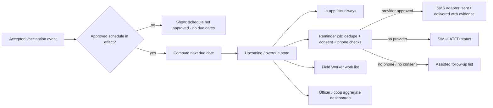

| Attribute | Description |
|---|---|
| Starting stakeholder | System (scheduler) after a vaccination event |
| Trigger | Event accepted, correction, or scheduled run |
| Preconditions | Approved schedule version in effect |
| Input data | Events, animals (REGISTERED/VERIFIED, ACTIVE), approved rules, consent flags |
| Responsible person | System job; follow-ups by FW/VO |
| Next stakeholder | Farmer; Field Worker; VO; coop (aggregates) |
| Notifications | Farmer in-app list; SMS only when provider approved; honest statuses |
| Database updates | reminders, reminder_delivery_attempts, follow_up_tasks, notifications, jobs |
| Permission checks | Job runs as system; users need `aggregate.view` / scope |
| Success outcome | Due lists and reminders current |
| Failure outcome | No schedule → SCHEDULE_NOT_APPROVED; provider missing → SIMULATED; no phone → follow-up |
| Alternative paths | Corrected date cancels obsolete reminders |
| Recovery | Failed delivery → follow-up task |
| Audit | REMINDER_RUN, CANCEL_OBSOLETE |
| Acceptance criteria | AC-11, AC-12, T-VACCINE-001; no DELIVERED without provider evidence |

**Step by step**

| # | Actor | Action | System processing | Result |
|---|---|---|---|---|
| 1 | System | Evaluates due state with query 7.6 using approved rules only | No rule → empty | Due list |
| 2 | System | Creates reminders with dedupe_key | ON CONFLICT DO NOTHING | One reminder per key |
| 3 | System | Checks consent/phone; routes channel (IN_APP always) | SKIPPED_* statuses | Channel decision |
| 4 | Adapter | Sends via provider or marks SIMULATED | attempts table; DELIVERED needs evidence | Honest state |
| 5 | FW / VO | Use assisted follow-up list (call/visit) | follow_up_tasks | Contact |
| 6 | System | On correction cancels obsolete reminders | 7.8 | Clean list |

### Workflow I — Help request / callback
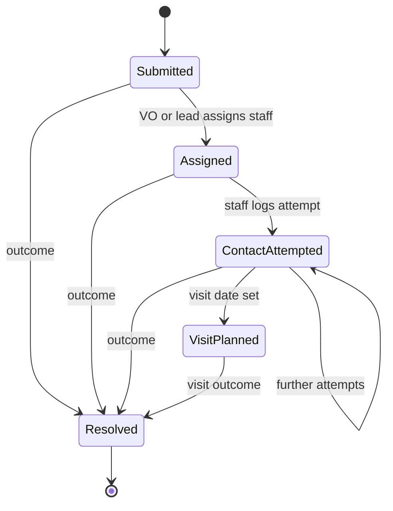

| Attribute | Description |
|---|---|
| Starting stakeholder | Farmer (app) or staff on behalf |
| Trigger | Farmer needs assistance |
| Preconditions | Village known; phone may be missing/unverified |
| Input data | Name, contact (optional), village, animal (optional), problem text |
| Responsible person | Assignee = FW or VO |
| Next stakeholder | Veterinary Officer / Field Worker |
| Notifications | Assignee notified; farmer (if account) sees status |
| Database updates | help_requests, help_request_attempts, follow_up_tasks, notifications |
| Permission checks | `help.create`, `help.manage` |
| Success outcome | Resolved with outcome |
| Failure outcome | Cannot assign outside scope |
| Alternative paths | No phone: village visit path; no IVR/auto-dialling |
| Recovery | Request reopened as new request |
| Audit | REQUEST_CREATE/ASSIGN/ATTEMPT/RESOLVE |
| Acceptance criteria | AC-22, T-FARMER-003; reference number; five states |

**Step by step**

| # | Actor | Action | System processing | Result |
|---|---|---|---|---|
| 1 | Farmer / staff | Creates request | Reference HR-BOT-YYYY-###### | Submitted |
| 2 | VO / lead | Assigns staff | help.manage + scope | Assigned |
| 3 | Assignee | Calls or visits (own phone); logs attempt | attempt row | Contact Attempted |
| 4 | Assignee | Plans visit | visit_planned_for | Visit Planned |
| 5 | Assignee | Records outcome | outcome mandatory | Resolved |

### Workflow J — Bulk import (Excel/CSV)
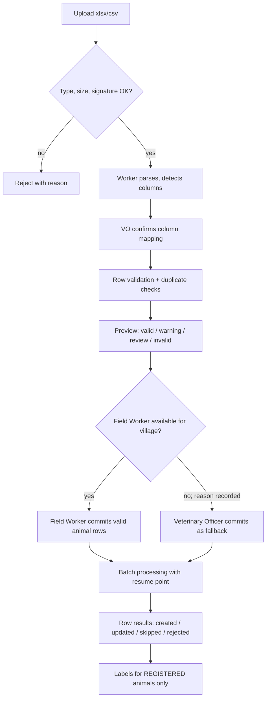

| Attribute | Description |
|---|---|
| Starting stakeholder | Field Worker (primary for animal registration); Veterinary Officer only as fallback when Field Worker is unavailable |
| Trigger | Existing records must be digitised |
| Preconditions | Authorised villages; file prepared |
| Input data | File, mapping |
| Responsible person | Field Worker leads animal registration/import for assigned villages; Veterinary Officer may commit/register records only where Field Worker unavailability is recorded; worker process validates rows |
| Next stakeholder | Field Workers (labels to attach) |
| Notifications | VO: job progress/completion; failed rows report |
| Database updates | import_jobs, import_rows, farmers, animals, animal_external_identifiers, animal_qr_tokens, label_batches, jobs, audit_events |
| Permission checks | `import.run`, `animal.register` / `animal.register.fallback`, village scope; per-row Field Worker priority enforced |
| Success outcome | Animals REGISTERED with IDs; PDF labels |
| Failure outcome | Invalid rows reported; REVIEW rows await VO |
| Alternative paths | Partial import; resume after interruption |
| Recovery | Retry-safe (row_hash + unique constraints) |
| Audit | IMPORT_UPLOAD/COMMIT, LABEL_BATCH |
| Acceptance criteria | AC-09, AC-10, AC-19, T-IMPORT-001..005 |

**Step by step**

| # | Actor | Action | System processing | Result |
|---|---|---|---|---|
| 1 | Field Worker | Uploads/imports animal file for assigned village; VO may do so only after recording Field Worker unavailability | Role, scope and fallback checks; magic bytes, size, no macros | Job UPLOADED |
| 2 | Worker | Parses; formulas not evaluated; formula-like cells neutralised | Safe parser limits | Columns detected |
| 3 | VO | Maps columns | Required mapping check | Mapping saved |
| 4 | Worker | Validates rows; farmers resolved/created for review; village must exist | outcomes per row | Preview |
| 5 | Authorized registrar (FW primary; VO fallback with reason) | Reviews errors; commits | Per-row priority and scope checks; COMMITTING; last_committed_row | Job running |
| 6 | Worker | Inserts in batches, idempotent | 7.11 | Counts |
| 7 | VO | Downloads error report and label PDF | formula-safe CSV; eligibility 7.12 | Deliverables |

### Workflow K — Offline operation and synchronisation
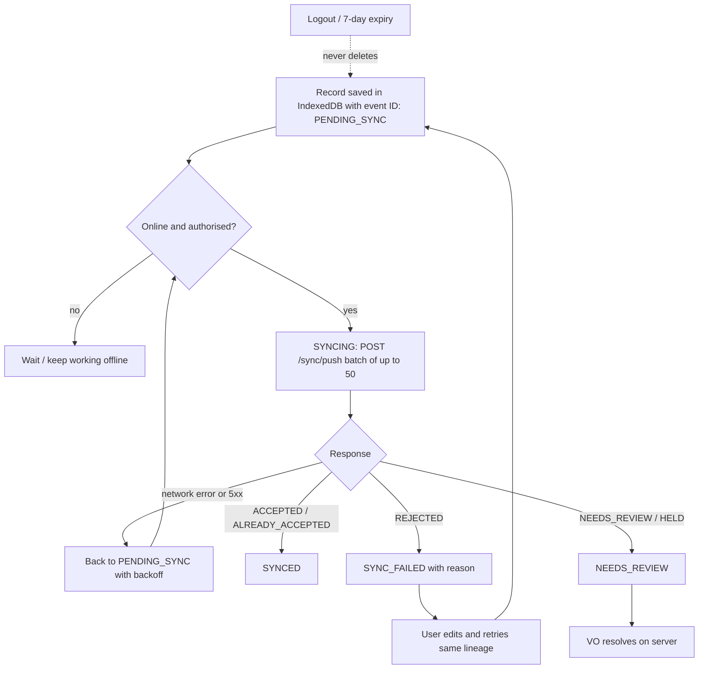

| Attribute | Description |
|---|---|
| Starting stakeholder | Field Worker / VO (app) |
| Trigger | Any local save; connectivity returns; app open; manual sync |
| Preconditions | Offline grant valid (≤ 7 days) for new offline work |
| Input data | Queued events |
| Responsible person | Sync controller (client) and API (server) |
| Next stakeholder | Veterinary Officer (conflict review) |
| Notifications | User sees per-record states and counts; Admin sees long-offline devices |
| Database updates | Dexie queue; sync_batches, sync_receipts, sync_conflicts, animal_events |
| Permission checks | Token valid; per-event scope check |
| Success outcome | All events SYNCED; data refreshed |
| Failure outcome | SYNC_FAILED / NEEDS_REVIEW with actionable reason |
| Alternative paths | Export pending file; re-authenticate after expiry |
| Recovery | Lost ack → ALREADY_ACCEPTED; storage full → block new saves, never delete |
| Audit | SYNC_BATCH, HELD_FOR_REVIEW, CONFLICT_RESOLVE |
| Acceptance criteria | AC-04..07, AC-18, AC-19, AC-28, T-OFFLINE-001..004, T-SYNC-001..004 |

**Step by step**

| # | Actor | Action | System processing | Result |
|---|---|---|---|---|
| 1 | App | Writes event to IndexedDB in one transaction | event_id UUID; ownerUserId tag | PENDING_SYNC |
| 2 | Controller | Triggers on open/online/after save/manual | bounded backoff | SYNCING |
| 3 | API | Per event: authenticate, scope, idempotent insert, validate, conflict check | 7.1, 7.2, 7.15 | Ack list |
| 4 | App | Applies acks; SYNCED only after ACCEPTED/ALREADY_ACCEPTED | — | Per-record state |
| 5 | App | Refreshes affected animals and reference data | pull changes | Fresh cache |
| 6 | User | Logout: warning; pending stays protected and recoverable | BR-AUTH-006 | Nothing lost |
| 7 | User | After 7 days offline: re-authenticate online, then sync | BR-AUTH-003 | Resume |

### Workflow L — Ownership transfer, duplicates, death/sale/move and corrections
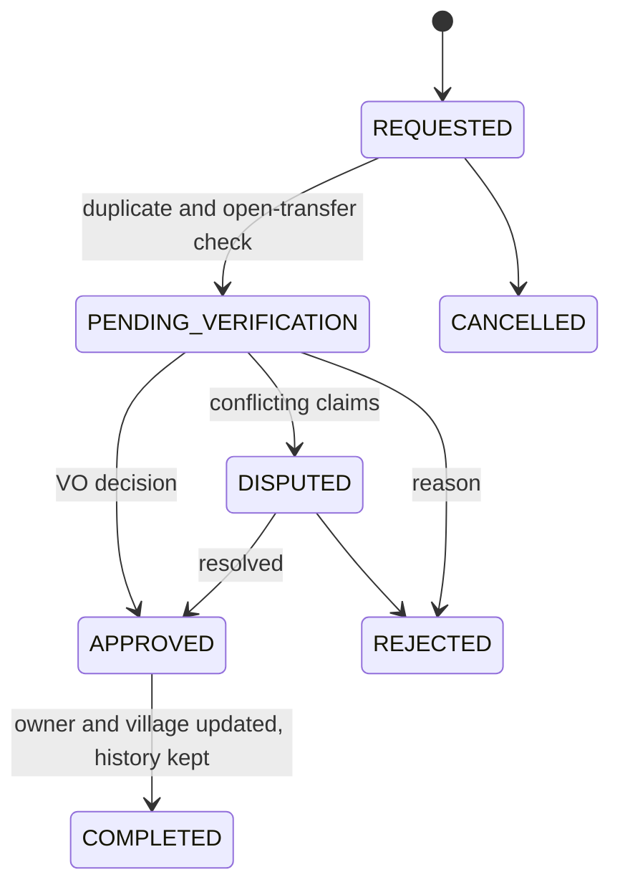

| Attribute | Description |
|---|---|
| Starting stakeholder | Farmer / Field Worker / Veterinary Officer |
| Trigger | Animal sold, gifted, inherited, moved village; data correction |
| Preconditions | Animal REGISTERED/VERIFIED; destination farmer exists |
| Input data | Animal, from/to farmer, to village, reason, evidence note, effective date |
| Responsible person | Requester; field verifier FW; decision VO |
| Next stakeholder | Veterinary Officer; Field Worker in new village |
| Notifications | Both farmers (in-app if account); VO decision notice |
| Database updates | ownership_transfers, animal_ownership_history, animals, reminders, audit_events |
| Permission checks | `animal.transfer.request`, `animal.transfer.decide`, scope |
| Success outcome | History preserved; new owner active |
| Failure outcome | Dispute/rejection leaves owner unchanged |
| Alternative paths | Death/sold/moved without new owner → status change; duplicates → merge (VO) |
| Recovery | Mistaken transfer reversed by new transfer with reason |
| Audit | TRANSFER_*, ANIMAL_STATUS, ANIMAL_MERGE |
| Acceptance criteria | AC-26, T-ANIMAL-004/005/007 |

**Step by step**

| # | Actor | Action | System processing | Result |
|---|---|---|---|---|
| 1 | Requester | Creates transfer with reason | One open transfer per animal | REQUESTED |
| 2 | FW | Field verification note | verified_by/at | PENDING_VERIFICATION |
| 3 | VO | Approves / rejects / marks disputed | decision_note mandatory | Decision |
| 4 | System | Completes in one transaction; reminders regenerated; events untouched | 7.18 | COMPLETED |
| 5 | VO | Merges duplicate animals when found | animal_merge_log; aliases | One identity |

### Workflow M — Cooperative / camp coordination
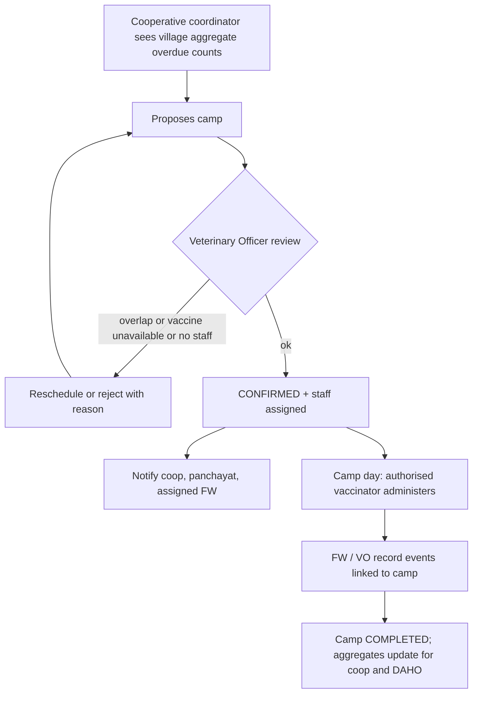

| Attribute | Description |
|---|---|
| Starting stakeholder | Cooperative Coordinator |
| Trigger | Cooperative sees overdue need among members/villages (aggregates) |
| Preconditions | Active campaign; cooperative assigned to village; coordinator assignment active |
| Input data | Village, date/time, place, expected farmers, organiser type, vaccine availability note |
| Responsible person | Coordinator proposes; **VO confirms**; authorised vaccinators/FWs act |
| Next stakeholder | Veterinary Officer → Field Worker/vaccinator → Panchayat/Farmers |
| Notifications | Coop: confirmed/cancelled/rescheduled; FW: staffing; Panchayat: confirmed date |
| Database updates | camps, camp_staff, cooperative_staff_assignments, notifications, vaccination_details(camp_id) |
| Permission checks | `camp.propose` (+assignment), `camp.manage` (VO), `event.create` (FW/authorised) |
| Success outcome | Staffed confirmed camp; recorded vaccinations; aggregate progress |
| Failure outcome | Overlap/availability/staff rule failures |
| Alternative paths | Government, joint, doorstep, no-vaccinator, farmer-absent variants (§4) |
| Recovery | Cancel/reschedule with reason; animals stay due |
| Audit | CAMP_*, ACCESS_DENIED |
| Acceptance criteria | AC-24, AC-25, T-COOP-001..005 |

**Step by step**

| # | Actor | Action | System processing | Result |
|---|---|---|---|---|
| 1 | Coop | Views aggregates only | BR-COOP-001 | Planning |
| 2 | Coop | Proposes camp | camps PROPOSED | Proposal |
| 3 | VO | Checks overlap, availability, staff | 7.16; constraint | Decision |
| 4 | VO | Confirms and assigns staff | CONFIRMED; camp_staff | Camp ready |
| 5 | System | Notifies parties | notifications | Informed |
| 6 | FW/vaccinator | Perform and record | Workflow E | Events with camp_id |
| 7 | VO | Closes camp as COMPLETED | status | Progress visible |

## 4. Camp and vaccination-service variants  **[REAL-WORLD; authority varies — see D-COOP-01/02]**
| Variant | Who organises | Who vaccinates and records | System handling | Failure / alternative |
|---|---|---|---|---|
| Government-organised camp | VO (proposes and confirms) | Government FW/VO | `organizer_type=GOVERNMENT`; cooperative only informs farmers | Vaccine unavailable → reschedule |
| Cooperative-organised camp | Coop coordinator proposes; VO confirms | VO / authorised Govt FW / approved vaccinator | `COOPERATIVE`; cooperative_id required | No authorised vaccinator → cannot CONFIRM |
| Joint government/cooperative camp | Both; VO confirms | As above | `JOINT` | Overlap blocked |
| Doorstep vaccination | VO assigns FW/vaccinator rounds | Assigned staff | `DOORSTEP` | Farmer absent → follow-up task |
| Farmer visits veterinary facility | — | VO/FW | Normal Workflow E without camp | — |
| Cooperative has its own veterinarian | Coop | Veterinarian with VETERINARY_OFFICER authorization | Approved authorization needed | Missing authorization → FLAG/REJECT |
| Cooperative has trained vaccinators | Coop | Only if Department confirms **and** authorization APPROVED | `COOPERATIVE_VACCINATOR` authorization + camp assignment | Otherwise not permitted |
| Cooperative has no veterinarian/vaccinator | Coop | Government staff assigned by VO | Camp staff = government | Camp not confirmable without staff |
| Vaccine unavailable | — | — | `vaccine_availability=UNAVAILABLE` blocks confirmation | Reschedule; notify |
| Farmer absent | — | — | Animal remains due; follow-up task | Next round |
| Animal not eligible under approved protocol | — | — | Not in due list; shown with reason from approved rules (no invented rules) | VO guidance outside system |
| Vaccination recorded offline | — | FW | Workflow K | Sync later |
| Cooperative staff lack authorization | — | — | 403; audit | Ask VO/Admin |

## 5. Worked examples  **[DEMO — illustrative IDs and data]**
### Example 1 — Farmer with smartphone
1. Meena (smartphone) gives consent and her details to Field Worker **Suresh**; Suresh creates her farmer record in the staff workspace → farmer ID `FRM-BOT-000041` [DEMO]. No farmer signup or OTP registration is available.
2. Suresh checks duplicates and verifies Meena in person → **VERIFIED**; if a farmer login is enabled, authorized staff provisions/links it after registration.
3. Meena tells Suresh about 2 animals (buffalo, cow) and provides the existing Bharat Pashudhan 12-digit tag for one (`000000000123` [DEMO]); she does not register them herself.
4. Suresh, as the available Field Worker, registers both animals, checks the ear tag and ownership, and completes verification → internal IDs `ANM-BOT-000412/413` and QR tokens are issued under the configured lifecycle rules. Authorized staff downloads the QR PDF; Suresh attaches labels and scans to confirm.
5. A camp is confirmed for Barvala; Meena sees the due list; the authorised vaccinator administers; Suresh records the event (batch left blank — optional); history and coverage update.
### Example 2 — Farmer without smartphone
Field Worker **Kiran** meets **Dhanji** (no phone). With Dhanji’s consent Kiran registers the farmer (`mobile_status=NONE`, `has_smartphone=NO`), verifies in person, registers 3 goats individually (flock rule pending Department), links tags if present, verifies animals on the spot (status VERIFIED), prints/attaches QR labels from the VO’s PDF sheet. Dhanji appears on the **assisted follow-up list** for reminders; for a sick goat Kiran registers a **callback/visit request** (reference `HR-BOT-2026-000017` [DEMO]) and later logs the visit outcome.
### Example 3 — Cooperative vaccination camp (and the government-organised alternative)
The **Cooperative Coordinator** sees village aggregate overdue counts (no names), proposes a camp for Saturday; the **VO** checks overlap, notes vaccine availability, assigns Govt FW **Kiran** and a veterinarian with approved authorization, confirms. The cooperative informs its members by its own channels; the Panchayat announces the confirmed date. On camp day the vaccinator administers, Kiran records events linked to the camp (offline if needed). Aggregates update for the cooperative and DAHO.
*Alternative:* government organises the camp; VO proposes+confirms it; the cooperative only gathers farmers — the cooperative has no event permissions either way.
### Example 4 — Farmer reports disease
Farmer submits symptoms + photo → report `DR-2026-000031` SUBMITTED → VO notified, sets UNDER_REVIEW, assigns Kiran for a visit → Kiran records observations → an authorised veterinarian examines → user with `disease.confirm` records NOT_CONFIRMED / CONFIRMED / INSUFFICIENT_INFORMATION with basis → map shows suspected vs confirmed separately → DAHO monitors; any departmental action follows official procedure.
### Example 5 — Offline field operation
Kiran downloads Barvala before leaving (data ‘last updated 08:12’). In a low-signal village he registers a new animal draft, records 18 vaccinations offline (PENDING_SYNC), signal drops during upload (3 accepted, rest back to PENDING_SYNC). He **logs out** with 15 pending — the app warns, then keeps them protected. Next day he logs in online, sync resumes, a lost acknowledgement returns ALREADY_ACCEPTED, 14 become SYNCED, 1 is SYNC_FAILED (invalid date) which he corrects. The VO’s dashboard shows no duplicates and nothing lost.

## 6. Role-wise journeys (login → logout) with approved screen IDs
| Role | Journey | Screens |
|---|---|---|
| System Administrator | Login → overview → users/roles → villages/geodata → schedules/rules → cooperatives/authorizations → monitoring → audit → logout | A1, S1–S5 |
| District Animal Husbandry Officer (DAHO) | Login → district dashboard → villages and stakeholder master data → Veterinary Officers → vaccine stock → campaigns → vaccination map → disease map → alerts/investigations → data quality/export → logout | A1, D1–D5 |
| Veterinary Officer | Login → overview → farmers/animals → verification → campaigns/camps → disease review → import/labels → corrections → sync centre → logout | A1, V1–V6 |
| Field Worker | Login (online) → download village → home → scan → profile → vaccinate/record → report disease → follow-ups → sync centre → logout with pending warning | A1, W1–W10 |
| Farmer | Login only if staff-provisioned account exists → home → my animals (view) → history → reminders → report/callback → profile → logout; no signup or registration screens | F1–F8 |
| Dairy Cooperative | Login → aggregate dashboard → camp proposals → outreach list (only if authorised) → logout | A1, C1–C2 |
| Gram Panchayat | Login → village overview → camp dates → awareness → logout | A1, G1 |
New screens needed by v0.3 workflows that are **not in the approved mockups** (staff-only farmer registration, Field Worker animal registration, Veterinary Officer fallback registration with unavailability reason, farmer/animal verification queue, camp proposal/confirmation, vaccinator authorization admin) are listed in `DECISION_REGISTER.md` D-UI-01 and must be built from the **approved components and tokens** without redesigning existing screens; they require UI approval before release.

## 7. Error-handling flows
### 7.1 Authentication and session
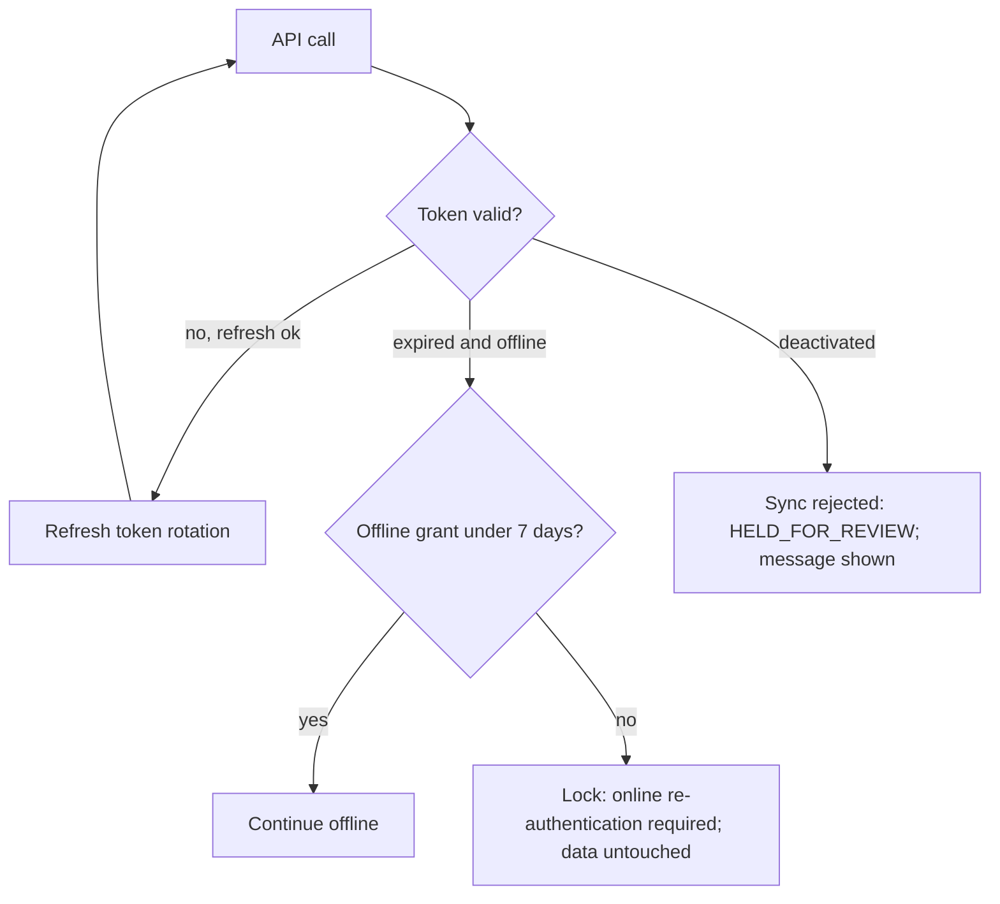
### 7.2 Import failure and resume
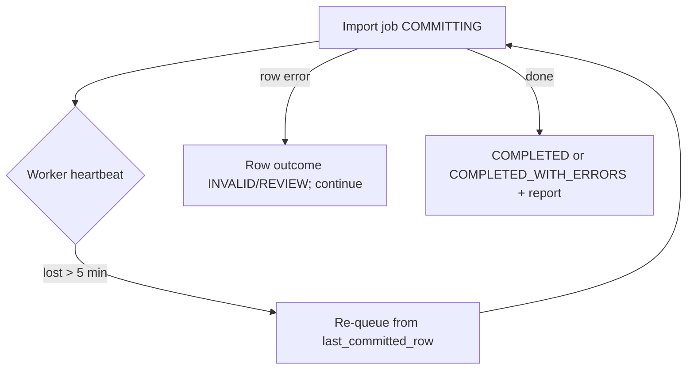
### 7.3 Common failure rules
| Failure | System behaviour | Stakeholder responsible next |
|---|---|---|
| Validation error | Inline Gujarati message; form preserved | Same user |
| 403 access denied | Neutral message; audit | User asks Admin/VO |
| Server down | Local data safe; retry | Same user; Admin if prolonged |
| Conflict | NEEDS_REVIEW; both versions kept | Veterinary Officer |
| Held event (deactivated user) | HELD_FOR_REVIEW | Admin releases to VO |
| Unknown animal | Registration/verification flow | Field Worker |
| Duplicate | Candidate review | Verifier / VO |
| Provider unavailable | SIMULATED/FAILED; follow-up list | Field Worker / VO |

## 8. Cross-references
Edge cases: `EDGE_CASE_CATALOGUE.md` · Permissions: `STAKEHOLDER_PERMISSION_MATRIX.md` · Rules/lifecycles: `PRD.md` §8–§9 · Technical flows: `TRD.md` §5–§6, §10–§14 · Tables/SQL: `BACKENDDATABASESCHEMA.md` · Traceability: `REQUIREMENTS_TRACEABILITY_MATRIX.md`.
