# BACKENDDATABASESCHEMA — PostgreSQL Schema and Backend Data Rules
**Project:** PS000195 · **Working name:** PashuRakshak Botad *(provisional placeholder)* · **Document:** 5 of 7 (file `BACKENDDATABASESCHEMA.md`) · **Version:** v0.4 (Consolidated APPFLOW v0.4 Alignment Draft) · **Date:** 31 October 2026
**Depends on:** PRD.md (FR/BR IDs), TRD.md (sync, security, jobs).

> **Status.** This is a *design* of the schema. **No database has been created or migrated.** DDL below is a proposed PostgreSQL 16 baseline for Alembic. This v0.4 draft closes the previously listed structural gaps against APPFLOW v0.4, adds district master data, explicit Field Worker availability, camp coordination, Gram Panchayat staff assignment, report provenance, notifications and transaction-safe stock movements. It remains a proposed design; no PostgreSQL server is available in this work session, so execution testing is explicitly not claimed.
> **No official data is invented:** every vaccination-schedule parameter, coverage target and outbreak threshold column is **nullable and only usable once an APPROVED version exists** (*To be configured and approved by the Department*). Seed data contains structure and codes only.

Labels: **[OFFICIAL]** · **[PROPOSED]** · **[ASSUMPTION]** · **[PENDING]** · **[DEMO]**.

---
## 1. Design principles
| # | Principle | Requirement |
|---|---|---|
| S1 | One reliable identity per animal: surrogate `animals.id` (UUID, **primary key**) + unique human-readable `animal_code`; the 12-digit Bharat Pashudhan tag is a **separate optional unique** column | DI-01, FR-ANM-02 |
| S2 | Events are **immutable**; corrections are linked rows (`event_corrections`); a trigger blocks UPDATE/DELETE of event facts | BR-01, DI-02, DI-05 |
| S3 | Client-generated `event_id` (UUID) is the PK of events → idempotent sync | BR-03, FR-SYNC-02 |
| S4 | Constraints in the database for identity, status, uniqueness and required fields; business rules that need context (future dates, scope) enforced in services and, where practical, triggers | DI-04 |
| S5 | **No duplicated sources of truth:** current owner/village live on `animals`; history in `animal_ownership_history`; coverage and due lists are **computed** (views/materialised views) | DI-07 |
| S6 | Configuration (schedules, thresholds, alert rules) is data with `DRAFT/APPROVED` status and approval references | FR-SCH-01, FR-MAP-04 |
| S7 | Audit log is append-only | FR-AUD-01 |
| S8 | Personal data minimised; phone numbers stored in E.164; no OTP or token in clear text | NFR-PRV-01 |
| S9 | Time stored as `timestamptz` (UTC); dates as `date`; Western digits | — |

Naming: `snake_case`, singular concepts, plural table names; PKs `id` (UUID) unless a natural key is stronger; FKs `<entity>_id`.

---
## 2. Entity-relationship overview

```mermaid
erDiagram
  DISTRICTS ||--o{ TALUKAS : contains
  TALUKAS ||--o{ VILLAGES : contains
  DISTRICTS ||--o{ DAHO_DISTRICT_ASSIGNMENTS : scopes
  VILLAGES ||--o{ GRAM_PANCHAYAT_VILLAGES : mapped_to
  GRAM_PANCHAYATS ||--o{ GRAM_PANCHAYAT_VILLAGES : covers
  DAIRY_COOPERATIVES ||--o{ COOPERATIVE_VILLAGES : serves
  VILLAGES ||--o{ COOPERATIVE_VILLAGES : served_by
  USERS ||--o{ DAIRY_COOPERATIVE_STAFF : assigned
  DAIRY_COOPERATIVES ||--o{ DAIRY_COOPERATIVE_STAFF : has_staff
  USERS ||--o{ VETERINARY_OFFICER_PROFILES : profile
  USERS ||--o{ DAHO_DISTRICT_ASSIGNMENTS : district_scope
  VACCINE_PRODUCTS ||--o{ VACCINE_STOCK_LOTS : lot
  VACCINE_STOCK_LOTS ||--o{ VACCINE_STOCK_TRANSACTIONS : movements
  USERS ||--o{ VACCINE_STOCK_TRANSACTIONS : records
  VILLAGES ||--o{ OWNERS : has
  VILLAGES ||--o{ ANIMALS : located_in
  OWNERS ||--o{ ANIMALS : owns
  ANIMALS ||--o{ ANIMAL_QR_TOKENS : tagged_by
  ANIMALS ||--o{ ANIMAL_EVENTS : has
  ANIMAL_EVENTS ||--o| VACCINATION_DETAILS : detail
  ANIMAL_EVENTS ||--o| TREATMENT_DETAILS : detail
  ANIMAL_EVENTS ||--o| EVENT_CORRECTIONS : corrected_by
  USERS ||--o{ USER_VILLAGE_ASSIGNMENTS : assigned
  USERS ||--o{ FIELD_WORKER_AVAILABILITY_RECORDS : availability
  CAMPAIGNS ||--o{ CAMPS : coordinates
  VILLAGES ||--o{ CAMPS : hosts
  CAMPS ||--o{ CAMP_STATUS_HISTORY : history
  USERS ||--o{ NOTIFICATIONS : receives
  USERS ||--o{ DEVICES : uses
  USERS ||--o{ ANIMAL_EVENTS : performs
  SCHEDULE_VERSIONS ||--o{ SCHEDULE_RULES : contains
  SCHEDULE_VERSIONS ||--o{ CAMPAIGNS : applied_to
  CAMPAIGNS ||--o{ CAMPAIGN_VILLAGES : targets
  CAMPAIGNS ||--o{ CAMPAIGN_ASSIGNMENTS : assigns
  ANIMALS ||--o{ DISEASE_REPORTS : subject
  DISEASE_REPORTS }o--o{ DISEASE_ALERTS : contributes
  DISEASE_ALERTS ||--o{ INVESTIGATIONS : triggers
  ANIMALS ||--o{ REMINDERS : due
  REMINDERS ||--o{ REMINDER_DELIVERY_ATTEMPTS : attempts
  IMPORT_JOBS ||--o{ IMPORT_ROWS : rows
  LABEL_BATCHES ||--o{ LABEL_BATCH_ITEMS : items
  HELP_REQUESTS ||--o{ HELP_REQUEST_ATTEMPTS : attempts
  USERS ||--o{ AUDIT_EVENTS : acts
```


---
## 3. Table catalogue
| Group | Tables |
|---|---|
| Geography/reference | `districts`, `talukas`, `villages`, `gram_panchayats`, `gram_panchayat_villages`, `gram_panchayat_staff_assignments`, `dairy_cooperatives`, `cooperative_villages`, `geodata_imports`, `species`, `breeds`, `programmes` |
| Identity & access | `users`, `permissions`, `role_permissions`, `user_permission_grants`, `user_village_assignments`, `field_worker_availability_records`, `owner_user_links`, `veterinary_officer_profiles`, `daho_district_assignments`, `dairy_cooperative_staff`, `devices`, `refresh_tokens`, `otp_challenges` |
| Owners & animals | `owners`, `animals`, `animal_qr_tokens`, `animal_ownership_history`, `animal_merge_log` |
| Events | `animal_events`, `vaccination_details`, `treatment_details`, `observation_details`, `event_corrections` |
| Schedules, campaigns & vaccine inventory | `schedule_versions`, `schedule_rules`, `campaigns`, `campaign_programmes`, `campaign_villages`, `campaign_assignments`, `campaign_animal_targets`, `camps`, `camp_status_history`, `vaccine_products`, `vaccine_stock_lots`, `vaccine_stock_transactions` |
| Reminders & follow-up | `reminder_templates`, `reminders`, `reminder_delivery_attempts`, `follow_up_tasks` |
| Help requests | `help_requests`, `help_request_attempts` |
| Disease surveillance | `disease_reports`, `disease_report_status_history`, `disease_alert_rules`, `disease_alerts`, `alert_reports`, `investigations`, `investigation_actions`, `map_threshold_sets` |
| Import & labels | `import_jobs`, `import_rows`, `label_batches`, `label_batch_items` |
| Sync | `sync_batches`, `sync_receipts`, `sync_conflicts` |
| Notifications | `notifications` |
| Platform | `audit_events`, `export_log`, `system_settings`, `integration_settings`, `jobs` |
| Views | `v_current_events`, `v_animal_last_event`, `v_village_coverage` (mat.), `v_village_surveillance` (mat.) |

---
## 4. DDL

### 4.1 Extensions and helpers
```sql
CREATE EXTENSION IF NOT EXISTS citext;       -- case-insensitive usernames
CREATE EXTENSION IF NOT EXISTS btree_gist;   -- exclusion constraint on schedule validity ranges
-- CREATE EXTENSION IF NOT EXISTS postgis;   -- ONLY if polygons/spatial queries are adopted (TRD §15)

CREATE SEQUENCE animal_code_seq START 1;
CREATE SEQUENCE help_request_ref_seq START 1;

CREATE OR REPLACE FUNCTION set_updated_at() RETURNS trigger AS $$
BEGIN NEW.updated_at = now(); RETURN NEW; END; $$ LANGUAGE plpgsql;
```

### 4.2 Geography and reference data
```sql
CREATE TABLE districts (
  id          uuid PRIMARY KEY DEFAULT gen_random_uuid(),
  code        text NOT NULL UNIQUE,
  name_gu     text NOT NULL,
  name_en     text NOT NULL,
  active      boolean NOT NULL DEFAULT true,
  created_at  timestamptz NOT NULL DEFAULT now(),
  updated_at  timestamptz NOT NULL DEFAULT now()
);

CREATE TABLE talukas (
  id        uuid PRIMARY KEY DEFAULT gen_random_uuid(),
  district_id uuid NOT NULL REFERENCES districts(id),
  code      text NOT NULL UNIQUE,
  name_gu   text NOT NULL,
  name_en   text NOT NULL
);

CREATE TABLE villages (
  id            uuid PRIMARY KEY DEFAULT gen_random_uuid(),
  code          text NOT NULL UNIQUE,                 -- e.g. BTD-BV (internal code) [DEMO]
  taluka_id     uuid NOT NULL REFERENCES talukas(id),
  district_id   uuid NOT NULL REFERENCES districts(id),
  name_gu       text NOT NULL,
  name_en       text NOT NULL,
  census_code   text,                                 -- optional official code, if supplied
  latitude      numeric(9,6),
  longitude     numeric(9,6),
  coord_status  text NOT NULL DEFAULT 'UNAVAILABLE'
                CHECK (coord_status IN ('VERIFIED','UNVERIFIED','UNAVAILABLE')),
  coord_source_id uuid,                               -- FK added after geodata_imports
  is_pilot      boolean NOT NULL DEFAULT false,
  active        boolean NOT NULL DEFAULT true,
  created_at    timestamptz NOT NULL DEFAULT now(),
  updated_at    timestamptz NOT NULL DEFAULT now(),
  CHECK ((latitude IS NULL) = (longitude IS NULL)),
  CHECK (coord_status = 'UNAVAILABLE' OR latitude IS NOT NULL),   -- no invented coordinates
  CHECK (latitude  IS NULL OR latitude  BETWEEN -90  AND 90),
  CHECK (longitude IS NULL OR longitude BETWEEN -180 AND 180)
);
CREATE TRIGGER trg_villages_updated BEFORE UPDATE ON villages FOR EACH ROW EXECUTE FUNCTION set_updated_at();

CREATE TABLE geodata_imports (
  id               uuid PRIMARY KEY DEFAULT gen_random_uuid(),
  source_name      text NOT NULL,
  source_reference text NOT NULL,          -- URL/document/authorisation reference
  dataset_version  text,
  verified         boolean NOT NULL DEFAULT false,
  verified_by_name text,
  imported_by      uuid NOT NULL,          -- FK users added below
  imported_at      timestamptz NOT NULL DEFAULT now(),
  rows_applied     integer NOT NULL DEFAULT 0,
  notes            text,
  CHECK (NOT verified OR verified_by_name IS NOT NULL)
);
ALTER TABLE villages ADD CONSTRAINT fk_villages_coord_source
  FOREIGN KEY (coord_source_id) REFERENCES geodata_imports(id);

CREATE TABLE species (
  code    text PRIMARY KEY CHECK (code IN ('CATTLE','BUFFALO','GOAT','SHEEP')),
  name_gu text NOT NULL,
  name_en text NOT NULL
);

CREATE TABLE breeds (
  id           uuid PRIMARY KEY DEFAULT gen_random_uuid(),
  species_code text NOT NULL REFERENCES species(code),
  name_gu      text NOT NULL,
  name_en      text NOT NULL,
  UNIQUE (species_code, name_en)
);

CREATE TABLE programmes (            -- vaccination-programme categories; applicability is configuration
  code    text PRIMARY KEY CHECK (code IN ('FMD','HS','BQ','BRUCELLOSIS','PPR')),
  name_en text NOT NULL,
  name_gu text,                       -- Department terminology to be supplied
  active  boolean NOT NULL DEFAULT true
);
```

### 4.3 Identity and access
```sql
CREATE TABLE users (
  id                   uuid PRIMARY KEY DEFAULT gen_random_uuid(),
  role                 text NOT NULL CHECK (role IN
                       ('VET_OFFICER','FIELD_WORKER','FARMER','DAIRY_STAFF','DAHO','GRAM_PANCHAYAT','SYS_ADMIN')),
  full_name            text NOT NULL,
  username             citext UNIQUE,                    -- staff
  password_hash        text,                             -- Argon2id (staff)
  mobile_e164          text UNIQUE CHECK (mobile_e164 ~ '^\+[1-9][0-9]{7,14}$'),
  designation          text,
  organisation         text,                             -- e.g. cooperative / panchayat name
  status               text NOT NULL DEFAULT 'ACTIVE' CHECK (status IN ('ACTIVE','INACTIVE','LOCKED')),
  must_change_password boolean NOT NULL DEFAULT true,
  failed_attempts      integer NOT NULL DEFAULT 0,
  locked_until         timestamptz,
  last_login_at        timestamptz,
  deactivated_at       timestamptz,
  deactivated_reason   text,
  created_by           uuid REFERENCES users(id),
  created_at           timestamptz NOT NULL DEFAULT now(),
  updated_at           timestamptz NOT NULL DEFAULT now(),
  CHECK ( (role = 'FARMER' AND mobile_e164 IS NOT NULL)
       OR (role <> 'FARMER' AND username IS NOT NULL AND password_hash IS NOT NULL) ),
  CHECK (status <> 'INACTIVE' OR deactivated_at IS NOT NULL)
);
CREATE TRIGGER trg_users_updated BEFORE UPDATE ON users FOR EACH ROW EXECUTE FUNCTION set_updated_at();
ALTER TABLE geodata_imports ADD CONSTRAINT fk_geo_imported_by FOREIGN KEY (imported_by) REFERENCES users(id);

CREATE TABLE permissions (
  code        text PRIMARY KEY,
  description text NOT NULL
);
CREATE TABLE role_permissions (               -- default permission set per role (Department approves final matrix)
  role            text NOT NULL CHECK (role IN ('VET_OFFICER','FIELD_WORKER','FARMER','DAIRY_STAFF','DAHO','GRAM_PANCHAYAT','SYS_ADMIN')) ,
  permission_code text NOT NULL REFERENCES permissions(code),
  PRIMARY KEY (role, permission_code)
);
CREATE TABLE user_permission_grants (         -- explicit extra grants, e.g. 'disease.confirm'
  user_id         uuid NOT NULL REFERENCES users(id),
  permission_code text NOT NULL REFERENCES permissions(code),
  granted_by      uuid NOT NULL REFERENCES users(id),
  granted_at      timestamptz NOT NULL DEFAULT now(),
  revoked_at      timestamptz,
  PRIMARY KEY (user_id, permission_code, granted_at)
);

CREATE TABLE user_village_assignments (
  id          uuid PRIMARY KEY DEFAULT gen_random_uuid(),
  user_id     uuid NOT NULL REFERENCES users(id),
  village_id  uuid NOT NULL REFERENCES villages(id),
  assigned_by uuid NOT NULL REFERENCES users(id),
  assigned_at timestamptz NOT NULL DEFAULT now(),
  ended_at    timestamptz
);
CREATE UNIQUE INDEX uq_user_village_active ON user_village_assignments(user_id, village_id) WHERE ended_at IS NULL;
CREATE INDEX ix_uva_user ON user_village_assignments(user_id) WHERE ended_at IS NULL;

-- Explicit, authorised availability declaration; no timeout or attendance inference is assumed.
CREATE TABLE field_worker_availability_records (
  id uuid PRIMARY KEY DEFAULT gen_random_uuid(),
  field_worker_user_id uuid NOT NULL REFERENCES users(id),
  village_id uuid NOT NULL REFERENCES villages(id),
  availability_status text NOT NULL CHECK (availability_status IN ('AVAILABLE','UNAVAILABLE')) ,
  reason text NOT NULL CHECK (length(btrim(reason)) > 0),
  valid_from timestamptz NOT NULL DEFAULT now(),
  valid_until timestamptz,
  recorded_by uuid NOT NULL REFERENCES users(id),
  recorded_at timestamptz NOT NULL DEFAULT now(),
  revoked_at timestamptz,
  CHECK (valid_until IS NULL OR valid_until > valid_from)
);
CREATE INDEX ix_fw_availability_current ON field_worker_availability_records(field_worker_user_id,village_id,valid_from DESC) WHERE revoked_at IS NULL;
-- VO fallback requires a current explicit UNAVAILABLE record for the assigned FW/village.
-- The exact authorised recorder and duration remain Department-configurable; no automatic expiry is invented.

-- DAHO's operational authority is explicitly district-scoped.
-- A DAHO account is provisioned by System Administrator; DAHO cannot create another DAHO or SYS_ADMIN.
CREATE TABLE daho_district_assignments (
  id             uuid PRIMARY KEY DEFAULT gen_random_uuid(),
  daho_user_id   uuid NOT NULL REFERENCES users(id),
  district_id    uuid NOT NULL REFERENCES districts(id),
  assigned_by    uuid NOT NULL REFERENCES users(id),
  assigned_at    timestamptz NOT NULL DEFAULT now(),
  ended_at       timestamptz,
  CHECK (daho_user_id IS NOT NULL)
);
CREATE UNIQUE INDEX uq_daho_district_active
  ON daho_district_assignments(daho_user_id, district_id) WHERE ended_at IS NULL;

-- Optional staff profile metadata; login credentials and role remain in users.
CREATE TABLE veterinary_officer_profiles (
  user_id          uuid PRIMARY KEY REFERENCES users(id),
  employee_ref     text UNIQUE,
  designation      text,
  office_name      text,
  contact_mobile   text CHECK (contact_mobile IS NULL OR contact_mobile ~ '^\+[1-9][0-9]{7,14}$'),
  created_by       uuid NOT NULL REFERENCES users(id), -- DAHO or authorised administrator
  created_at       timestamptz NOT NULL DEFAULT now()
);

-- District operational master data maintained by DAHO within the authorised district.
-- These tables store the directory and village mappings; they do not grant clinical/vaccination authority.
CREATE TABLE gram_panchayats (
  id           uuid PRIMARY KEY DEFAULT gen_random_uuid(),
  code         text NOT NULL UNIQUE,
  name_gu      text NOT NULL,
  name_en      text NOT NULL,
  taluka_id    uuid NOT NULL REFERENCES talukas(id),
  active       boolean NOT NULL DEFAULT true,
  created_by   uuid NOT NULL REFERENCES users(id),
  created_at   timestamptz NOT NULL DEFAULT now(),
  updated_at   timestamptz NOT NULL DEFAULT now()
);

CREATE TABLE gram_panchayat_villages (
  gram_panchayat_id uuid NOT NULL REFERENCES gram_panchayats(id),
  village_id        uuid NOT NULL REFERENCES villages(id),
  mapped_by         uuid NOT NULL REFERENCES users(id),
  mapped_at         timestamptz NOT NULL DEFAULT now(),
  ended_at          timestamptz,
  PRIMARY KEY (gram_panchayat_id, village_id, mapped_at)
);
CREATE UNIQUE INDEX uq_gp_village_active
  ON gram_panchayat_villages(village_id) WHERE ended_at IS NULL;
-- If the Department confirms a village can belong to multiple Gram Panchayats,
-- replace the unique village-only index with an approved many-to-many rule.

CREATE TABLE gram_panchayat_staff_assignments (
  id uuid PRIMARY KEY DEFAULT gen_random_uuid(),
  gram_panchayat_id uuid NOT NULL REFERENCES gram_panchayats(id),
  user_id uuid NOT NULL REFERENCES users(id),
  assigned_by uuid NOT NULL REFERENCES users(id),
  assigned_at timestamptz NOT NULL DEFAULT now(),
  ended_at timestamptz
);
CREATE UNIQUE INDEX uq_gp_staff_active ON gram_panchayat_staff_assignments(gram_panchayat_id,user_id) WHERE ended_at IS NULL;

CREATE TABLE dairy_cooperatives (
  id              uuid PRIMARY KEY DEFAULT gen_random_uuid(),
  code            text NOT NULL UNIQUE,
  name_gu         text NOT NULL,
  name_en         text NOT NULL,
  registration_ref text,
  contact_name    text,
  contact_mobile  text CHECK (contact_mobile IS NULL OR contact_mobile ~ '^\+[1-9][0-9]{7,14}$'),
  address_text    text,
  taluka_id       uuid REFERENCES talukas(id),
  active          boolean NOT NULL DEFAULT true,
  created_by      uuid NOT NULL REFERENCES users(id),
  created_at      timestamptz NOT NULL DEFAULT now(),
  updated_at      timestamptz NOT NULL DEFAULT now()
);

CREATE TABLE cooperative_villages (
  cooperative_id uuid NOT NULL REFERENCES dairy_cooperatives(id),
  village_id     uuid NOT NULL REFERENCES villages(id),
  mapped_by      uuid NOT NULL REFERENCES users(id),
  mapped_at      timestamptz NOT NULL DEFAULT now(),
  ended_at       timestamptz,
  PRIMARY KEY (cooperative_id, village_id, mapped_at)
);
CREATE UNIQUE INDEX uq_coop_village_active
  ON cooperative_villages(cooperative_id, village_id) WHERE ended_at IS NULL;

CREATE TABLE dairy_cooperative_staff (
  id              uuid PRIMARY KEY DEFAULT gen_random_uuid(),
  cooperative_id  uuid NOT NULL REFERENCES dairy_cooperatives(id),
  user_id         uuid NOT NULL REFERENCES users(id),
  assigned_by     uuid NOT NULL REFERENCES users(id),
  assigned_at     timestamptz NOT NULL DEFAULT now(),
  ended_at        timestamptz
);
CREATE UNIQUE INDEX uq_coop_staff_active
  ON dairy_cooperative_staff(cooperative_id, user_id) WHERE ended_at IS NULL;


CREATE TABLE devices (
  id                 uuid PRIMARY KEY,                     -- client-generated device ID
  user_id            uuid NOT NULL REFERENCES users(id),
  label              text,
  first_seen_at      timestamptz NOT NULL DEFAULT now(),
  last_seen_at       timestamptz,
  last_sync_at       timestamptz,
  pending_count_reported integer,                          -- from client; supports long-offline monitor
  status             text NOT NULL DEFAULT 'ACTIVE' CHECK (status IN ('ACTIVE','REVOKED')),
  revoked_at         timestamptz,
  revoked_reason     text
);
CREATE INDEX ix_devices_user ON devices(user_id);

CREATE TABLE refresh_tokens (
  id           uuid PRIMARY KEY DEFAULT gen_random_uuid(),
  user_id      uuid NOT NULL REFERENCES users(id),
  device_id    uuid REFERENCES devices(id),
  token_hash   text NOT NULL UNIQUE,                       -- hash only, never the token
  issued_at    timestamptz NOT NULL DEFAULT now(),
  expires_at   timestamptz NOT NULL,
  rotated_from uuid REFERENCES refresh_tokens(id),
  revoked_at   timestamptz
);
CREATE INDEX ix_refresh_user ON refresh_tokens(user_id) WHERE revoked_at IS NULL;

CREATE TABLE otp_challenges (
  id           uuid PRIMARY KEY DEFAULT gen_random_uuid(),
  mobile_e164  text NOT NULL,
  code_hash    text NOT NULL,
  expires_at   timestamptz NOT NULL,
  attempts     integer NOT NULL DEFAULT 0,
  consumed_at  timestamptz,
  created_at   timestamptz NOT NULL DEFAULT now(),
  request_ip   inet
);
CREATE INDEX ix_otp_mobile_created ON otp_challenges(mobile_e164, created_at DESC);
```

### 4.4 Owners and animals
```sql
CREATE TABLE owners (
  id                   uuid PRIMARY KEY DEFAULT gen_random_uuid(),
  full_name            text NOT NULL,
  name_norm            text NOT NULL,                      -- normalised for search/duplicate checks
  mobile_e164          text CHECK (mobile_e164 IS NULL OR mobile_e164 ~ '^\+[1-9][0-9]{7,14}$'),
  mobile_verified      boolean NOT NULL DEFAULT false,
  village_id           uuid NOT NULL REFERENCES villages(id),
  address_text         text,
  outreach_consent     text NOT NULL DEFAULT 'UNKNOWN' CHECK (outreach_consent IN ('UNKNOWN','GRANTED','WITHDRAWN')),
  consent_basis        text,                               -- consent / lawful basis reference
  consent_recorded_by  uuid REFERENCES users(id),
  consent_recorded_at  timestamptz,
  active               boolean NOT NULL DEFAULT true,
  row_version          integer NOT NULL DEFAULT 1,
  created_by           uuid NOT NULL REFERENCES users(id),
  created_at           timestamptz NOT NULL DEFAULT now(),
  updated_at           timestamptz NOT NULL DEFAULT now(),
  CHECK (outreach_consent = 'UNKNOWN' OR (consent_recorded_by IS NOT NULL AND consent_recorded_at IS NOT NULL))
);
CREATE INDEX ix_owners_village ON owners(village_id);
CREATE INDEX ix_owners_name_norm ON owners(village_id, name_norm);
CREATE INDEX ix_owners_mobile ON owners(mobile_e164) WHERE mobile_e164 IS NOT NULL;
CREATE TRIGGER trg_owners_updated BEFORE UPDATE ON owners FOR EACH ROW EXECUTE FUNCTION set_updated_at();

CREATE TABLE owner_user_links (               -- farmer login account -> owner record(s)
  user_id  uuid NOT NULL REFERENCES users(id),
  owner_id uuid NOT NULL REFERENCES owners(id),
  linked_by uuid NOT NULL REFERENCES users(id),   -- registered by authorised vet/worker
  linked_at timestamptz NOT NULL DEFAULT now(),
  PRIMARY KEY (user_id, owner_id)
);

-- Farmer login is permitted only after an authorised staff member provisions/links it.
-- OTP challenges authenticate an existing FARMER user; they must never create users or owners.
CREATE TABLE farmer_account_provisioning (
  user_id          uuid PRIMARY KEY REFERENCES users(id),
  owner_id         uuid NOT NULL REFERENCES owners(id),
  provisioned_by   uuid NOT NULL REFERENCES users(id),
  provisioned_at   timestamptz NOT NULL DEFAULT now(),
  activation_status text NOT NULL DEFAULT 'PENDING' CHECK (activation_status IN ('PENDING','ACTIVE','REVOKED')),
  activated_at     timestamptz,
  revoked_at       timestamptz,
  CHECK (activation_status <> 'ACTIVE' OR activated_at IS NOT NULL)
);

CREATE TABLE animals (
  id                  uuid PRIMARY KEY DEFAULT gen_random_uuid(),   -- INTERNAL ANIMAL ID (primary key)
  animal_code         text NOT NULL UNIQUE
                      DEFAULT ('ANM-BOT-' || lpad(nextval('animal_code_seq')::text, 6, '0')),
  species_code        text NOT NULL REFERENCES species(code),
  breed_id            uuid REFERENCES breeds(id),
  sex                 text NOT NULL DEFAULT 'UNKNOWN' CHECK (sex IN ('F','M','UNKNOWN')),
  birth_date          date,
  age_months_estimate integer CHECK (age_months_estimate IS NULL OR age_months_estimate BETWEEN 0 AND 600),
  age_estimated_on    date,
  owner_id            uuid NOT NULL REFERENCES owners(id),
  village_id          uuid NOT NULL REFERENCES villages(id),
  tag12               char(12) UNIQUE CHECK (tag12 IS NULL OR tag12 ~ '^[0-9]{12}$'),   -- Bharat Pashudhan tag (optional)
  identity_status     text NOT NULL DEFAULT 'UNVERIFIED' CHECK (identity_status IN ('UNVERIFIED','VERIFIED','NEEDS_REVIEW')),
  verified_by         uuid REFERENCES users(id),
  verified_at         timestamptz,
  status              text NOT NULL DEFAULT 'ACTIVE' CHECK (status IN ('ACTIVE','DECEASED','TRANSFERRED_OUT','MERGED')),
  merged_into_animal_id uuid REFERENCES animals(id),
  source              text NOT NULL CHECK (source IN ('FIELD','IMPORT','DRAFT_SYNC','REGISTRY_API')),
  import_job_id       uuid,                                  -- FK added after import_jobs
  row_version         integer NOT NULL DEFAULT 1,
  created_by          uuid NOT NULL REFERENCES users(id),
  created_at          timestamptz NOT NULL DEFAULT now(),
  updated_at          timestamptz NOT NULL DEFAULT now(),
  CHECK (identity_status <> 'VERIFIED' OR (verified_by IS NOT NULL AND verified_at IS NOT NULL)),
  CHECK ((status = 'MERGED') = (merged_into_animal_id IS NOT NULL)),
  CHECK (merged_into_animal_id IS NULL OR merged_into_animal_id <> id),
);
CREATE INDEX ix_animals_village ON animals(village_id) WHERE status = 'ACTIVE';
CREATE INDEX ix_animals_owner   ON animals(owner_id);
CREATE INDEX ix_animals_species_village ON animals(village_id, species_code);
CREATE INDEX ix_animals_identity ON animals(identity_status) WHERE identity_status <> 'VERIFIED';
CREATE TRIGGER trg_animals_updated BEFORE UPDATE ON animals FOR EACH ROW EXECUTE FUNCTION set_updated_at();
CREATE OR REPLACE FUNCTION trg_animal_birth_date_guard() RETURNS trigger AS $$
BEGIN
  IF NEW.birth_date IS NOT NULL AND NEW.birth_date > CURRENT_DATE THEN
    RAISE EXCEPTION 'birth_date cannot be in the future' USING ERRCODE='23514';
  END IF;
  RETURN NEW;
END; $$ LANGUAGE plpgsql;
CREATE TRIGGER trg_animals_birth_date BEFORE INSERT OR UPDATE OF birth_date ON animals
  FOR EACH ROW EXECUTE FUNCTION trg_animal_birth_date_guard();
ALTER TABLE animals ADD COLUMN merged_marker boolean GENERATED ALWAYS AS (status = 'MERGED') STORED;  -- convenience for filters

CREATE TABLE animal_qr_tokens (
  token          text PRIMARY KEY CHECK (token ~ '^[A-Z2-7]{26}$'),     -- Base32 of 16 random bytes
  animal_id      uuid NOT NULL REFERENCES animals(id),
  status         text NOT NULL DEFAULT 'ACTIVE' CHECK (status IN ('ACTIVE','REVOKED')),
  issued_by      uuid NOT NULL REFERENCES users(id),
  issued_at      timestamptz NOT NULL DEFAULT now(),
  revoked_at     timestamptz,
  revoked_reason text,
  CHECK (status = 'ACTIVE' OR (revoked_at IS NOT NULL AND revoked_reason IS NOT NULL))
);
CREATE UNIQUE INDEX uq_one_active_token_per_animal ON animal_qr_tokens(animal_id) WHERE status = 'ACTIVE';

CREATE TABLE animal_ownership_history (        -- history of owner/village changes (current values live on animals)
  id            uuid PRIMARY KEY DEFAULT gen_random_uuid(),
  animal_id     uuid NOT NULL REFERENCES animals(id),
  owner_id      uuid NOT NULL REFERENCES owners(id),
  village_id    uuid NOT NULL REFERENCES villages(id),
  valid_from    date NOT NULL,
  valid_to      date,
  change_reason text NOT NULL,
  changed_by    uuid NOT NULL REFERENCES users(id),
  recorded_at   timestamptz NOT NULL DEFAULT now(),
  CHECK (valid_to IS NULL OR valid_to >= valid_from)
);
CREATE INDEX ix_aoh_animal ON animal_ownership_history(animal_id, valid_from DESC);

CREATE TABLE animal_merge_log (
  id             uuid PRIMARY KEY DEFAULT gen_random_uuid(),
  from_animal_id uuid NOT NULL REFERENCES animals(id),
  into_animal_id uuid NOT NULL REFERENCES animals(id),
  reason         text NOT NULL,
  merged_by      uuid NOT NULL REFERENCES users(id),
  merged_at      timestamptz NOT NULL DEFAULT now(),
  snapshot       jsonb NOT NULL                   -- pre-merge state of both animals
);
```

### 4.5 Events (immutable history)
```sql
CREATE TABLE animal_events (
  event_id          uuid PRIMARY KEY,                       -- client-generated; idempotency key
  server_seq        bigint GENERATED ALWAYS AS IDENTITY UNIQUE,
  animal_id         uuid NOT NULL REFERENCES animals(id),
  village_id        uuid NOT NULL REFERENCES villages(id),  -- village at time of event
  event_type        text NOT NULL CHECK (event_type IN ('VACCINATION','TREATMENT','OBSERVATION')),
  event_date        date NOT NULL,
  performed_by      uuid NOT NULL REFERENCES users(id),     -- who recorded it (BR-16)
  device_id         uuid REFERENCES devices(id),
  client_created_at timestamptz,
  received_at       timestamptz NOT NULL DEFAULT now(),     -- when recorded centrally
  source            text NOT NULL CHECK (source IN ('ONLINE','SYNC','IMPORT')),
  schema_version    integer NOT NULL DEFAULT 1,
  remarks           text,
  review_status     text NOT NULL DEFAULT 'NONE' CHECK (review_status IN ('NONE','REVIEWED','FLAGGED')),  -- optional officer review/audit
  review_note       text,
  reviewed_by       uuid REFERENCES users(id),
  reviewed_at       timestamptz,
  CHECK (review_status = 'NONE' OR (reviewed_by IS NOT NULL AND reviewed_at IS NOT NULL))
);
CREATE INDEX ix_events_animal_date ON animal_events(animal_id, event_date DESC);
CREATE INDEX ix_events_village_type_date ON animal_events(village_id, event_type, event_date DESC);
CREATE INDEX ix_events_performer ON animal_events(performed_by, received_at DESC);
CREATE INDEX ix_events_flagged ON animal_events(review_status) WHERE review_status = 'FLAGGED';

CREATE TABLE vaccination_details (
  event_id       uuid PRIMARY KEY REFERENCES animal_events(event_id),
  programme_code text NOT NULL REFERENCES programmes(code),
  batch_number   text,                                   -- OPTIONAL (decision)
  dose_note      text                                    -- free text as recorded; no dose logic in system
);
CREATE INDEX ix_vacc_programme ON vaccination_details(programme_code);

CREATE TABLE treatment_details (
  event_id       uuid PRIMARY KEY REFERENCES animal_events(event_id),
  diagnosis_text text,
  treatment_text text NOT NULL,
  medicine_text  text,
  follow_up_date date
);

CREATE TABLE observation_details (
  event_id    uuid PRIMARY KEY REFERENCES animal_events(event_id),
  symptoms    text[] NOT NULL DEFAULT '{}',
  notes       text
);

CREATE TABLE event_corrections (                           -- corrections never overwrite originals
  id                   uuid PRIMARY KEY DEFAULT gen_random_uuid(),
  original_event_id    uuid NOT NULL UNIQUE REFERENCES animal_events(event_id),
  action               text NOT NULL CHECK (action IN ('AMEND','VOID')),
  replacement_event_id uuid UNIQUE REFERENCES animal_events(event_id),
  reason               text NOT NULL CHECK (length(btrim(reason)) > 0),
  corrected_by         uuid NOT NULL REFERENCES users(id),
  corrected_at         timestamptz NOT NULL DEFAULT now(),
  CHECK ((action = 'AMEND' AND replacement_event_id IS NOT NULL)
      OR (action = 'VOID'  AND replacement_event_id IS NULL))
);

-- Immutability of event facts (review columns may change)
CREATE OR REPLACE FUNCTION trg_events_immutable() RETURNS trigger AS $$
BEGIN
  IF TG_OP = 'DELETE' THEN RAISE EXCEPTION 'animal_events rows cannot be deleted'; END IF;
  IF (NEW.event_id, NEW.server_seq, NEW.animal_id, NEW.village_id, NEW.event_type, NEW.event_date, NEW.performed_by, NEW.device_id, NEW.client_created_at, NEW.received_at, NEW.source, NEW.schema_version, NEW.remarks)
     IS DISTINCT FROM
     (OLD.event_id, OLD.server_seq, OLD.animal_id, OLD.village_id, OLD.event_type, OLD.event_date, OLD.performed_by, OLD.device_id, OLD.client_created_at, OLD.received_at, OLD.source, OLD.schema_version, OLD.remarks)
  THEN RAISE EXCEPTION 'animal_events facts are immutable; use event_corrections'; END IF;
  RETURN NEW;
END; $$ LANGUAGE plpgsql;
CREATE TRIGGER trg_animal_events_immutable BEFORE UPDATE OR DELETE ON animal_events
  FOR EACH ROW EXECUTE FUNCTION trg_events_immutable();
-- Detail rows are append-only too; corrections are represented through event_corrections.
CREATE OR REPLACE FUNCTION reject_event_detail_mutation() RETURNS trigger AS $$
BEGIN RAISE EXCEPTION 'event detail rows are immutable; correct through event_corrections'; END; $$ LANGUAGE plpgsql;
CREATE TRIGGER trg_vaccination_details_immutable BEFORE UPDATE OR DELETE ON vaccination_details FOR EACH ROW EXECUTE FUNCTION reject_event_detail_mutation();
CREATE TRIGGER trg_treatment_details_immutable BEFORE UPDATE OR DELETE ON treatment_details FOR EACH ROW EXECUTE FUNCTION reject_event_detail_mutation();
CREATE TRIGGER trg_observation_details_immutable BEFORE UPDATE OR DELETE ON observation_details FOR EACH ROW EXECUTE FUNCTION reject_event_detail_mutation();

-- Defensive future-date guard (CURRENT_DATE is not allowed in a plain CHECK that must stay immutable; use trigger)
CREATE OR REPLACE FUNCTION trg_event_date_guard() RETURNS trigger AS $$
DECLARE b date;
BEGIN
  IF NEW.event_date > CURRENT_DATE + 1 THEN        -- +1 day tolerance for time-zone edge; services enforce strict rule
    RAISE EXCEPTION 'event_date in the future' USING ERRCODE = '23514';
  END IF;
  SELECT birth_date INTO b FROM animals WHERE id = NEW.animal_id;
  IF b IS NOT NULL AND NEW.event_date < b THEN
    RAISE EXCEPTION 'event_date before birth_date' USING ERRCODE = '23514';
  END IF;
  RETURN NEW;
END; $$ LANGUAGE plpgsql;
CREATE TRIGGER trg_animal_events_date BEFORE INSERT ON animal_events FOR EACH ROW EXECUTE FUNCTION trg_event_date_guard();

-- Current (effective) events = not corrected-away
CREATE VIEW v_current_events AS
SELECT e.*
FROM animal_events e
WHERE NOT EXISTS (SELECT 1 FROM event_corrections c WHERE c.original_event_id = e.event_id);
```
> `animals.birth_date` is validated by `trg_animals_birth_date_guard`; no time-dependent CHECK constraint is used.

### 4.6 Schedules (configuration — *To be configured and approved by the Department*)
```sql
CREATE TABLE schedule_versions (
  id                 uuid PRIMARY KEY DEFAULT gen_random_uuid(),
  name               text NOT NULL,
  status             text NOT NULL DEFAULT 'DRAFT' CHECK (status IN ('DRAFT','APPROVED','RETIRED')),
  approved_by_name   text,                        -- Department authority (name/designation)
  approval_reference text,                        -- order/letter reference supplied by Department
  approved_at        timestamptz,
  effective_from     date,
  effective_to       date,
  created_by         uuid NOT NULL REFERENCES users(id),
  created_at         timestamptz NOT NULL DEFAULT now(),
  CHECK (status <> 'APPROVED' OR (approved_by_name IS NOT NULL AND approval_reference IS NOT NULL
                                  AND approved_at IS NOT NULL AND effective_from IS NOT NULL)),
  CHECK (effective_to IS NULL OR effective_to >= effective_from)
);
ALTER TABLE schedule_versions ADD CONSTRAINT excl_approved_overlap
  EXCLUDE USING gist (daterange(effective_from, COALESCE(effective_to,'infinity'::date), '[]') WITH &&)
  WHERE (status = 'APPROVED');

CREATE TABLE schedule_rules (
  id                  uuid PRIMARY KEY DEFAULT gen_random_uuid(),
  schedule_version_id uuid NOT NULL REFERENCES schedule_versions(id),
  species_code        text NOT NULL REFERENCES species(code),
  programme_code      text NOT NULL REFERENCES programmes(code),
  applicability       text NOT NULL DEFAULT 'UNCONFIGURED' CHECK (applicability IN ('UNCONFIGURED','APPLICABLE','NOT_APPLICABLE')),
  sex_filter          text CHECK (sex_filter IS NULL OR sex_filter IN ('F','M')),
  min_age_days        integer CHECK (min_age_days IS NULL OR min_age_days >= 0),   -- ALL parameters are NULL until approved
  first_due_age_days  integer CHECK (first_due_age_days IS NULL OR first_due_age_days >= 0),
  repeat_interval_days integer CHECK (repeat_interval_days IS NULL OR repeat_interval_days > 0),
  grace_days          integer CHECK (grace_days IS NULL OR grace_days >= 0),
  notes               text,
  UNIQUE (schedule_version_id, species_code, programme_code, sex_filter)
);
CREATE INDEX ix_rules_version ON schedule_rules(schedule_version_id, species_code, programme_code);
```
> The columns hold **parameters entered by Department-authorised administrators**. This design stores no default numbers. Due calculation returns nothing for `UNCONFIGURED`/`NULL` values and the UI shows “schedule not approved”.

### 4.7 Campaigns
```sql
-- Vaccine inventory: DAHO manages district stock records.
-- Product metadata and batch/expiry requirements must follow Department-approved procurement/stock policy.
CREATE TABLE vaccine_products (
  id            uuid PRIMARY KEY DEFAULT gen_random_uuid(),
  code          text NOT NULL UNIQUE,
  name          text NOT NULL,
  programme_code text REFERENCES programmes(code),
  unit_name     text NOT NULL DEFAULT 'DOSE',
  active        boolean NOT NULL DEFAULT true,
  created_by    uuid NOT NULL REFERENCES users(id),
  created_at    timestamptz NOT NULL DEFAULT now()
);

CREATE TABLE vaccine_stock_lots (
  id                uuid PRIMARY KEY DEFAULT gen_random_uuid(),
  product_id        uuid NOT NULL REFERENCES vaccine_products(id),
  district_id       uuid NOT NULL REFERENCES districts(id),
  batch_number      text,
  expiry_date       date,
  received_date     date,
  storage_location  text,
  quantity_received numeric(14,3) NOT NULL CHECK (quantity_received >= 0),
  quantity_on_hand  numeric(14,3) NOT NULL CHECK (quantity_on_hand >= 0),
  status            text NOT NULL DEFAULT 'AVAILABLE'
                    CHECK (status IN ('AVAILABLE','QUARANTINED','EXPIRED','DEPLETED','CLOSED')),
  source_reference  text,
  notes             text,
  created_by        uuid NOT NULL REFERENCES users(id), -- DAHO
  created_at        timestamptz NOT NULL DEFAULT now(),
  updated_at        timestamptz NOT NULL DEFAULT now(),
  CHECK (expiry_date IS NULL OR received_date IS NULL OR expiry_date >= received_date)
);
CREATE INDEX ix_vaccine_stock_district_product
  ON vaccine_stock_lots(district_id, product_id, status);

CREATE TABLE vaccine_stock_transactions (
  id               uuid PRIMARY KEY DEFAULT gen_random_uuid(),
  stock_lot_id     uuid NOT NULL REFERENCES vaccine_stock_lots(id),
  transaction_type text NOT NULL CHECK (transaction_type IN
                    ('RECEIPT','ISSUE','ADJUSTMENT_IN','ADJUSTMENT_OUT','RETURN','WASTAGE','TRANSFER_OUT','TRANSFER_IN')),
  quantity         numeric(14,3) NOT NULL CHECK (quantity > 0),
  from_location    text,
  to_location      text,
  reference_type   text,
  reference_id     uuid,
  reason           text,
  recorded_by      uuid NOT NULL REFERENCES users(id),
  recorded_at      timestamptz NOT NULL DEFAULT now(),
  CHECK (transaction_type NOT IN ('ADJUSTMENT_OUT','WASTAGE','TRANSFER_OUT') OR length(btrim(coalesce(reason,''))) > 0)
);
CREATE INDEX ix_vaccine_stock_txn_lot_time
  ON vaccine_stock_transactions(stock_lot_id, recorded_at DESC);
-- Database guard: all stock movement inserts lock the lot, validate available balance,
-- and update quantity_on_hand in the same transaction. Transfers use paired movements linked by reference_id.
CREATE OR REPLACE FUNCTION apply_vaccine_stock_movement() RETURNS trigger AS $$
DECLARE current_qty numeric(14,3); delta numeric(14,3);
BEGIN
  SELECT quantity_on_hand INTO current_qty FROM vaccine_stock_lots WHERE id=NEW.stock_lot_id FOR UPDATE;
  IF NOT FOUND THEN RAISE EXCEPTION 'stock lot not found'; END IF;
  delta := CASE WHEN NEW.transaction_type IN ('RECEIPT','ADJUSTMENT_IN','RETURN','TRANSFER_IN') THEN NEW.quantity
                WHEN NEW.transaction_type IN ('ISSUE','ADJUSTMENT_OUT','WASTAGE','TRANSFER_OUT') THEN -NEW.quantity END;
  IF current_qty + delta < 0 THEN RAISE EXCEPTION 'insufficient vaccine stock' USING ERRCODE='23514'; END IF;
  UPDATE vaccine_stock_lots SET quantity_on_hand=current_qty+delta, updated_at=now(),
    status=CASE WHEN current_qty+delta=0 THEN 'DEPLETED' ELSE status END WHERE id=NEW.stock_lot_id;
  RETURN NEW;
END; $$ LANGUAGE plpgsql;
CREATE TRIGGER trg_apply_vaccine_stock_movement BEFORE INSERT ON vaccine_stock_transactions
  FOR EACH ROW EXECUTE FUNCTION apply_vaccine_stock_movement();
CREATE OR REPLACE FUNCTION reject_stock_transaction_mutation() RETURNS trigger AS $$
BEGIN RAISE EXCEPTION 'stock transactions are append-only; use a compensating movement'; END; $$ LANGUAGE plpgsql;
CREATE TRIGGER trg_stock_txn_immutable BEFORE UPDATE OR DELETE ON vaccine_stock_transactions
  FOR EACH ROW EXECUTE FUNCTION reject_stock_transaction_mutation();
-- Service/API must restrict transaction_type and lot district scope to DAHO-authorised users.

CREATE TABLE campaigns (
  id                  uuid PRIMARY KEY DEFAULT gen_random_uuid(),
  code                text NOT NULL UNIQUE,
  name                text NOT NULL,
  status              text NOT NULL DEFAULT 'DRAFT' CHECK (status IN ('DRAFT','ACTIVE','CLOSED','CANCELLED')),
  schedule_version_id uuid REFERENCES schedule_versions(id),
  start_date          date,
  end_date            date,
  created_by          uuid NOT NULL REFERENCES users(id),     -- DAHO only within district scope (service-enforced)
  created_at          timestamptz NOT NULL DEFAULT now(),
  activated_by        uuid REFERENCES users(id),
  activated_at        timestamptz,
  CHECK (status <> 'ACTIVE' OR (schedule_version_id IS NOT NULL AND start_date IS NOT NULL AND activated_by IS NOT NULL)),
  CHECK (end_date IS NULL OR start_date IS NULL OR end_date >= start_date)
);

CREATE TABLE campaign_programmes (
  campaign_id    uuid NOT NULL REFERENCES campaigns(id),
  species_code   text NOT NULL REFERENCES species(code),
  programme_code text NOT NULL REFERENCES programmes(code),
  PRIMARY KEY (campaign_id, species_code, programme_code)
);
CREATE TABLE campaign_villages (
  campaign_id uuid NOT NULL REFERENCES campaigns(id),
  village_id  uuid NOT NULL REFERENCES villages(id),
  PRIMARY KEY (campaign_id, village_id)
);
CREATE TABLE campaign_assignments (            -- Veterinary Officer assigns Field Workers in authorised villages
  id             uuid PRIMARY KEY DEFAULT gen_random_uuid(),
  campaign_id    uuid NOT NULL,
  village_id     uuid NOT NULL,
  worker_user_id uuid NOT NULL REFERENCES users(id),
  assigned_by    uuid NOT NULL REFERENCES users(id),
  assigned_at    timestamptz NOT NULL DEFAULT now(),
  ended_at       timestamptz,
  FOREIGN KEY (campaign_id, village_id) REFERENCES campaign_villages(campaign_id, village_id)
);
CREATE UNIQUE INDEX uq_campaign_assignment_active
  ON campaign_assignments(campaign_id, village_id, worker_user_id) WHERE ended_at IS NULL;

-- Eligibility snapshot at campaign start: a justified, controlled exception to "no derived storage"
-- (eligibility changes over time; coverage denominators must be reproducible for the campaign).
CREATE TABLE campaign_animal_targets (
  campaign_id    uuid NOT NULL REFERENCES campaigns(id),
  animal_id      uuid NOT NULL REFERENCES animals(id),
  programme_code text NOT NULL REFERENCES programmes(code),
  snapshot_at    timestamptz NOT NULL DEFAULT now(),
  excluded       boolean NOT NULL DEFAULT false,
  exclusion_reason text,
  PRIMARY KEY (campaign_id, animal_id, programme_code),
  CHECK (NOT excluded OR exclusion_reason IS NOT NULL)
);
CREATE INDEX ix_cat_animal ON campaign_animal_targets(animal_id);
```
> Role rules (service-enforced, **APPFLOW v0.4**): DAHO creates/configures/activates campaigns within district scope. Veterinary Officers assign Field Workers only within their authorised villages. System Administrator does not replace the operational VO assignment role. Field Workers read their assignments and record authorised work.

### 4.7A Camp coordination lifecycle
```sql
-- Camp proposal and operational decision are separate from campaign configuration.
CREATE TABLE camps (
  id uuid PRIMARY KEY DEFAULT gen_random_uuid(),
  campaign_id uuid REFERENCES campaigns(id),
  village_id uuid NOT NULL REFERENCES villages(id),
  cooperative_id uuid REFERENCES dairy_cooperatives(id),
  proposed_by uuid NOT NULL REFERENCES users(id),
  proposal_source_role text NOT NULL CHECK (proposal_source_role IN ('DAIRY_STAFF','VET_OFFICER','FIELD_WORKER','GRAM_PANCHAYAT','DAHO')),
  proposed_date date NOT NULL,
  proposed_start_time time,
  proposed_end_time time,
  status text NOT NULL DEFAULT 'PROPOSED' CHECK (status IN ('PROPOSED','CONFIRMED','RESCHEDULED','REJECTED','CANCELLED','COMPLETED')),
  confirmed_by uuid REFERENCES users(id),
  confirmed_at timestamptz,
  confirmed_date date,
  confirmed_start_time time,
  confirmed_end_time time,
  decision_reason text,
  location_text text,
  notes text,
  created_at timestamptz NOT NULL DEFAULT now(),
  updated_at timestamptz NOT NULL DEFAULT now(),
  CHECK (proposed_end_time IS NULL OR proposed_start_time IS NULL OR proposed_end_time > proposed_start_time),
  CHECK (confirmed_end_time IS NULL OR confirmed_start_time IS NULL OR confirmed_end_time > confirmed_start_time),
  CHECK (status NOT IN ('CONFIRMED','RESCHEDULED') OR (confirmed_by IS NOT NULL AND confirmed_at IS NOT NULL AND confirmed_date IS NOT NULL)),
  CHECK (status NOT IN ('REJECTED','CANCELLED') OR length(btrim(coalesce(decision_reason,''))) > 0)
);
CREATE INDEX ix_camps_village_status_date ON camps(village_id,status,proposed_date);

CREATE TABLE camp_status_history (
  id uuid PRIMARY KEY DEFAULT gen_random_uuid(),
  camp_id uuid NOT NULL REFERENCES camps(id),
  old_status text,
  new_status text NOT NULL,
  changed_by uuid NOT NULL REFERENCES users(id),
  reason text,
  changed_at timestamptz NOT NULL DEFAULT now()
);
```
Role boundary: cooperative staff may propose/coordinate; Veterinary Officer confirms, reschedules or rejects with reason. Camp coordination does not confer authority to vaccinate. Only an authorised vaccinator records the vaccination event.

### 4.8 Reminders and follow-up
```sql
CREATE TABLE reminder_templates (
  id        uuid PRIMARY KEY DEFAULT gen_random_uuid(),
  code      text NOT NULL,
  channel   text NOT NULL CHECK (channel IN ('SMS','IN_APP')),
  language  text NOT NULL DEFAULT 'gu' CHECK (language IN ('gu','en')),
  body      text NOT NULL,                       -- placeholders: {owner_name} {species} {tag_last4} {programme} {due_date}
  status    text NOT NULL DEFAULT 'DRAFT' CHECK (status IN ('DRAFT','APPROVED','RETIRED')),
  version   integer NOT NULL DEFAULT 1,
  UNIQUE (code, channel, language, version)
);

CREATE TABLE reminders (
  id                  uuid PRIMARY KEY DEFAULT gen_random_uuid(),
  animal_id           uuid NOT NULL REFERENCES animals(id),
  owner_id            uuid NOT NULL REFERENCES owners(id),
  programme_code      text NOT NULL REFERENCES programmes(code),
  due_date            date NOT NULL,
  schedule_version_id uuid NOT NULL REFERENCES schedule_versions(id),
  channel             text NOT NULL CHECK (channel IN ('SMS','IN_APP')),
  dedupe_key          text NOT NULL UNIQUE,      -- owner|animal|programme|due_date|channel
  status              text NOT NULL DEFAULT 'SCHEDULED' CHECK (status IN
                      ('SCHEDULED','QUEUED','SENT','DELIVERED','FAILED','SIMULATED','CANCELLED_OBSOLETE','SKIPPED_NO_CONSENT','SKIPPED_NO_PHONE')),
  scheduled_for       timestamptz NOT NULL,
  cancelled_reason    text,
  template_id         uuid REFERENCES reminder_templates(id),
  created_at          timestamptz NOT NULL DEFAULT now(),
  updated_at          timestamptz NOT NULL DEFAULT now()
);
CREATE INDEX ix_reminders_status_sched ON reminders(status, scheduled_for);
CREATE INDEX ix_reminders_animal ON reminders(animal_id);

CREATE TABLE reminder_delivery_attempts (
  id                  uuid PRIMARY KEY DEFAULT gen_random_uuid(),
  reminder_id         uuid NOT NULL REFERENCES reminders(id),
  attempt_no          integer NOT NULL,
  provider            text NOT NULL,             -- 'simulated' until an approved provider exists
  provider_message_id text,
  status              text NOT NULL CHECK (status IN ('QUEUED','SENT','DELIVERED','FAILED','SIMULATED')),
  provider_status_raw text,
  error_code          text,
  attempted_at        timestamptz NOT NULL DEFAULT now(),
  delivered_at        timestamptz,
  evidence            jsonb,                      -- provider delivery report; required for DELIVERED
  UNIQUE (reminder_id, attempt_no),
  CHECK (status <> 'DELIVERED' OR (delivered_at IS NOT NULL AND evidence IS NOT NULL AND provider <> 'simulated'))
);

CREATE TABLE follow_up_tasks (                    -- assisted follow-up lists (calls/visits by staff)
  id           uuid PRIMARY KEY DEFAULT gen_random_uuid(),
  kind         text NOT NULL CHECK (kind IN ('CALL','VILLAGE_VISIT')),
  reason       text NOT NULL CHECK (reason IN ('OVERDUE','DUE','NO_PHONE','SMS_FAILED','HELP_REQUEST','OTHER')),
  animal_id    uuid REFERENCES animals(id),
  owner_id     uuid REFERENCES owners(id),
  village_id   uuid NOT NULL REFERENCES villages(id),
  assigned_to  uuid REFERENCES users(id),
  due_by       date,
  status       text NOT NULL DEFAULT 'OPEN' CHECK (status IN ('OPEN','DONE','CANCELLED')),
  outcome_note text,
  created_at   timestamptz NOT NULL DEFAULT now(),
  closed_at    timestamptz
);
CREATE INDEX ix_followup_assignee ON follow_up_tasks(assigned_to, status);
```

### 4.9 Help requests (Request Veterinary Help / Callback)
```sql
CREATE TABLE help_requests (
  id                 uuid PRIMARY KEY,                       -- client event id when created offline
  reference_no       text NOT NULL UNIQUE
                     DEFAULT ('HR-BOT-' || to_char(now(),'YYYY') || '-' || lpad(nextval('help_request_ref_seq')::text,6,'0')),
  requester_name     text NOT NULL,
  contact_number     text,                                    -- may be missing / unverified
  contact_verified   boolean NOT NULL DEFAULT false,
  village_id         uuid NOT NULL REFERENCES villages(id),
  owner_id           uuid REFERENCES owners(id),
  animal_id          uuid REFERENCES animals(id),
  animal_description text,
  problem_text       text NOT NULL,
  source             text NOT NULL CHECK (source IN ('STAFF_ASSISTED','FARMER_APP')),
  registered_by      uuid NOT NULL REFERENCES users(id),      -- staff member (assisted) or farmer account
  submitted_on_behalf_of_owner_id uuid REFERENCES owners(id),
  submission_actor_role text NOT NULL CHECK (submission_actor_role IN ('FARMER','FIELD_WORKER','VET_OFFICER','SYS_ADMIN')),
  status             text NOT NULL DEFAULT 'SUBMITTED' CHECK (status IN
                     ('SUBMITTED','ASSIGNED','CONTACT_ATTEMPTED','VISIT_PLANNED','RESOLVED')),
  assigned_to        uuid REFERENCES users(id),
  visit_planned_for  date,
  outcome_text       text,
  created_at         timestamptz NOT NULL DEFAULT now(),
  updated_at         timestamptz NOT NULL DEFAULT now(),
  resolved_at        timestamptz,
  CHECK ((source = 'STAFF_ASSISTED' AND submitted_on_behalf_of_owner_id IS NOT NULL) OR (source = 'FARMER_APP' AND submitted_on_behalf_of_owner_id IS NULL)),
  CHECK (status <> 'ASSIGNED' OR assigned_to IS NOT NULL),
  CHECK (status <> 'VISIT_PLANNED' OR visit_planned_for IS NOT NULL),
  CHECK (status <> 'RESOLVED' OR (outcome_text IS NOT NULL AND resolved_at IS NOT NULL))
);
CREATE INDEX ix_help_status_village ON help_requests(village_id, status);
CREATE INDEX ix_help_assignee ON help_requests(assigned_to, status);

CREATE TABLE help_request_attempts (
  id            uuid PRIMARY KEY DEFAULT gen_random_uuid(),
  request_id    uuid NOT NULL REFERENCES help_requests(id),
  attempt_type  text NOT NULL CHECK (attempt_type IN ('CALL','VILLAGE_VISIT','OTHER')),   -- made by staff; no IVR/auto-dialling
  outcome       text NOT NULL,
  notes         text,
  attempted_by  uuid NOT NULL REFERENCES users(id),
  attempted_at  timestamptz NOT NULL DEFAULT now()
);
CREATE INDEX ix_hra_request ON help_request_attempts(request_id, attempted_at);
```

### 4.10 Disease surveillance
```sql
CREATE TABLE disease_reports (
  report_id          uuid PRIMARY KEY,                       -- client event_id (idempotent)
  animal_id          uuid REFERENCES animals(id),            -- may be null for herd/area-level reports
  village_id         uuid NOT NULL REFERENCES villages(id),
  disease_code       text NOT NULL,                          -- suspected disease label code (e.g. programme code or OTHER)
  report_date        date NOT NULL,
  symptoms           text[] NOT NULL DEFAULT '{}',
  observation_text   text,
  latitude           numeric(9,6),
  longitude          numeric(9,6),
  location_accuracy_m integer,
  reported_by        uuid NOT NULL REFERENCES users(id),
  submission_source  text NOT NULL CHECK (submission_source IN ('FARMER_APP','STAFF_ASSISTED')),
  submitted_on_behalf_of_owner_id uuid REFERENCES owners(id),
  submission_actor_role text NOT NULL CHECK (submission_actor_role IN ('FARMER','FIELD_WORKER','VET_OFFICER','SYS_ADMIN')),
  device_id          uuid REFERENCES devices(id),
  received_at        timestamptz NOT NULL DEFAULT now(),
  status             text NOT NULL DEFAULT 'SUBMITTED' CHECK (status IN
                     ('SUBMITTED','UNDER_REVIEW','SUSPECTED','NEEDS_MORE_INFORMATION','CONFIRMED','NOT_CONFIRMED','INSUFFICIENT_INFORMATION')),
  duplicate_of       uuid REFERENCES disease_reports(report_id),
  conflict_flag      boolean NOT NULL DEFAULT false,         -- conflicting authorised veterinary assessments
  confirmed_by       uuid REFERENCES users(id),
  confirmed_at       timestamptz,
  confirmation_basis text,
  not_confirmed_reason text,
  row_version        integer NOT NULL DEFAULT 1,
  CHECK ((latitude IS NULL) = (longitude IS NULL)),
  CHECK ((submission_source = 'STAFF_ASSISTED' AND submitted_on_behalf_of_owner_id IS NOT NULL) OR (submission_source = 'FARMER_APP' AND submitted_on_behalf_of_owner_id IS NULL)),
  CHECK (status <> 'CONFIRMED' OR (confirmed_by IS NOT NULL AND confirmed_at IS NOT NULL
                                   AND length(btrim(coalesce(confirmation_basis,''))) > 0)),
  CHECK (status <> 'NOT_CONFIRMED' OR length(btrim(coalesce(not_confirmed_reason,''))) > 0),
  CHECK (duplicate_of IS NULL OR duplicate_of <> report_id)
);
CREATE INDEX ix_dr_village_date ON disease_reports(village_id, report_date DESC) WHERE duplicate_of IS NULL;
CREATE INDEX ix_dr_status ON disease_reports(status, report_date DESC);
CREATE INDEX ix_dr_animal ON disease_reports(animal_id);

CREATE TABLE disease_report_status_history (
  id          uuid PRIMARY KEY DEFAULT gen_random_uuid(),
  report_id   uuid NOT NULL REFERENCES disease_reports(report_id),
  from_status text,
  to_status   text NOT NULL,
  reason      text,
  changed_by  uuid NOT NULL REFERENCES users(id),
  changed_at  timestamptz NOT NULL DEFAULT now()
);

CREATE TABLE disease_alert_rules (           -- parameters entered by Department-authorised admins; none invented here
  id                 uuid PRIMARY KEY DEFAULT gen_random_uuid(),
  name               text NOT NULL,
  disease_code       text NOT NULL,
  scope_level        text NOT NULL CHECK (scope_level IN ('VILLAGE','TALUKA','RADIUS')),
  radius_km          numeric(6,2),
  window_days        integer,
  min_distinct_animals integer,
  min_reports        integer,
  status             text NOT NULL DEFAULT 'DRAFT' CHECK (status IN ('DRAFT','APPROVED','RETIRED')),
  version            integer NOT NULL DEFAULT 1,
  approved_by_name   text,
  approval_reference text,
  created_by         uuid NOT NULL REFERENCES users(id),
  created_at         timestamptz NOT NULL DEFAULT now(),
  CHECK (status <> 'APPROVED' OR (window_days IS NOT NULL AND min_reports IS NOT NULL
                                  AND approved_by_name IS NOT NULL AND approval_reference IS NOT NULL)),
  CHECK (scope_level <> 'RADIUS' OR radius_km IS NOT NULL OR status = 'DRAFT')
);

CREATE TABLE disease_alerts (
  id                 uuid PRIMARY KEY DEFAULT gen_random_uuid(),
  rule_id            uuid NOT NULL REFERENCES disease_alert_rules(id),
  rule_version       integer NOT NULL,
  village_id         uuid NOT NULL REFERENCES villages(id),
  disease_code       text NOT NULL,
  status             text NOT NULL DEFAULT 'UNDER_REVIEW' CHECK (status IN
                     ('UNDER_REVIEW','UNDER_INVESTIGATION','CLOSED_FALSE_ALARM','CLOSED_RESOLVED','CONFIRMED_HIGH_PRIORITY')),
  raised_at          timestamptz NOT NULL DEFAULT now(),
  evaluation_snapshot jsonb NOT NULL,           -- counts AFTER duplicate exclusion, window, inputs
  assigned_to        uuid REFERENCES users(id),
  confirmed_by       uuid REFERENCES users(id), -- only users with disease.confirm
  confirmed_at       timestamptz,
  closed_at          timestamptz,
  closed_reason      text,
  CHECK (status <> 'CONFIRMED_HIGH_PRIORITY' OR (confirmed_by IS NOT NULL AND confirmed_at IS NOT NULL)),
  CHECK (status NOT LIKE 'CLOSED%' OR (closed_at IS NOT NULL AND closed_reason IS NOT NULL))
);
-- never two open alerts for the same rule+village+disease
CREATE UNIQUE INDEX uq_open_alert ON disease_alerts(rule_id, village_id, disease_code)
  WHERE status IN ('UNDER_REVIEW','UNDER_INVESTIGATION');

CREATE TABLE alert_reports (
  alert_id  uuid NOT NULL REFERENCES disease_alerts(id),
  report_id uuid NOT NULL REFERENCES disease_reports(report_id),
  PRIMARY KEY (alert_id, report_id)
);

CREATE TABLE investigations (
  id          uuid PRIMARY KEY DEFAULT gen_random_uuid(),
  alert_id    uuid NOT NULL REFERENCES disease_alerts(id),
  assigned_to uuid NOT NULL REFERENCES users(id),
  assigned_by uuid NOT NULL REFERENCES users(id),
  status      text NOT NULL DEFAULT 'OPEN' CHECK (status IN ('OPEN','IN_PROGRESS','CLOSED')),
  opened_at   timestamptz NOT NULL DEFAULT now(),
  closed_at   timestamptz,
  summary     text
);
CREATE TABLE investigation_actions (
  id               uuid PRIMARY KEY DEFAULT gen_random_uuid(),
  investigation_id uuid NOT NULL REFERENCES investigations(id),
  action_type      text NOT NULL CHECK (action_type IN ('VERIFICATION','SAMPLE_COLLECTED','FOLLOW_UP','NOTE','CLOSURE')),
  notes            text,
  due_date         date,
  done_at          timestamptz,
  by_user          uuid NOT NULL REFERENCES users(id),
  at               timestamptz NOT NULL DEFAULT now()
);

CREATE TABLE map_threshold_sets (              -- coverage targets + data-sufficiency/staleness windows: Department-approved
  id                    uuid PRIMARY KEY DEFAULT gen_random_uuid(),
  name                  text NOT NULL,
  status                text NOT NULL DEFAULT 'DRAFT' CHECK (status IN ('DRAFT','APPROVED','RETIRED')),
  coverage_green_min_pct numeric(5,2),
  coverage_yellow_min_pct numeric(5,2),
  coverage_stale_after_days integer,
  surveillance_stale_after_days integer,
  surveillance_min_reporting_villages_pct numeric(5,2),
  approved_by_name      text,
  approval_reference    text,
  effective_from        date,
  created_by            uuid NOT NULL REFERENCES users(id),
  created_at            timestamptz NOT NULL DEFAULT now(),
  CHECK (status <> 'APPROVED' OR (coverage_green_min_pct IS NOT NULL AND coverage_yellow_min_pct IS NOT NULL
         AND coverage_yellow_min_pct <= coverage_green_min_pct
         AND approved_by_name IS NOT NULL AND approval_reference IS NOT NULL))
);
```

### 4.11 Bulk import and labels
```sql
CREATE TABLE import_jobs (
  id             uuid PRIMARY KEY DEFAULT gen_random_uuid(),
  file_name      text NOT NULL,                          -- original name kept for display only
  file_sha256    text NOT NULL,
  file_path      text NOT NULL,                          -- generated storage name
  size_bytes     bigint NOT NULL CHECK (size_bytes > 0),
  uploaded_by    uuid NOT NULL REFERENCES users(id),
  status         text NOT NULL DEFAULT 'UPLOADED' CHECK (status IN
                 ('UPLOADED','PARSING','AWAITING_MAPPING','VALIDATING','AWAITING_REVIEW','COMMITTING',
                  'COMPLETED','COMPLETED_WITH_ERRORS','FAILED','CANCELLED')),
  mapping        jsonb,
  total_rows     integer, created_count integer NOT NULL DEFAULT 0, updated_count integer NOT NULL DEFAULT 0,
  skipped_count  integer NOT NULL DEFAULT 0, rejected_count integer NOT NULL DEFAULT 0, review_count integer NOT NULL DEFAULT 0,
  last_committed_row integer NOT NULL DEFAULT 0,         -- resume point
  error_summary  text,
  created_at     timestamptz NOT NULL DEFAULT now(),
  started_at     timestamptz,
  finished_at    timestamptz
);
CREATE INDEX ix_import_user ON import_jobs(uploaded_by, created_at DESC);
ALTER TABLE animals ADD CONSTRAINT fk_animals_import FOREIGN KEY (import_job_id) REFERENCES import_jobs(id);

CREATE TABLE import_rows (
  import_job_id uuid NOT NULL REFERENCES import_jobs(id),
  row_number    integer NOT NULL,
  row_hash      text NOT NULL,                           -- hash of normalised row; retry safety
  raw           jsonb NOT NULL,                          -- original values (formula-neutralised)
  normalised    jsonb,
  outcome       text NOT NULL CHECK (outcome IN ('VALID','WARNING','REVIEW','INVALID','SKIPPED_DUPLICATE','CREATED','UPDATED')),
  animal_id     uuid REFERENCES animals(id),
  errors        jsonb NOT NULL DEFAULT '[]',             -- [{field, code, message}]
  PRIMARY KEY (import_job_id, row_number)
);
CREATE INDEX ix_import_rows_hash ON import_rows(import_job_id, row_hash);
CREATE INDEX ix_import_rows_outcome ON import_rows(import_job_id, outcome);

CREATE TABLE label_batches (
  id                   uuid PRIMARY KEY DEFAULT gen_random_uuid(),
  requested_by         uuid NOT NULL REFERENCES users(id),
  source_import_job_id uuid REFERENCES import_jobs(id),
  status               text NOT NULL DEFAULT 'QUEUED' CHECK (status IN ('QUEUED','GENERATING','READY','FAILED','EXPIRED')),
  layout               jsonb NOT NULL,                   -- e.g. {"page":"A4","cols":3,"rows":8} (example)
  pdf_path             text,
  requested_count      integer NOT NULL,
  included_count       integer NOT NULL DEFAULT 0,
  excluded_count       integer NOT NULL DEFAULT 0,
  created_at           timestamptz NOT NULL DEFAULT now(),
  generated_at         timestamptz,
  expires_at           timestamptz
);
CREATE TABLE label_batch_items (
  batch_id        uuid NOT NULL REFERENCES label_batches(id),
  animal_id       uuid NOT NULL REFERENCES animals(id),
  qr_token        text NOT NULL REFERENCES animal_qr_tokens(token),
  included        boolean NOT NULL,
  excluded_reason text,
  is_reprint      boolean NOT NULL DEFAULT false,
  reprint_reason  text,
  PRIMARY KEY (batch_id, animal_id),
  CHECK (included OR excluded_reason IS NOT NULL),
  CHECK (NOT is_reprint OR reprint_reason IS NOT NULL)
);
-- Application rule (also checkable by trigger): only animals whose record exists on the server and
-- are registered/verified may have included = true; UNVERIFIED/pending animals are excluded with a reason.
```

### 4.12 Synchronisation
```sql
CREATE TABLE sync_batches (
  id            uuid PRIMARY KEY DEFAULT gen_random_uuid(),
  device_id     uuid NOT NULL REFERENCES devices(id),
  user_id       uuid NOT NULL REFERENCES users(id),
  received_at   timestamptz NOT NULL DEFAULT now(),
  client_time   timestamptz,
  event_count   integer NOT NULL,
  accepted      integer NOT NULL DEFAULT 0,
  already_accepted integer NOT NULL DEFAULT 0,
  rejected      integer NOT NULL DEFAULT 0,
  needs_review  integer NOT NULL DEFAULT 0
);

CREATE TABLE sync_receipts (                    -- one row per event_id; latest outcome (per-record acknowledgement)
  event_id          uuid PRIMARY KEY,
  device_id         uuid NOT NULL REFERENCES devices(id),
  user_id           uuid NOT NULL REFERENCES users(id),
  last_batch_id     uuid REFERENCES sync_batches(id),
  event_type        text NOT NULL,
  status            text NOT NULL CHECK (status IN ('ACCEPTED','ALREADY_ACCEPTED','REJECTED','NEEDS_REVIEW','HELD_FOR_REVIEW')),
  code              text,
  errors            jsonb,
  payload           jsonb,                          -- kept for REJECTED / HELD / NEEDS_REVIEW; may be trimmed after success
  attempt_count     integer NOT NULL DEFAULT 1,
  first_received_at timestamptz NOT NULL DEFAULT now(),
  last_received_at  timestamptz NOT NULL DEFAULT now(),
  processed_at      timestamptz
);
CREATE INDEX ix_receipts_status ON sync_receipts(status) WHERE status IN ('REJECTED','NEEDS_REVIEW','HELD_FOR_REVIEW');
CREATE INDEX ix_receipts_device ON sync_receipts(device_id, last_received_at DESC);

CREATE TABLE sync_conflicts (
  id            uuid PRIMARY KEY DEFAULT gen_random_uuid(),
  event_id      uuid REFERENCES sync_receipts(event_id),
  entity_type   text NOT NULL,                      -- 'EVENT','ANIMAL','OWNER'
  entity_id     uuid,
  conflict_type text NOT NULL CHECK (conflict_type IN
                ('POSSIBLE_DUPLICATE_EVENT','STALE_ROW_VERSION','IDENTITY_MISMATCH','DUPLICATE_ANIMAL','DEACTIVATED_USER')),
  details       jsonb NOT NULL,
  status        text NOT NULL DEFAULT 'OPEN' CHECK (status IN ('OPEN','RESOLVED')),
  resolved_by   uuid REFERENCES users(id),
  resolution    text,
  resolved_at   timestamptz,
  created_at    timestamptz NOT NULL DEFAULT now(),
  CHECK (status = 'OPEN' OR (resolved_by IS NOT NULL AND resolved_at IS NOT NULL))
);
CREATE INDEX ix_conflicts_open ON sync_conflicts(created_at) WHERE status = 'OPEN';
```

### 4.12A Persistent in-app notifications
```sql
CREATE TABLE notifications (
  id uuid PRIMARY KEY DEFAULT gen_random_uuid(),
  recipient_user_id uuid NOT NULL REFERENCES users(id),
  notification_type text NOT NULL,
  title text NOT NULL,
  body text NOT NULL,
  entity_type text,
  entity_id uuid,
  payload jsonb NOT NULL DEFAULT '{}'::jsonb,
  created_at timestamptz NOT NULL DEFAULT now(),
  read_at timestamptz,
  dismissed_at timestamptz,
  deduplication_key text,
  created_by uuid REFERENCES users(id)
);
CREATE INDEX ix_notifications_recipient_unread ON notifications(recipient_user_id,created_at DESC) WHERE read_at IS NULL AND dismissed_at IS NULL;
CREATE UNIQUE INDEX uq_notifications_dedupe ON notifications(recipient_user_id,deduplication_key) WHERE deduplication_key IS NOT NULL;
```
In-app notifications are the primary hand-off mechanism. SMS/WhatsApp remain disabled/simulated until approved provider credentials and permissions exist. Notification generation is transactional with the triggering business action where practical, or uses the jobs/outbox workflow.

### 4.13 Platform: audit, exports, settings, integration, jobs
```sql
CREATE TABLE audit_events (
  id            bigint GENERATED ALWAYS AS IDENTITY PRIMARY KEY,
  occurred_at   timestamptz NOT NULL DEFAULT now(),
  actor_user_id uuid,                                 -- null for system/anonymous (e.g. failed login)
  actor_role    text,
  action        text NOT NULL,                        -- e.g. EVENT_CREATE, EVENT_CORRECT, LABEL_REPRINT, EXPORT, ACCESS_DENIED
  object_type   text,
  object_id     text,
  village_id    uuid,
  result        text NOT NULL CHECK (result IN ('SUCCESS','DENIED','FAILED')),
  reason        text,
  before_state  jsonb,
  after_state   jsonb,
  ip            inet,
  device_id     uuid,
  request_id    text
);
CREATE INDEX ix_audit_time ON audit_events(occurred_at DESC);
CREATE INDEX ix_audit_actor ON audit_events(actor_user_id, occurred_at DESC);
CREATE INDEX ix_audit_object ON audit_events(object_type, object_id);
CREATE INDEX ix_audit_denied ON audit_events(occurred_at DESC) WHERE result = 'DENIED';

CREATE OR REPLACE FUNCTION trg_audit_append_only() RETURNS trigger AS $$
BEGIN RAISE EXCEPTION 'audit_events is append-only'; END; $$ LANGUAGE plpgsql;
CREATE TRIGGER trg_audit_no_update BEFORE UPDATE OR DELETE ON audit_events FOR EACH ROW EXECUTE FUNCTION trg_audit_append_only();
-- Also: REVOKE UPDATE, DELETE, TRUNCATE ON audit_events FROM app_role;
-- Optional at scale: partition by month (RANGE on occurred_at).

CREATE TABLE export_log (
  id           uuid PRIMARY KEY DEFAULT gen_random_uuid(),
  user_id      uuid NOT NULL REFERENCES users(id),
  export_type  text NOT NULL,
  filters      jsonb,
  purpose      text NOT NULL,
  row_count    integer,
  file_path    text,
  formula_safe boolean NOT NULL DEFAULT true,
  created_at   timestamptz NOT NULL DEFAULT now(),
  expires_at   timestamptz
);

CREATE TABLE system_settings (
  key        text PRIMARY KEY,
  value      jsonb NOT NULL,
  updated_by uuid REFERENCES users(id),
  updated_at timestamptz NOT NULL DEFAULT now()
);

CREATE TABLE integration_settings (
  key        text PRIMARY KEY,                       -- 'bharat_pashudhan','sms_provider','map_tiles'
  mode       text NOT NULL CHECK (mode IN ('DISABLED','SIMULATED','DEMO','ENABLED')),
  status_text text NOT NULL,                         -- e.g. 'Pending departmental approval and authorized API access'
  config_ref text,                                   -- reference to secret store; NEVER the secret itself
  updated_by uuid REFERENCES users(id),
  updated_at timestamptz NOT NULL DEFAULT now(),
  CHECK (key <> 'bharat_pashudhan' OR mode IN ('DISABLED','DEMO') OR config_ref IS NOT NULL)
);

CREATE TABLE jobs (
  id            bigint GENERATED ALWAYS AS IDENTITY PRIMARY KEY,
  type          text NOT NULL,
  payload       jsonb NOT NULL DEFAULT '{}',
  status        text NOT NULL DEFAULT 'queued' CHECK (status IN ('queued','running','succeeded','failed','cancelled')),
  run_at        timestamptz NOT NULL DEFAULT now(),
  attempts      integer NOT NULL DEFAULT 0,
  max_attempts  integer NOT NULL DEFAULT 5,
  locked_by     text,
  locked_at     timestamptz,
  heartbeat_at  timestamptz,
  last_error    text,
  dedupe_key    text,
  created_by    uuid REFERENCES users(id),
  created_at    timestamptz NOT NULL DEFAULT now(),
  finished_at   timestamptz
);
CREATE INDEX ix_jobs_ready ON jobs(run_at) WHERE status = 'queued';
CREATE INDEX ix_jobs_running ON jobs(heartbeat_at) WHERE status = 'running';
CREATE UNIQUE INDEX uq_jobs_dedupe ON jobs(dedupe_key) WHERE dedupe_key IS NOT NULL AND status IN ('queued','running');
```

### 4.14 Aggregates (computed, not stored by hand)
```sql
-- Last effective vaccination per animal & programme (derived; no duplicate storage of history)
CREATE VIEW v_animal_last_vaccination AS
SELECT e.animal_id, d.programme_code, max(e.event_date) AS last_date
FROM v_current_events e JOIN vaccination_details d USING (event_id)
WHERE e.event_type = 'VACCINATION'
GROUP BY e.animal_id, d.programme_code;

-- Village coverage for a campaign (materialised; refreshed by worker). "Valid" = effective event on/after campaign start.
CREATE MATERIALIZED VIEW v_village_coverage AS
SELECT t.campaign_id, a.village_id, t.programme_code,
       count(*) FILTER (WHERE NOT t.excluded)                                         AS eligible,
       count(*) FILTER (WHERE NOT t.excluded AND a.identity_status = 'VERIFIED' AND v.last_date IS NOT NULL
                          AND v.last_date >= c.start_date)                            AS covered,
       max(r.received_at)                                                             AS data_as_of   -- latest sync evidence
FROM campaign_animal_targets t
JOIN campaigns c ON c.id = t.campaign_id
JOIN animals a   ON a.id = t.animal_id
LEFT JOIN v_animal_last_vaccination v ON v.animal_id = t.animal_id AND v.programme_code = t.programme_code
LEFT JOIN animal_events r ON r.animal_id = t.animal_id
GROUP BY t.campaign_id, a.village_id, t.programme_code;
CREATE UNIQUE INDEX ON v_village_coverage(campaign_id, village_id, programme_code);
-- Coverage % and the colour band are computed in the API from map_threshold_sets (APPROVED); if none is approved or
-- data_as_of is older than the configured window => 'GREY (insufficient/stale)'. No band is hardcoded here.

-- Surveillance per village (de-duplicated, suspected vs confirmed). Absence of rows is NOT "safe".
CREATE MATERIALIZED VIEW v_village_surveillance AS
SELECT village_id, disease_code,
       count(*) FILTER (WHERE status = 'SUSPECTED' AND duplicate_of IS NULL) AS suspected,
       count(*) FILTER (WHERE status = 'CONFIRMED' AND duplicate_of IS NULL)                          AS confirmed,
       count(*) FILTER (WHERE status = 'INCOMPLETE')                         AS incomplete,
       max(received_at)                                                      AS last_report_at
FROM disease_reports
GROUP BY village_id, disease_code;
CREATE UNIQUE INDEX ON v_village_surveillance(village_id, disease_code);
-- "Green" additionally requires: no open alert AND data-sufficiency rule satisfied (from map_threshold_sets).
```

---
## 5. Seed data (structure only) **[PROPOSED]**
```sql
INSERT INTO species(code,name_en,name_gu) VALUES
 ('CATTLE','Cattle','ગાય'),('BUFFALO','Buffalo','ભેંસ'),('GOAT','Goat','બકરી'),('SHEEP','Sheep','ઘેટું');

INSERT INTO programmes(code,name_en) VALUES
 ('FMD','FMD'),('HS','HS'),('BQ','BQ'),('BRUCELLOSIS','Brucellosis'),('PPR','PPR');
-- Applicability by species/programme and every interval/age/eligibility value are NOT seeded:
-- To be configured and approved by the Department.

INSERT INTO permissions(code,description) VALUES
 ('animal.read','View animals in scope'),('animal.create','Register animals'),('animal.verify','Verify animal identity'),
 ('animal.merge','Merge duplicate animals'),('event.create','Record vaccination/treatment/observation'),
 ('event.correct','Correct or void an event with reason'),('event.review','Mark event reviewed/flagged'),
 ('disease.report','Create disease report'),('disease.review','Review and triage suspected disease reports (veterinary officer)'),('disease.confirm','Confirm/disprove disease case (authorised veterinary review)'),
 ('import.run','Bulk import'),('label.generate','Generate QR label PDF'),
 ('campaign.view','View campaigns and progress'),('campaign.view_assigned','View own campaign assignments'),
 ('campaign.configure','Create/configure campaigns and schedules'),('camp.coordinate','Propose and coordinate camps'),('camp.review','Review, confirm, reschedule or reject camp proposals'),('notification.read','Read own in-app notifications'),('notification.manage','Create in-app notifications'),('field_worker.availability.record','Record authorised Field Worker availability status'),('farmer.register','Create farmer records'),('farmer.verify','Verify farmer records'),('campaign.assign_workers','Assign field workers (authorised villages)'),
 ('owner.phone.view','View owner phone number (audited)'),('owner.outreach','Use consented owner contacts for outreach'),
 ('aggregate.view','View aggregates in scope'),('map.view','View map layers in scope'),
 ('export.run','Run authorised export'),('audit.read','Read full audit log'),('audit.read_summary','Read audit summary'),
 ('audit.read_own','Read own audit entries'),('user.manage','Manage users, roles, villages'),
 ('config.manage','Manage platform settings, thresholds and rules'),('platform.admin','Manage platform-level administration'),
 ('district.setup.manage','Manage district operational setup within assigned district'),
 ('village.manage','Create and maintain district villages and verified geodata'),
 ('gram_panchayat.manage','Create and maintain Gram Panchayat directory and village mappings'),
 ('cooperative.manage','Create and maintain dairy cooperative directory and village mappings'),
 ('veterinary_officer.manage','Create and maintain Veterinary Officer accounts/profiles and authorised assignments'),
 ('vaccine_stock.manage','Manage district vaccine stock lots and stock movements'),
 ('campaign.manage','Create, configure, activate and manage district vaccination campaigns'),
 ('farmer.account.provision','Provision/link/activate farmer login for an existing owner record'),
 ('animal.create.fallback','Register animal as Veterinary Officer fallback when assigned Field Worker is formally unavailable'),
 ('help.manage','Manage help requests'),('help.create','Create help request'),
 ('own.read','Read own animals/records (farmer)');

-- Default role matrix (Department approves final version) — mirrors PRD §12
INSERT INTO role_permissions(role,permission_code) VALUES
 ('VET_OFFICER','farmer.register'),('VET_OFFICER','farmer.account.provision'),('VET_OFFICER','animal.read'),('VET_OFFICER','animal.create.fallback'),('VET_OFFICER','animal.verify'),('VET_OFFICER','animal.merge'),
 ('VET_OFFICER','event.create'),('VET_OFFICER','camp.review'),('VET_OFFICER','field_worker.availability.record'),('VET_OFFICER','event.correct'),('VET_OFFICER','event.review'),('VET_OFFICER','disease.report'),('VET_OFFICER','disease.review'),
 ('VET_OFFICER','import.run'),('VET_OFFICER','label.generate'),('VET_OFFICER','campaign.view'),('VET_OFFICER','campaign.assign_workers'),
 ('VET_OFFICER','owner.phone.view'),('VET_OFFICER','aggregate.view'),('VET_OFFICER','map.view'),('VET_OFFICER','export.run'),
 ('VET_OFFICER','audit.read_own'),('VET_OFFICER','help.manage'),('VET_OFFICER','help.create'),
 ('FIELD_WORKER','farmer.register'),('FIELD_WORKER','farmer.account.provision'),('FIELD_WORKER','animal.read'),('FIELD_WORKER','animal.create'),('FIELD_WORKER','event.create'),('FIELD_WORKER','disease.report'),
 ('FIELD_WORKER','campaign.view_assigned'),('FIELD_WORKER','aggregate.view'),('FIELD_WORKER','help.create'),
 ('FARMER','own.read'),('FARMER','notification.read'),('FARMER','disease.report'),('FARMER','help.create'),
 ('DAIRY_STAFF','camp.coordinate'),('DAIRY_STAFF','aggregate.view'),('DAIRY_STAFF','notification.read'),('DAIRY_STAFF','campaign.view'),
 ('DAHO','district.setup.manage'),('DAHO','village.manage'),('DAHO','gram_panchayat.manage'),
 ('DAHO','cooperative.manage'),('DAHO','veterinary_officer.manage'),('DAHO','vaccine_stock.manage'),
 ('DAHO','campaign.manage'),('DAHO','campaign.configure'),('DAHO','campaign.view'),('DAHO','notification.manage'),('DAHO','aggregate.view'),('DAHO','map.view'),
 ('DAHO','export.run'),('DAHO','audit.read_summary'),
 ('GRAM_PANCHAYAT','aggregate.view'),('GRAM_PANCHAYAT','notification.read'),('GRAM_PANCHAYAT','campaign.view'),
 ('SYS_ADMIN','platform.admin'),('SYS_ADMIN','farmer.register'),('SYS_ADMIN','farmer.account.provision'),('SYS_ADMIN','campaign.view'),('SYS_ADMIN','user.manage'),
 ('SYS_ADMIN','config.manage'),('SYS_ADMIN','audit.read'),('SYS_ADMIN','aggregate.view'),('SYS_ADMIN','export.run');
-- Not granted by default: disease.confirm (explicit user_permission_grants for qualified veterinary users),
-- owner.outreach (explicit grant for authorised dairy users), label.generate/import.run for FIELD_WORKER (optional grants).

INSERT INTO system_settings(key,value) VALUES
 ('offline_period_days','7'),                         -- default offline authorisation; administrator-configurable
 ('sync_batch_max_events','50'),
 ('upload_max_mb','10'),                              -- [ASSUMPTION] example limit
 ('access_token_minutes','15');

INSERT INTO integration_settings(key,mode,status_text) VALUES
 ('bharat_pashudhan','DISABLED','Pending departmental approval and authorized API access'),
 ('sms_provider','SIMULATED','Simulated until provider credentials, permissions and approvals exist'),
 ('map_tiles','DISABLED','Basemap source pending decision');
```

---
### Authorisation rules that services MUST enforce (APPFLOW v0.4 alignment)

- **Farmer login:** a `FARMER` user and `owner_user_links`/`farmer_account_provisioning` row can be created only by an authorised staff actor (`FIELD_WORKER`, `VET_OFFICER`, or `SYS_ADMIN`) after the `owners` row exists. Farmer OTP is login-only for an existing active, provisioned account; OTP verification must never insert `users`, `owners`, or account links.
- **DAHO:** may create/update district villages, Gram Panchayat and dairy cooperative directories/mappings, Veterinary Officer accounts/profiles and authorised village assignments, vaccine stock and campaigns within the assigned district. DAHO cannot create `SYS_ADMIN` or another DAHO account unless a separate approved policy says so.
- **Campaigns:** DAHO owns campaign create/configure/activate operations. Veterinary Officers view campaigns and assign Field Workers within their authorised villages. Field Workers perform assigned work. Cooperative staff may coordinate/propose camps but cannot administer or record vaccination solely by virtue of cooperative role.
- **Animal registration:** Field Worker is primary registrar. Veterinary Officer fallback is allowed only with an explicit recorded unavailability status/reason for the assigned Field Worker and an audit event. `field_worker_availability_records` stores an explicit authorised AVAILABLE/UNAVAILABLE declaration and reason; the precise authorised recorder/duration remains a Department decision. No attendance timeout is inferred. DAHO, farmer and System Administrator have no animal-create grant.
- **DAHO district scope:** every DAHO write must verify `daho_district_assignments` and district ownership of the target record. Do not trust client-supplied district identifiers.

## 6. Authorisation in the database layer
Primary enforcement is in the API (TRD §7.2). **Defence-in-depth (optional, proposed)**: PostgreSQL Row-Level Security on village-scoped tables using a session variable set per request:
```sql
ALTER TABLE animals ENABLE ROW LEVEL SECURITY;
CREATE POLICY animals_village_scope ON animals
  USING (
    (current_setting('app.role', true) = 'SYS_ADMIN')
    OR village_id IN (SELECT uva.village_id FROM user_village_assignments uva
                      WHERE uva.user_id = current_setting('app.user_id', true)::uuid AND uva.ended_at IS NULL)
    OR EXISTS (SELECT 1 FROM villages v JOIN daho_district_assignments dda ON dda.district_id = v.district_id
               WHERE v.id = animals.village_id AND dda.daho_user_id = current_setting('app.user_id', true)::uuid AND dda.ended_at IS NULL)
  );
-- App sets: SET LOCAL app.user_id = '...'; SET LOCAL app.role = '...'; per transaction.
```
Aggregate roles (dairy, panchayat) never receive row-level access; they read pre-aggregated views through dedicated endpoints.

---
## 7. SQL examples
### 7.1 Idempotent event insert (sync / online create)
```sql
-- Within one transaction per event
WITH ins AS (
  INSERT INTO animal_events (event_id, animal_id, village_id, event_type, event_date, performed_by,
                             device_id, client_created_at, source, remarks)
  VALUES (:event_id, :animal_id, :village_id, 'VACCINATION', :event_date, :user_id,
          :device_id, :client_created_at, 'SYNC', :remarks)
  ON CONFLICT (event_id) DO NOTHING
  RETURNING event_id
), det AS (
  INSERT INTO vaccination_details (event_id, programme_code, batch_number)
  SELECT event_id, :programme_code, :batch_number FROM ins
  RETURNING event_id
)
SELECT CASE WHEN EXISTS (SELECT 1 FROM ins) THEN 'ACCEPTED' ELSE 'ALREADY_ACCEPTED' END AS status;
```
### 7.2 Possible duplicate vaccination (conflict flag, window from configuration)
```sql
SELECT e.event_id
FROM v_current_events e JOIN vaccination_details d USING (event_id)
WHERE e.animal_id = :animal_id AND d.programme_code = :programme_code
  AND e.event_type = 'VACCINATION'
  AND e.event_date BETWEEN :event_date - :window_days AND :event_date + :window_days   -- window_days from system_settings; no default invented here
  AND e.event_id <> :event_id;
-- Rows found => accept the new event but create sync_conflicts(POSSIBLE_DUPLICATE_EVENT) and return NEEDS_REVIEW.
```
### 7.3 Correct a vaccination (amend) without overwriting
```sql
BEGIN;
INSERT INTO animal_events(event_id, animal_id, village_id, event_type, event_date, performed_by, source)
VALUES (:new_event_id, :animal_id, :village_id, 'VACCINATION', :corrected_date, :officer_id, 'ONLINE');
INSERT INTO vaccination_details(event_id, programme_code, batch_number)
VALUES (:new_event_id, :programme_code, :batch_number);
INSERT INTO event_corrections(original_event_id, action, replacement_event_id, reason, corrected_by)
VALUES (:original_event_id, 'AMEND', :new_event_id, :reason, :officer_id);
COMMIT;   -- original row untouched; v_current_events now shows the replacement; obsolete reminders are cancelled by a job
```
### 7.4 Duplicate animal detection before create
```sql
-- 1) exact official tag
SELECT id, animal_code FROM animals WHERE tag12 = :tag12;
-- 2) probable duplicate by owner/village/species/sex/age window (candidates only; never auto-merge)
SELECT a.id, a.animal_code, a.identity_status
FROM animals a JOIN owners o ON o.id = a.owner_id
WHERE a.village_id = :village_id AND a.species_code = :species AND a.sex = :sex
  AND a.status = 'ACTIVE' AND o.name_norm = :owner_name_norm
  AND (a.birth_date IS NULL OR :birth_date IS NULL OR abs(a.birth_date - :birth_date) <= 120);   -- tolerance is an example
```
### 7.5 Resolve QR token (server)
```sql
SELECT a.id, a.animal_code, a.identity_status, t.status AS token_status
FROM animal_qr_tokens t JOIN animals a ON a.id = t.animal_id
WHERE t.token = :token
  AND a.village_id IN (SELECT village_id FROM user_village_assignments WHERE user_id = :user_id AND ended_at IS NULL);
-- merged animals: follow merged_into_animal_id to the survivor
```
### 7.6 Due / overdue list — *structure only; every parameter comes from an APPROVED schedule*
```sql
WITH sv AS (
  SELECT id FROM schedule_versions
  WHERE status = 'APPROVED' AND daterange(effective_from, COALESCE(effective_to,'infinity'), '[]') @> :as_of::date
), r AS (
  SELECT sr.* FROM schedule_rules sr JOIN sv ON sv.id = sr.schedule_version_id
  WHERE sr.applicability = 'APPLICABLE'
)
SELECT a.id AS animal_id, a.animal_code, r.programme_code,
       COALESCE(lv.last_date + r.repeat_interval_days,
                a.birth_date + r.first_due_age_days)               AS due_date,
       CASE WHEN COALESCE(lv.last_date + r.repeat_interval_days, a.birth_date + r.first_due_age_days)
                 + COALESCE(r.grace_days,0) < :as_of::date THEN 'OVERDUE' ELSE 'DUE' END AS state
FROM animals a
JOIN r ON r.species_code = a.species_code AND (r.sex_filter IS NULL OR r.sex_filter = a.sex)
LEFT JOIN v_animal_last_vaccination lv ON lv.animal_id = a.id AND lv.programme_code = r.programme_code
WHERE a.village_id = :village_id AND a.status = 'ACTIVE'
  AND COALESCE(lv.last_date + r.repeat_interval_days, a.birth_date + r.first_due_age_days) IS NOT NULL
  AND COALESCE(lv.last_date + r.repeat_interval_days, a.birth_date + r.first_due_age_days) <= :as_of::date + :lookahead_days;
-- If no APPROVED schedule row matches, the result is empty and the API returns SCHEDULE_NOT_APPROVED.
-- The rule structure may need extension (e.g. seasonal programmes) once the Department supplies its programme.
```
### 7.7 Reminder generation with de-duplication
```sql
INSERT INTO reminders (animal_id, owner_id, programme_code, due_date, schedule_version_id, channel, dedupe_key, scheduled_for, status)
SELECT d.animal_id, a.owner_id, d.programme_code, d.due_date, :schedule_version_id, 'IN_APP',
       a.owner_id || '|' || d.animal_id || '|' || d.programme_code || '|' || d.due_date || '|IN_APP',
       :scheduled_for, 'SCHEDULED'
FROM (/* due list query 7.6 */ SELECT * FROM due_cte) d JOIN animals a ON a.id = d.animal_id
ON CONFLICT (dedupe_key) DO NOTHING;
-- SMS reminders additionally require owners.outreach_consent / lawful basis and a valid phone; otherwise status SKIPPED_*
-- and a follow_up_tasks row is created.
```
### 7.8 Cancel obsolete reminders after a correction
```sql
UPDATE reminders SET status = 'CANCELLED_OBSOLETE', cancelled_reason = 'vaccination date corrected', updated_at = now()
WHERE animal_id = :animal_id AND programme_code = :programme_code
  AND status IN ('SCHEDULED','QUEUED') AND due_date <> :new_due_date;
```
### 7.9 Disease alert evaluation (de-duplicated, parameters from an APPROVED rule)
```sql
SELECT r.village_id, count(DISTINCT r.animal_id) AS distinct_animals, count(*) AS reports, array_agg(r.report_id) AS report_ids
FROM disease_reports r
WHERE r.disease_code = :disease_code AND r.status IN ('SUSPECTED','CONFIRMED')
  AND r.duplicate_of IS NULL
  AND r.report_date >= :today - :window_days            -- window_days from the approved rule
GROUP BY r.village_id
HAVING count(*) >= :min_reports                         -- thresholds come from the approved rule, not from code
   AND count(DISTINCT r.animal_id) >= COALESCE(:min_distinct_animals, 0);
-- Result rows create disease_alerts(UNDER_REVIEW) + alert_reports; nothing is auto-confirmed.
```
### 7.10 Confirm a disease report (authorised only)
```sql
BEGIN;
UPDATE disease_reports
SET status = 'CONFIRMED', confirmed_by = :user_id, confirmed_at = now(), confirmation_basis = :basis, row_version = row_version + 1
WHERE report_id = :report_id AND row_version = :expected_version;      -- optimistic concurrency
INSERT INTO disease_report_status_history(report_id, from_status, to_status, reason, changed_by)
VALUES (:report_id, 'SUSPECTED', 'CONFIRMED', :basis, :user_id);
INSERT INTO audit_events(actor_user_id, actor_role, action, object_type, object_id, result, reason)
VALUES (:user_id, :role, 'DISEASE_CONFIRM', 'disease_report', :report_id::text, 'SUCCESS', :basis);
COMMIT;   -- API first checks permission 'disease.confirm'; the CHECK constraint blocks a CONFIRMED row without basis
```
### 7.11 Import commit (retry-safe) for a row with a tag
```sql
INSERT INTO animals (species_code, sex, birth_date, owner_id, village_id, tag12, source, import_job_id, created_by)
VALUES (:species, :sex, :birth_date, :owner_id, :village_id, :tag12, 'IMPORT', :job_id, :user_id)
ON CONFLICT (tag12) DO NOTHING
RETURNING id;
-- no row returned => tag exists: compare fields; if existing identity_status = 'VERIFIED' and data conflicts,
-- set import_rows.outcome = 'REVIEW' (never overwrite). Else update only empty/non-conflicting fields -> 'UPDATED'.
```
### 7.12 Label eligibility
```sql
SELECT a.id, a.animal_code, t.token
FROM animals a JOIN animal_qr_tokens t ON t.animal_id = a.id AND t.status = 'ACTIVE'
WHERE a.id = ANY(:animal_ids) AND a.status = 'ACTIVE'
  AND a.identity_status IN ('VERIFIED')   -- or UNVERIFIED-but-registered if the Department allows; configurable policy
  AND a.village_id IN (/* officer's authorised villages */);
-- Animals not returned are inserted into label_batch_items with included=false and an excluded_reason.
```
### 7.13 Job claim (PostgreSQL queue)
```sql
WITH next AS (
  SELECT id FROM jobs WHERE status = 'queued' AND run_at <= now()
  ORDER BY run_at FOR UPDATE SKIP LOCKED LIMIT 5
)
UPDATE jobs j SET status = 'running', locked_by = :worker, locked_at = now(), heartbeat_at = now(), attempts = attempts + 1
FROM next WHERE j.id = next.id RETURNING j.*;

-- Recover jobs of dead workers
UPDATE jobs SET status = 'queued', locked_by = NULL
WHERE status = 'running' AND heartbeat_at < now() - interval '5 minutes';
```
### 7.14 Long-offline monitor
```sql
SELECT u.full_name, d.id AS device_id, d.last_sync_at, d.pending_count_reported
FROM devices d JOIN users u ON u.id = d.user_id
WHERE d.status = 'ACTIVE' AND (d.last_sync_at IS NULL OR d.last_sync_at < now() - interval '3 days')
ORDER BY d.last_sync_at NULLS FIRST;
```

---
## 8. Index strategy summary
| Need | Index |
|---|---|
| Animals by village/owner/tag | `ix_animals_village`, `ix_animals_owner`, unique `tag12`, unique `animal_code` |
| QR resolve | PK on `animal_qr_tokens.token` |
| Animal history | `ix_events_animal_date` |
| Village campaign activity | `ix_events_village_type_date` |
| Pending/problem syncs | partial `ix_receipts_status`, `ix_conflicts_open` |
| Due/reminder jobs | `ix_reminders_status_sched`, unique `dedupe_key` |
| Disease map and alerts | `ix_dr_village_date`, `uq_open_alert` |
| Audit queries | time, actor, object, denied |
| Jobs | partial `ix_jobs_ready`, `ix_jobs_running` |
Verify with `EXPLAIN (ANALYZE, BUFFERS)` on synthetic data of pilot scale **[ASSUMPTION: ≈ 20,000 animals; tens of thousands of events per cycle]**.

---
## 9. Referential integrity and deletion policy
- **No hard deletes** of clinical/audit facts: events, corrections, disease reports, audit rows are never deleted (retention/archival policy **[PENDING]**).
- Soft state via `status`/`active`/`ended_at` for users, owners, villages, assignments, campaigns.
- `ON DELETE` defaults to `NO ACTION`; no cascading deletes are used.
- **Merge:** survivor keeps events; loser becomes `status='MERGED'` with `merged_into_animal_id`; its QR tokens remain and resolve to the survivor (with warning).
- **Ownership/village change:** update `animals.owner_id/village_id` in the same transaction as an `animal_ownership_history` row; events keep `village_id_at_event`.

## 10. Data lifecycle, privacy and retention
| Data | Rule |
|---|---|
| Owner phone | E.164; visible only with `owner.phone.view`/consent; each view audited |
| OTP | Hash only; expire quickly; purge after use/expiry |
| Refresh tokens | Hash only; purge expired/revoked after a retention window |
| Import files | Quarantined; purge after configured period (e.g. 30 days **[ASSUMPTION]**) |
| Label PDFs / exports | Expire (`expires_at`); regenerate on demand |
| Sync receipts payloads | Trim `payload` for ACCEPTED rows after a period; keep for problem rows |
| Audit | Retain per Department policy **[PENDING]**; archive by partition |
| Demo environment | Synthetic or authorised data only |

## 11. Migration and operations notes
1. Alembic baseline migration = §4 in dependency order (geography → users → owners/animals → events → config → campaigns → reminders → help → disease → import/labels → sync → platform → views).
2. Forward-only migrations with tested rollback via backups; migrations run before app start.
3. Materialised views refreshed by scheduled jobs (`REFRESH MATERIALIZED VIEW CONCURRENTLY`).
4. Seed scripts are idempotent (`ON CONFLICT DO NOTHING`).
5. Database roles: `app_rw` (no DDL, no audit UPDATE/DELETE), `app_ro` (reports), `migrator` (DDL). Secrets via environment/secret store.
6. Backups: see TRD §17.4. Restore drills before pilot.

## 12. Requirement-to-schema traceability
| Requirement | Schema element |
|---|---|
| FR-ANM-02, DI-01 | `animals.id`, `animal_code`, `tag12` unique+CHECK |
| FR-ANM-03 | duplicate queries 7.4; `idx` on owner/village |
| FR-ANM-05/06 | `animal_ownership_history`, `animal_merge_log`, `merged_into_animal_id` |
| FR-QR-01..03 | `animal_qr_tokens`, `label_batches/items` |
| FR-VAC-01..04 | `animal_events`, `vaccination_details` (optional `batch_number`), `event_corrections`, `review_status` |
| FR-SCH-01/02 | `schedule_versions`, `schedule_rules` (APPROVED gate) |
| FR-OFF/SYNC | `devices`, `sync_batches`, `sync_receipts`, `sync_conflicts`, client `event_id` PK |
| FR-IMP | `import_jobs`, `import_rows`, `row_hash`, `last_committed_row` |
| FR-REM | `reminders`, `reminder_delivery_attempts`, `follow_up_tasks`, `reminder_templates` |
| FR-HELP | `help_requests`, `help_request_attempts` |
| FR-DIS | `disease_reports`, history, `disease_alert_rules`, `disease_alerts`, `investigations` |
| FR-MAP | `v_village_coverage`, `v_village_surveillance`, `map_threshold_sets`, `villages.coord_status` |
| FR-CAMP | `campaigns`, `campaign_*` (DAHO configure; VO assign; FW perform; cooperative coordinate) |
| FR-AUTH / PERM | `users`, `role_permissions`, `user_permission_grants`, `user_village_assignments`, `daho_district_assignments`, `farmer_account_provisioning`, `refresh_tokens`, `otp_challenges` |
| FR-AUD | `audit_events`, `export_log` |
| FR-INT-01 | `integration_settings` (`bharat_pashudhan` DISABLED + status text) |

## 13. Known limitations
- DDL is a baseline design and has not been executed in this deliverable; expect small fixes when first applied.
- `schedule_rules` structure supports interval/age-based rules only; other programme logic (seasonal, campaign-only) may need extension **after the Department supplies its programme**.
- Coverage band computation depends on an APPROVED `map_threshold_sets` record; without it the map shows grey.
- PostGIS tables/columns are intentionally omitted until polygon/spatial queries are needed.
- Retention periods, backup RPO/RTO and consent basis are **[PENDING]** Department decisions.


## 14. APPFLOW v0.4 alignment review — v0.3 closure status

This review is against the supplied APPFLOW v0.4 dated 31 October 2026. It distinguishes schema structures from rules that must still be enforced by the API/service layer.

| APPFLOW requirement | v0.3 schema treatment | Remaining enforcement / decision |
|---|---|---|
| Farmer account only after authorised staff creates farmer record; OTP login-only | `owners`, `owner_user_links`, `farmer_account_provisioning`, `otp_challenges`; `farmer.register` permission | Service must atomically create/link/activate only after owner exists; OTP verification must only authenticate existing active provisioned account. |
| FW primary animal registrar; VO fallback only on explicit FW unavailability | `field_worker_availability_records`; separate `animal.create` and `animal.create.fallback` grants | Service must identify assigned FW, verify current explicit UNAVAILABLE record, reject VO fallback if FW is AVAILABLE, and audit reason/record id. No timeout/attendance rule is invented. |
| DAHO district operations | `districts`, `daho_district_assignments`, village/GP/cooperative/VO/stock/campaign structures | Every DAHO write must be district-scoped in service and tested. |
| DAHO adds villages, Gram Panchayats, dairy cooperatives and maps villages | `districts`, `talukas`, `villages`, `gram_panchayats`, mapping tables | Confirm whether one village can map to multiple GPs; current unique active GP mapping assumes one active GP per village. |
| DAHO creates Veterinary Officer records/accounts and assigns villages | `veterinary_officer_profiles`, `users`, `user_village_assignments` | User creation/activation and role constraints must be enforced transactionally; DAHO cannot create DAHO/SYS_ADMIN. |
| Vaccine stock with lot, optional batch/expiry, location and history | `vaccine_products`, `vaccine_stock_lots`, append-only `vaccine_stock_transactions`, balance trigger | Define approved stock location hierarchy and transfer pairing policy; transaction rows update balances under row lock. |
| DAHO configures campaigns; VO assigns FW | DAHO campaign permissions; `campaign_assignments` | API must enforce DAHO campaign ownership and VO-only worker assignment in assigned villages. |
| Cooperative proposes camps; VO confirms/reschedules/rejects | `camps`, `camp_status_history` | Confirm camp notification recipients and operational fields with stakeholders; only authorised vaccinators record vaccination. |
| Gram Panchayat staff awareness/aggregate access | `gram_panchayat_staff_assignments` | Enforce village/GP aggregate-only access; no owner-level data unless separately approved. |
| Staff reports on behalf of farmer | `submission_source`, `submitted_on_behalf_of_owner_id`, `submission_actor_role` on disease/help requests | API must validate owner/village relationship and actor role; keep farmer-facing identity separate from reporting actor. |
| Persistent in-app hand-off notifications | `notifications` | Create notifications for each APPFLOW notification matrix event; use idempotency/deduplication keys. SMS remains simulated until approved. |
| Farmer sees own animals/records | `owner_user_links` | Access policy must filter by linked owner ids, not merely village assignment. |
| Disease suspected vs confirmed; duplicates excluded | `disease_reports`, status history, `duplicate_of`; surveillance view filters duplicates | Disease confirmation must be authorised veterinary review; deduplicate in every aggregate/query. |
| No fabricated schedules, medical rules, thresholds or government APIs | Schedule/threshold values remain approval-gated; integrations disabled/pending | Department-approved values and API access must be supplied before activation. |
| Offline pending records retained; no silent deletion | Sync tables plus device-side IndexedDB behaviour in TRD | Client implementation and tests required; SQL cannot guarantee browser-local retention. |

### Technical issues corrected in this draft
1. Added `districts`; DAHO assignments and vaccine stock lots now reference district UUIDs rather than free-text district names/codes. `talukas` and `villages` include district references.
2. Removed the time-dependent `animals.birth_date <= CURRENT_DATE` CHECK and replaced it with a trigger plus API validation.
3. Expanded the immutable event fact comparison to include all event identity/source/device/schema fields; added append-only triggers for vaccination, treatment and observation detail rows. Corrections remain separate records.
4. Added explicit notification persistence and deduplication support.
5. Added explicit Field Worker availability records; no arbitrary timeout or attendance inference.
6. Added camp proposal/confirmation/reschedule/rejection/cancellation lifecycle and status history.
7. Added Gram Panchayat staff assignments.
8. Added explicit report source, actor role and on-behalf-of owner tracking to disease/help reporting.
9. Added stock movement trigger that locks the lot, checks available quantity and updates balance in the same transaction; stock movement history is append-only.
10. Replaced undefined `SYS_ADMIN_NO_PII` RLS role with the defined `SYS_ADMIN` role and district/village predicates. RLS remains defence-in-depth and requires policy tests; aggregate-only roles should use dedicated aggregate views.
11. Surveillance aggregate excludes rows with `duplicate_of IS NOT NULL`.
12. Campaign assignment comments/rules now state Veterinary Officer assignment; System Administrator is not treated as the operational assignment actor.

### Explicit decisions still needed (not schema defects to guess)
- Department must define who may record a Field Worker as unavailable, how long the declaration remains valid, and how it is revoked. The current schema stores an explicit declaration/reason without inventing these policies.
- Confirm whether a village may belong to more than one Gram Panchayat. Current active uniqueness enforces one active GP mapping per village.
- Confirm the stock location hierarchy and whether transfers require paired issue/receipt approval.
- Confirm whether a camp can be associated with multiple campaigns or multiple villages; current model is one camp to one village and optionally one campaign.
- Confirm notification retention and whether notification templates/localised message catalogues need separate tables.
- Confirm the exact farmer-account activation/verification steps and who may activate accounts; service rules are mandatory.
- Confirm production hosting, retention, backup RPO/RTO, data protection and formal government integrations separately.

### Verification record
- Source checked: APPFLOW v0.4 supplied in this conversation.
- Static review performed: table/column dependencies, role seed corrections, stale v0.2 findings, named PostgreSQL time-dependent CHECK, undefined RLS role, event immutability coverage, duplicate disease filtering, district scope, camp/notification/availability/provenance structures, stock balance transaction logic.
- PostgreSQL execution: **NOT RUN**. `psql`/PostgreSQL server is not installed/available in this execution environment. No claim is made that the DDL has passed a live PostgreSQL 16 migration.
- Production approval: **NOT YET**. Before production, execute the complete DDL as an Alembic migration on PostgreSQL 16, run migration-up/down tests, seed tests, role matrix tests, RLS tests, and the workflow acceptance tests listed in APPFLOW v0.4.

**Conclusion:** v0.3 closes the structural gaps listed in the prior v0.2 review and brings the proposed schema substantially closer to APPFLOW v0.4. It is a consolidated implementation draft, not a database execution certification.
