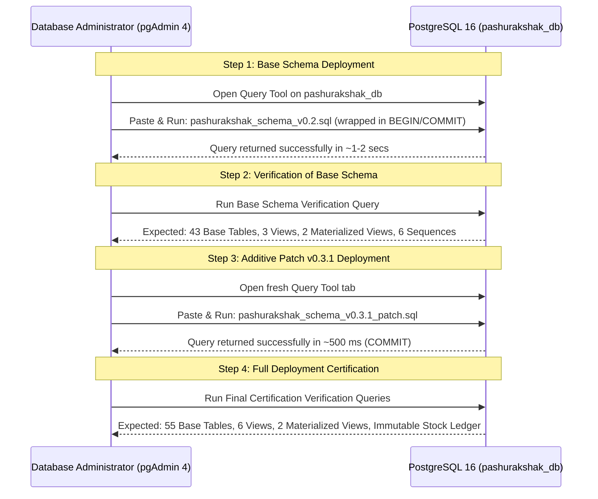

# PashuRakshak Botad — SQL Execution Order & Deployment Guide
**Project:** PS000195 · **Date:** 31 October 2026 · **Target Engine:** PostgreSQL 16.x (16.15)  
**Database Name:** `pashurakshak_db` · **Client Tool:** pgAdmin 4 or `psql`

---

## 1. Pre-Execution Checklist

Before executing any script in pgAdmin 4:
- [ ] Connect to local PostgreSQL 16.15 as superuser `postgres`.
- [ ] Confirm `pashurakshak_db` is clean and empty (no existing user tables in `public` schema):
  ```sql
  SELECT count(*) FROM information_schema.tables WHERE table_schema = 'public';
  -- Must return 0
  ```
- [ ] Ensure superuser privileges to create extensions (`citext`, `btree_gist`).

---

## 2. Step-by-Step Execution Sequence

Execute the files in strict sequential order. Do NOT execute the patch before the base schema.



---

## 3. Execution Instructions for pgAdmin 4

### Phase 1: Deploy Base Schema (`pashurakshak_schema_v0.2.sql`)

1. In the pgAdmin 4 Object Browser (left tree), expand **Servers** -> **PostgreSQL 16** -> **Databases**.
2. Right-click on **`pashurakshak_db`** and select **Query Tool**.
3. Open or paste the complete contents of [`pashurakshak_schema_v0.2.sql`](file:///c:/Users/milan/OneDrive/Documents/Desktop/PASHURAKSHAK/pashurakshak_schema_v0.2.sql).
4. **Best Practice:** Prepend `BEGIN;` at the very top (Line 1) and append `COMMIT;` at the very bottom (after Line 1318) to ensure transaction atomicity.
5. Click the **Execute/Refresh (F5)** button.
6. Verify output in the **Messages** pane: `Query returned successfully`.
7. Execute the Phase 1 quick check query:
   ```sql
   SELECT 
     (SELECT count(*) FROM information_schema.tables WHERE table_schema='public' AND table_type='BASE TABLE') as base_tables,
     (SELECT count(*) FROM information_schema.views WHERE table_schema='public') as views,
     (SELECT count(*) FROM pg_matviews WHERE schemaname='public') as mat_views,
     (SELECT count(*) FROM information_schema.sequences WHERE sequence_schema='public') as sequences;
   ```
   *Expected counts: Base Tables = 43, Views = 3, Materialized Views = 2, Sequences = 6.*

---

### Phase 2: Deploy Additive Patch (`pashurakshak_schema_v0.3.1_patch.sql`)

1. In the same Query Tool (or a new tab on `pashurakshak_db`), clear the editor.
2. Open or paste the complete contents of [`pashurakshak_schema_v0.3.1_patch.sql`](file:///c:/Users/milan/OneDrive/Documents/Desktop/PASHURAKSHAK/pashurakshak_schema_v0.3.1_patch.sql).
3. The script already contains `BEGIN;` and `COMMIT;`.
4. Click **Execute (F5)**.
5. Verify output: `Query returned successfully`.

---

### Phase 3: Post-Migration Object Verification

Execute the following verification script in pgAdmin 4 to confirm complete schema certification:

```sql
-- 1. Total Object Counts
SELECT 
  (SELECT count(*) FROM information_schema.tables WHERE table_schema='public' AND table_type='BASE TABLE') as total_base_tables,
  (SELECT count(*) FROM information_schema.views WHERE table_schema='public') as total_views,
  (SELECT count(*) FROM pg_matviews WHERE schemaname='public') as total_mat_views;
-- Expected: total_base_tables = 55, total_views = 6, total_mat_views = 2

-- 2. Verify District and Village Migration & Indexes (ISSUE-SQL-05)
SELECT count(*) FROM districts WHERE code = 'BOTAD';
-- Expected: 1

SELECT count(*) FROM information_schema.columns 
WHERE table_name IN ('talukas', 'villages') AND column_name = 'district_id';
-- Expected: 2 (both tables have district_id)

SELECT count(*) FROM pg_indexes 
WHERE indexname IN ('ix_talukas_district_id', 'ix_villages_district_id');
-- Expected: 2

-- 3. Verify Compatibility Views
SELECT count(*) FROM owners;
SELECT count(*) FROM owner_user_links;
SELECT count(*) FROM dairy_cooperatives;
-- Expected: All three queries execute cleanly (returning 0 rows on clean DB)

-- 4. Verify System Setting (Rule 7: No Self-Registration)
SELECT value FROM system_settings WHERE key = 'farmer_self_registration_enabled';
-- Expected: 'false'

-- 5. Verify DAHO Campaign & Cooperative Permissions (ISSUE-SQL-03)
SELECT permission_code FROM role_permissions WHERE role = 'DAHO' ORDER BY permission_code;
-- Expected includes: campaign.configure, campaign.manage, campaign.view, cooperative.manage, 
--                    district.setup.manage, gram_panchayat.manage, vaccine_stock.manage, 
--                    veterinary_officer.manage, village.manage

-- 6. Verify SYS_ADMIN Separation
SELECT permission_code FROM role_permissions WHERE role = 'SYS_ADMIN' AND permission_code LIKE 'campaign.%';
-- Expected: campaign.view only (campaign.configure and campaign.assign_workers are absent)

-- 7. Verify VO Fallback-Only Animal Registration (ISSUE-SQL-02)
SELECT role, permission_code FROM role_permissions 
WHERE role IN ('VET_OFFICER', 'FIELD_WORKER') AND permission_code LIKE 'animal.create%';
-- Expected:
--   FIELD_WORKER | animal.create
--   VET_OFFICER  | animal.create.fallback
-- Note: VET_OFFICER must NOT have 'animal.create'

-- 8. Verify Stock Transactions Append-Only Trigger (ISSUE-SQL-01)
SELECT trigger_name, event_manipulation, action_statement 
FROM information_schema.triggers 
WHERE event_object_table = 'vaccine_stock_transactions' 
ORDER BY trigger_name;
-- Expected triggers:
--   trg_apply_vaccine_stock_movement (BEFORE INSERT)
--   trg_stock_txn_immutable         (BEFORE UPDATE OR DELETE)
```

---

## 4. Rollback and Recovery Considerations

If any statement fails during execution:

### If Base Schema Fails (Wrapped in Transaction):
- The entire transaction rolls back automatically.
- Check the error message, line number, and error code.
- Because `pashurakshak_db` is clean, you can resolve the issue and re-run.

### If Patch Fails:
- The patch runs inside `BEGIN ... COMMIT`.
- Any error immediately triggers a clean rollback of the patch objects.
- The base schema (`v0.2`) remains intact and undamaged.
- Fix the patch issue and re-execute the patch without needing to rebuild the base schema.

### Hard Reset Procedure (If Needed):
If an un-transactioned run left partial objects and you wish to completely wipe and restart:
```sql
-- Connect to 'postgres' database in Query Tool, then run:
DROP DATABASE IF EXISTS pashurakshak_db;
CREATE DATABASE pashurakshak_db WITH ENCODING = 'UTF8';
```
*(Do not run this if production data exists. Safe only on development environment).*
