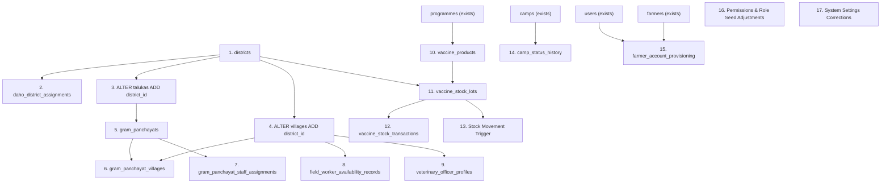

# PashuRakshak Botad — SQL Schema Gap Analysis (v0.2 vs Proposed v0.3/v0.4)
**Project:** PS000195 · **Date:** 31 October 2026 · **Status:** Complete Technical Gap Inventory  
**Scope:** Compare `pashurakshak_schema_v0.2.sql` (1318 lines) against `BACKENDDATABASESCHEMA.md` (1741 lines)

---

## 1. Complete Table-by-Table Inventory

| Table Name | Present in SQL v0.2? | Present in Schema v0.3? | Status / Gap | Dependency / Foreign Keys | Workflow Necessity | Proposed Action |
|---|:---:|:---:|---|---|---|---|
| `districts` | ❌ No | ✅ Yes (§4.2) | Missing from SQL | None (Root Geo) | Mandatory (Workflow A, Scope) | Create in Patch |
| `talukas` | ✅ Yes | ✅ Yes (§4.2) | Missing `district_id` in SQL | `districts` | Mandatory (Scope) | Add column & FK in Patch |
| `villages` | ✅ Yes | ✅ Yes (§4.2) | Missing `district_id` in SQL | `districts`, `talukas` | Mandatory (Scope) | Add column & FK in Patch |
| `geodata_imports` | ✅ Yes | ✅ Yes (§4.2) | Aligned | `users` | Optional admin tool | Retain |
| `species` | ✅ Yes | ✅ Yes (§4.2) | Aligned | None | Mandatory (Animal Master) | Retain |
| `breeds` | ✅ Yes | ✅ Yes (§4.2) | Aligned | `species` | Mandatory (Animal Master) | Retain |
| `programmes` | ✅ Yes | ✅ Yes (§4.2) | Aligned | None | Mandatory (Vaccination) | Retain |
| `users` | ✅ Yes | ✅ Yes (§4.3) | Aligned | Self-reference | Mandatory (Auth) | Retain |
| `permissions` | ✅ Yes | ✅ Yes (§4.3) | Incomplete seed in v0.2 | None | Mandatory (Auth) | Insert missing codes |
| `role_permissions` | ✅ Yes | ✅ Yes (§4.3) | Seed Divergence | `permissions` | Mandatory (Auth) | Update seed in Patch |
| `user_permission_grants` | ✅ Yes | ✅ Yes (§4.3) | Aligned | `users`, `permissions` | Mandatory (Explicit Grants) | Retain |
| `user_village_assignments` | ✅ Yes | ✅ Yes (§4.3) | Aligned | `users`, `villages` | Mandatory (Scope) | Retain |
| `field_worker_availability_records` | ❌ No | ✅ Yes (§4.3) | Missing from SQL | `users`, `villages` | Mandatory (Workflow C - VO Fallback) | Create in Patch |
| `daho_district_assignments` | ❌ No | ✅ Yes (§4.3) | Missing from SQL | `users`, `districts` | Mandatory (Workflow A, Scope) | Create in Patch |
| `veterinary_officer_profiles` | ❌ No | ✅ Yes (§4.3) | Missing from SQL | `users` | High (Operational Admin) | Create in Patch |
| `gram_panchayats` | ❌ No | ✅ Yes (§4.3) | Missing from SQL | `talukas`, `users` | Mandatory (Workflow A) | Create in Patch |
| `gram_panchayat_villages` | ❌ No | ✅ Yes (§4.3) | Missing from SQL | `gram_panchayats`, `villages` | Mandatory (Workflow A) | Create in Patch |
| `gram_panchayat_staff_assignments` | ❌ No | ✅ Yes (§4.3) | Missing from SQL | `gram_panchayats`, `users` | Mandatory (Workflow A) | Create in Patch |
| `cooperatives` / `dairy_cooperatives` | ✅ Yes (`cooperatives`) | ✅ Yes (`dairy_cooperatives`) | Naming difference | `users`, `talukas` | Mandatory (Workflow D, M) | Standardize or create view |
| `cooperative_villages` | ✅ Yes | ✅ Yes (§4.3) | Aligned | `cooperatives`, `villages` | Mandatory (Coordination) | Retain |
| `cooperative_staff_assignments` | ✅ Yes | ✅ Yes (§4.3) | Aligned | `cooperatives`, `users` | Mandatory (Coordination) | Retain |
| `cooperative_memberships` | ✅ Yes | ❌ No | Extra in SQL v0.2 | `cooperatives`, `farmers` | Feature-flagged off | Retain (harmless) |
| `devices` | ✅ Yes | ✅ Yes (§4.3) | Aligned | `users` | Mandatory (Sync/Offline) | Retain |
| `refresh_tokens` | ✅ Yes | ✅ Yes (§4.3) | Aligned | `users`, `devices` | Mandatory (Auth) | Retain |
| `otp_challenges` | ✅ Yes | ✅ Yes (§4.3) | Aligned | None | Mandatory (Auth Login) | Retain |
| `farmers` / `owners` | ✅ Yes (`farmers`) | ✅ Yes (`owners`) | Model divergence (see §2) | `villages`, `users` | Mandatory (Farmer Master) | Address via compatibility view |
| `farmer_verifications` | ✅ Yes | ❌ No | Extra in SQL v0.2 | `farmers`, `users` | Mandatory (Verification) | Retain |
| `farmer_user_links` / `owner_user_links` | ✅ Yes (`farmer_user_links`) | ✅ Yes (`owner_user_links`) | Naming divergence | `users`, `farmers`/`owners` | Mandatory (Auth Login) | Address via compatibility view |
| `farmer_account_provisioning` | ❌ No | ✅ Yes (§4.4) | Missing from SQL | `users`, `owners` | Mandatory (Workflow B step 7) | Create in Patch |
| `animals` | ✅ Yes | ✅ Yes (§4.4) | Attribute differences | `species`, `breeds`, `farmers`, `villages` | Mandatory (Core) | Align column names |
| `animal_external_identifiers` | ✅ Yes | ❌ No (tag in `animals`) | Divergence (SQL has table) | `animals`, `users` | Mandatory (Tag Tracking) | Retain SQL table |
| `animal_verifications` | ✅ Yes | ❌ No | Extra in SQL v0.2 | `animals`, `users` | Mandatory (Workflow C) | Retain |
| `flocks` | ✅ Yes | ❌ No | Extra in SQL v0.2 | `farmers`, `villages` | Disabled by flag | Retain |
| `animal_qr_tokens` | ✅ Yes | ✅ Yes (§4.4) | Aligned | `animals`, `users` | Mandatory (Labels) | Retain |
| `animal_ownership_history` | ✅ Yes | ✅ Yes (§4.4) | Aligned | `animals`, `farmers`, `villages` | Mandatory (Workflow L) | Retain |
| `ownership_transfers` | ✅ Yes | ❌ No in DDL body | Present in SQL | `animals`, `farmers`, `villages` | Mandatory (Workflow L) | Retain |
| `animal_merge_log` | ✅ Yes | ✅ Yes (§4.4) | Aligned | `animals`, `users` | Mandatory (Duplicates) | Retain |
| `animal_events` | ✅ Yes | ✅ Yes (§4.5) | Aligned | `animals`, `villages`, `users` | Mandatory (Core Fact) | Retain |
| `vaccination_details` | ✅ Yes | ✅ Yes (§4.5) | Aligned | `animal_events`, `programmes` | Mandatory (Core Detail) | Retain |
| `treatment_details` | ✅ Yes | ✅ Yes (§4.5) | Aligned | `animal_events` | Mandatory (Clinical) | Retain |
| `observation_details` | ✅ Yes | ✅ Yes (§4.5) | Aligned | `animal_events` | Mandatory (Clinical) | Retain |
| `event_corrections` | ✅ Yes | ✅ Yes (§4.5) | Aligned | `animal_events`, `users` | Mandatory (Immutability) | Retain |
| `schedule_versions` | ✅ Yes | ✅ Yes (§4.6) | Aligned | `users` | Mandatory (Configuration) | Retain |
| `schedule_rules` | ✅ Yes | ✅ Yes (§4.6) | Aligned | `schedule_versions`, `species`, `programmes` | Mandatory (Configuration) | Retain |
| `vaccine_products` | ❌ No | ✅ Yes (§4.7) | Missing from SQL | `programmes`, `users` | Mandatory (Stock Ledger) | Create in Patch |
| `vaccine_stock_lots` | ❌ No | ✅ Yes (§4.7) | Missing from SQL | `vaccine_products`, `districts`, `users` | Mandatory (Stock Ledger) | Create in Patch |
| `vaccine_stock_transactions` | ❌ No | ✅ Yes (§4.7) | Missing from SQL | `vaccine_stock_lots`, `users` | Mandatory (Stock Ledger) | Create in Patch |
| `campaigns` | ✅ Yes | ✅ Yes (§4.7) | Aligned | `schedule_versions`, `users` | Mandatory (Workflow D) | Retain |
| `campaign_programmes` | ✅ Yes | ✅ Yes (§4.7) | Aligned | `campaigns`, `species`, `programmes` | Mandatory (Workflow D) | Retain |
| `campaign_villages` | ✅ Yes | ✅ Yes (§4.7) | Aligned | `campaigns`, `villages` | Mandatory (Workflow D) | Retain |
| `campaign_assignments` | ✅ Yes | ✅ Yes (§4.7) | Aligned | `campaigns`, `villages`, `users` | Mandatory (Workflow D) | Retain |
| `campaign_animal_targets` | ✅ Yes | ✅ Yes (§4.7) | Aligned | `campaigns`, `animals`, `programmes` | Mandatory (Coverage Calc) | Retain |
| `camps` | ✅ Yes | ✅ Yes (§4.7A) | Aligned | `campaigns`, `villages`, `users` | Mandatory (Workflow M) | Retain |
| `camp_status_history` | ❌ No | ✅ Yes (§4.7A) | Missing from SQL | `camps`, `users` | High (Audit/Lifecycle) | Create in Patch |
| `camp_staff` | ✅ Yes | ❌ No | Extra in SQL v0.2 | `camps`, `users` | Mandatory (Rule 10/11) | Retain |
| `vaccinator_authorizations` | ✅ Yes | ❌ No | Extra in SQL v0.2 | `users` | Mandatory (Rule 11) | Retain |
| `reminder_templates` | ✅ Yes | ✅ Yes (§4.8) | Aligned | None | Mandatory (Reminders) | Retain |
| `reminders` | ✅ Yes | ✅ Yes (§4.8) | Aligned | `animals`, `farmers`, `programmes` | Mandatory (Reminders) | Retain |
| `reminder_delivery_attempts` | ✅ Yes | ✅ Yes (§4.8) | Aligned | `reminders` | Mandatory (SMS Audit) | Retain |
| `follow_up_tasks` | ✅ Yes | ✅ Yes (§4.8) | Aligned | `animals`, `farmers`, `villages` | Mandatory (Assisted Follow-up) | Retain |
| `help_requests` | ✅ Yes | ✅ Yes (§4.9) | Aligned | `villages`, `users` | Mandatory (Workflow I) | Retain |
| `help_request_attempts` | ✅ Yes | ✅ Yes (§4.9) | Aligned | `help_requests`, `users` | Mandatory (Workflow I) | Retain |
| `disease_reports` | ✅ Yes | ✅ Yes (§4.10) | Aligned (SQL v0.2 state is richer) | `villages`, `users` | Mandatory (Surveillance) | Retain SQL status machine |
| `disease_report_attachments` | ✅ Yes | ❌ No | Extra in SQL v0.2 | `disease_reports`, `users` | High (Photos) | Retain |
| `disease_reviews` | ✅ Yes | ❌ No | Extra in SQL v0.2 | `disease_reports`, `users` | Mandatory (Workflow G) | Retain |
| `disease_report_status_history` | ✅ Yes | ✅ Yes (§4.10) | Aligned | `disease_reports`, `users` | Mandatory (Audit) | Retain |
| `disease_alert_rules` | ✅ Yes | ✅ Yes (§4.10) | Aligned | `users` | Mandatory (Surveillance) | Retain |
| `disease_alerts` | ✅ Yes | ✅ Yes (§4.10) | Aligned | `disease_alert_rules`, `villages` | Mandatory (Surveillance) | Retain |
| `alert_reports` | ✅ Yes | ✅ Yes (§4.10) | Aligned | `disease_alerts`, `disease_reports` | Mandatory (Surveillance) | Retain |
| `investigations` | ✅ Yes | ✅ Yes (§4.10) | Aligned | `disease_alerts`, `users` | Mandatory (Surveillance) | Retain |
| `investigation_actions` | ✅ Yes | ✅ Yes (§4.10) | Aligned | `investigations`, `users` | Mandatory (Surveillance) | Retain |
| `map_threshold_sets` | ✅ Yes | ✅ Yes (§4.10) | Aligned | `users` | Mandatory (Map Viz) | Retain |
| `import_jobs` | ✅ Yes | ✅ Yes (§4.11) | Aligned | `users` | Mandatory (Workflow J) | Retain |
| `import_rows` | ✅ Yes | ✅ Yes (§4.11) | Aligned | `import_jobs` | Mandatory (Workflow J) | Retain |
| `label_batches` | ✅ Yes | ✅ Yes (§4.11) | Aligned | `users` | Mandatory (QR Print) | Retain |
| `label_batch_items` | ✅ Yes | ✅ Yes (§4.11) | Aligned | `label_batches`, `animals` | Mandatory (QR Print) | Retain |
| `sync_batches` | ✅ Yes | ✅ Yes (§4.12) | Aligned | `devices`, `users` | Mandatory (Sync) | Retain |
| `sync_receipts` | ✅ Yes | ✅ Yes (§4.12) | Aligned | `devices`, `users` | Mandatory (Sync) | Retain |
| `sync_conflicts` | ✅ Yes | ✅ Yes (§4.12) | Aligned | `sync_receipts`, `users` | Mandatory (Sync) | Retain |
| `notifications` | ✅ Yes | ✅ Yes (§4.12A) | Aligned | `users` | Mandatory (Hand-off) | Retain |
| `audit_events` | ✅ Yes | ✅ Yes (§4.13) | Aligned | `users` | Mandatory (Audit) | Retain |
| `export_log` | ✅ Yes | ✅ Yes (§4.13) | Aligned | `users` | Mandatory (Export) | Retain |
| `system_settings` | ✅ Yes | ✅ Yes (§4.13) | Aligned | `users` | Mandatory (Config) | Retain |
| `integration_settings` | ✅ Yes | ✅ Yes (§4.13) | Aligned | `users` | Mandatory (Integrations) | Retain |
| `jobs` | ✅ Yes | ✅ Yes (§4.13) | Aligned | `users` | Mandatory (Workers) | Retain |

---

## 2. Structural & Modeling Divergences

### A. Farmers vs Owners
- **SQL v0.2:** Uses table `farmers` (with `farmer_code`, `registration_status`, `registration_path`, `data_consent_at`, `mobile_status`).
- **Schema v0.3:** Uses table `owners` (simplified columns: `full_name`, `name_norm`, `mobile_e164`, `mobile_verified`, `outreach_consent`).
- **Resolution:** `farmers` in SQL v0.2 is actually **more comprehensive and aligned with APPFLOW v0.4** (capturing staff registration, consent, and duplicate status). SQL v0.2 structure must be retained; a compatibility view `CREATE VIEW owners AS SELECT id, full_name, name_norm, mobile_e164, (mobile_status IN ('VERIFIED_OTP','VERIFIED_STAFF')) AS mobile_verified, village_id, address_text, outreach_consent, consent_basis, consent_recorded_by, consent_recorded_at, active, row_version, created_by, created_at, updated_at FROM farmers;` satisfies schema dependencies without schema disruption.

### B. Missing Administrative Structures in SQL v0.2
The following 10 tables are completely missing from `pashurakshak_schema_v0.2.sql`:
1. `districts`
2. `daho_district_assignments`
3. `gram_panchayats`
4. `gram_panchayat_villages`
5. `gram_panchayat_staff_assignments`
6. `field_worker_availability_records`
7. `veterinary_officer_profiles`
8. `vaccine_products`
9. `vaccine_stock_lots`
10. `vaccine_stock_transactions`
11. `camp_status_history`
12. `farmer_account_provisioning`

---

## 3. Strict Topological Dependency Order for Patch

To apply the patch safely without foreign key violations, objects must be created in this sequence:

---

## 4. Patch Recommendation
Create a standalone file `pashurakshak_schema_v0.3_patch.sql` containing:
- Clean DDL for the 12 missing tables.
- Table alterations for `talukas` and `villages` to add `district_id`.
- Referential triggers for stock balance calculations.
- Seed fixes for `farmer_self_registration_enabled = false`.
- Seed updates for DAHO and SYS_ADMIN permissions.
- Seed entry for `farmer.account.provision`.
- Compatibility views (`owners`, `owner_user_links`).

