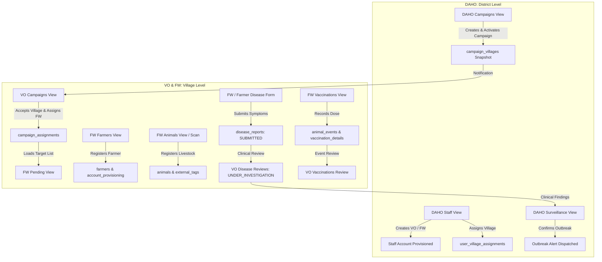

# PASHURAKSHAK — ACTUAL CURRENT WORKFLOW EXTRACTION REPORT (READ-ONLY AUDIT)

**Generated Date:** November 18, 2026  
**Audited Codebase Root:** `c:\Users\milan\OneDrive\Documents\Desktop\PASHURAKSHAK`  
**Report Target:** `docs/ACTUAL_CURRENT_ROLE_WORKFLOWS.md`  
**Scope:** 100% Code-Verified Extraction of Current Implementation (No assumptions, no redesign, strictly read-only).

---

## EXECUTIVE SUMMARY & SYSTEM ARCHITECTURE REALITY

This document extracts the **exact, currently implemented workflow** across the PashuRakshak repository by inspecting actual backend FastAPI routers, SQLAlchemy ORM models, PostgreSQL database schemas, RBAC permission matrices, and React 18/TypeScript frontend routes and views.

### Critical Architecture Findings:
1. **The 8 Roles in the Actual Codebase vs Prompt Specification:**
   - **`SUPER_ADMIN`**: Does **not** exist under this identifier. The actual technical administration role implemented in code is **`SYS_ADMIN`** (with frontend normalization alias `ADMIN`).
   - **`TAHO` (Taluka Animal Husbandry Officer)**: **NOT IMPLEMENTED.** There are zero database tables, zero backend API endpoints, zero role permissions, zero frontend layouts, zero navigation items, and zero views for TAHO. The administrative hierarchy implemented is strictly **District (`DAHO`) $\rightarrow$ Village (`VO` / `FW`)**.
   - **`GRAM_PANCHAYAT`**: **Partially modeled in backend only.** The database check constraint recognizes `'GRAM_PANCHAYAT'` and notification services query `gram_panchayat_staff_assignments`, but there is **no frontend portal, no navigation, and no login routing** (it redirects to `/access-denied`).
   - **`COOPERATIVE`**: Implemented in backend as `'DAIRY_STAFF'` (with `'COOPERATIVE'` alias) and in frontend as `'COOP'` (`/coop`).
   - **`DAHO`**, **`VO` (`VET_OFFICER`)**, **`FW` (`FIELD_WORKER`)**, and **`FARMER`**: Fully implemented across backend models, service layers, and frontend portals.

---

## 1. EXPLAIN ALL 8 ROLES SEPARATELY

---

### ROLE 1: SUPER_ADMIN (Actual Codebase Role: `SYS_ADMIN`)

* **Source Files:**
  - Backend: `backend/app/modules/technical/endpoints.py`, `backend/app/modules/authorization/service.py`, `backend/app/modules/authentication/models.py`
  - Frontend: `frontend/src/views/admin/AdminDashboard.tsx`, `frontend/src/views/admin/AdminUsersView.tsx`, `frontend/src/views/admin/AdminDevicesView.tsx`, `frontend/src/views/admin/AdminAuditLogsView.tsx`, `frontend/src/views/admin/AdminSystemHealthView.tsx`, `frontend/src/services/technicalService.ts`
* **How user logs in:**
  - Route: `/login` (`LoginView.tsx` + `LoginForm.tsx`)
  - Tab: Staff Login (Username & Password)
  - API Endpoint: `POST /api/v1/auth/staff/login`
  - Auth Method: Argon2id password hash verification against `users.password_hash`. Returns JWT Access Token + Rotated Refresh Token.
* **What happens immediately after login:**
  - `AuthContext.tsx` receives token, calls `GET /api/v1/auth/me` and `GET /api/v1/rbac/scope`.
  - Role string `"SYS_ADMIN"` is normalized via `normalizeRole("SYS_ADMIN")` $\rightarrow$ `'SYS_ADMIN'`.
  - `getRolePrefix('SYS_ADMIN')` resolves to `'/admin'`.
  - Browser automatically redirects to `'/admin/overview'`.
* **Which dashboard opens:**
  - `AdminDashboard.tsx` at URL path `/admin/overview`.
* **Visible navigation items (`ADMIN_NAV_ITEMS` in `navConfig.tsx`):**
  1. `/admin/overview` — ડેશબોર્ડ (Dashboard)
  2. `/admin/users` — વપરાશકર્તાઓ (Users Directory)
  3. `/admin/devices` — ઉપકરણો (Devices)
  4. `/admin/audit-logs` — ઓડિટ લોગ (Audit Logs)
  5. `/admin/system-health` — સિસ્ટમ આરોગ્ય (System Health)
  6. `/admin/profile` — પ્રોફાઇલ (Profile)
* **Which pages user can open:**
  - All 6 pages listed in navigation.
* **What actions user can perform:**
  - View technical overview metrics (counts of total/active users, total/active devices, total audit events).
  - Search and filter registered system user accounts (by username, full name, mobile, role, status).
  - Inspect field mobile/tablet devices registered for offline synchronization.
  - Review immutable security and operational audit trail logs (filter by action, result).
  - Monitor live database connectivity and system health.
  - Log out (`POST /api/v1/auth/logout`).
* **Which forms user can submit:**
  - Search/Filter form in `AdminUsersView.tsx` (`searchTerm`, `roleFilter`, `statusFilter`).
  - Device filter form in `AdminDevicesView.tsx` (`statusFilter`).
  - Audit log filter form in `AdminAuditLogsView.tsx` (`action`, `result`).
* **What data user can see:**
  - Technical metadata: user IDs, usernames, roles, account status (`ACTIVE`/`LOCKED`), last login timestamps, device sync states, audit log events, database connection pool status.
* **What data user can create, edit, approve, or reject:**
  - **NONE.** All endpoints under `/api/v1/technical/*` are strictly HTTP `GET` read-only operations. There are no UI controls or API methods for SYS_ADMIN to create, edit, approve, or reject operational records.
* **Geographical area assigned:**
  - **NONE.** Enforced by `AuthorizationService.assert_district_scope`: `SYS_ADMIN` has no operational geographic district or village authority. Any attempt to access operational district/village data is denied with `403 Forbidden` (`SYS_ADMIN_NO_OPERATIONAL_AUTHORITY`).
* **What happens after each action:**
  - Read actions execute SQL select queries; security audit events are recorded for privileged log access.
* **Which other role receives or processes that action:**
  - None. SYS_ADMIN is an independent technical audit/monitoring role.
* **What is currently missing or broken:**
  - **User Provisioning UI Missing:** `AdminUsersView.tsx` is completely read-only. SYS_ADMIN cannot create new DAHO, VO, or FW accounts from the UI.
  - **DAHO District Assignment UI Missing:** Backend has endpoint `POST /api/v1/administration/assignments/daho-district` restricted to SYS_ADMIN, but there is no frontend screen or button to trigger it.
  - **Role Naming:** Code uses `SYS_ADMIN`, not `SUPER_ADMIN`. Any token or record using `SUPER_ADMIN` is rejected as `UNKNOWN`.

---

### ROLE 2: DAHO (District Animal Husbandry Officer)

* **Source Files:**
  - Backend: `backend/app/modules/administration/endpoints.py`, `backend/app/modules/campaigns/endpoints.py`, `backend/app/modules/inventory/endpoints.py`, `backend/app/modules/disease_surveillance/endpoints.py`
  - Frontend: `frontend/src/views/daho/DahoDashboard.tsx`, `frontend/src/views/daho/DahoMasterDataView.tsx`, `frontend/src/views/daho/DahoStaffView.tsx`, `frontend/src/views/daho/DahoCampaignsView.tsx`, `frontend/src/views/daho/DahoCampsView.tsx`, `frontend/src/views/daho/DahoInventoryView.tsx`, `frontend/src/views/daho/DahoSurveillanceView.tsx`, `frontend/src/views/daho/DahoMapsView.tsx`, `frontend/src/views/daho/DahoReportsView.tsx`, `frontend/src/views/daho/DahoProfileView.tsx`, `frontend/src/services/dahoOpsService.ts`, `frontend/src/services/adminService.ts`
* **How user logs in:**
  - Route: `/login` (Staff Login tab)
  - Enters username & password $\rightarrow$ `POST /api/v1/auth/staff/login`.
* **What happens immediately after login:**
  - `normalizeRole("DAHO")` returns `'DAHO'`.
  - `getRolePrefix('DAHO')` resolves to `'/daho'`.
  - Browser redirects to `'/daho/overview'`.
* **Which dashboard opens:**
  - `DahoDashboard.tsx` (`/daho/overview`).
* **Visible navigation items (`DAHO_NAV_ITEMS` in `navConfig.tsx`):**
  1. `/daho/overview` — વિહંગાવલોકન (Overview)
  2. `/daho/master-data` — માસ્ટર ડેટા (Master Data)
  3. `/daho/staff` — સ્ટાફ સંચાલન (Staff Management)
  4. `/daho/campaigns` — ઝુંબેશ (Campaigns)
  5. `/daho/camps` — શિબિર (Camps)
  6. `/daho/inventory` — રસી સ્ટોક (Vaccine Inventory)
  7. `/daho/surveillance` — રોગ સર્વેક્ષણ (Disease Surveillance)
  8. `/daho/maps` — GIS નકશો (GIS Maps)
  9. `/daho/reports` — અહેવાલો (Reports)
  10. `/daho/profile` — પ્રોફાઇલ (Profile)
* **Which pages user can open:**
  - All 10 pages listed above.
* **What actions user can perform:**
  - **Master Data Management (`/daho/master-data`):**
    - View and create Talukas (`POST /api/v1/administration/talukas`).
    - View and create Villages (`POST /api/v1/administration/villages`) with GPS latitude/longitude and census codes.
    - View and create Gram Panchayats (`POST /api/v1/administration/gram-panchayats`) and map villages to GPs (`POST /api/v1/administration/gram-panchayats/{id}/villages`).
    - View and create Dairy Cooperatives (`POST /api/v1/administration/cooperatives`) and map villages to Cooperatives (`POST /api/v1/administration/cooperatives/{id}/villages`).
  - **Staff Management (`/daho/staff`):**
    - Provision Veterinary Officer accounts (`POST /api/v1/administration/veterinary-officers`).
    - Provision Field Worker accounts (`POST /api/v1/administration/field-workers`).
    - Assign VOs to villages individually (`POST /api/v1/administration/assignments/vo-village`) or in bulk (`POST /api/v1/administration/assignments/vo-village/bulk`).
    - Assign FWs to villages (`POST /api/v1/administration/assignments/fw-village`).
    - End village assignments for VO or FW (`POST .../end`).
    - Activate / deactivate staff accounts (`PATCH /api/v1/administration/veterinary-officers/{id}/status`, `PATCH /api/v1/administration/field-workers/{id}/status`).
  - **Campaign Management (`/daho/campaigns`):**
    - Create vaccination campaigns (`POST /api/v1/campaigns`).
    - Activate campaigns (`POST /api/v1/campaigns/{id}/activate`).
    - View real-time village drill-down monitoring (`GET /api/v1/campaigns/{id}/monitoring`).
  - **Veterinary Camps (`/daho/camps`):**
    - Propose camps (`POST /api/v1/veterinary-camps`).
    - Update camp status (`CONFIRMED`, `CANCELLED`).
  - **Vaccine Inventory (`/daho/inventory`):**
    - Register vaccine formulations in catalog (`POST /api/v1/vaccine-inventory/products`).
    - Receive batch stock lots (`POST /api/v1/vaccine-inventory/lots`).
    - Issue stock to camps/centers (`POST /api/v1/vaccine-inventory/lots/{id}/issue`).
    - Adjust stock/wastage (`POST /api/v1/vaccine-inventory/lots/{id}/adjust`).
  - **Disease Surveillance (`/daho/surveillance`):**
    - View all syndromic disease reports in the district (`GET /api/v1/disease-reports`).
    - Make final confirmation decisions: `CONFIRM`, `DISPROVE`, or `INSUFFICIENT` (`POST /api/v1/disease-reports/{id}/decide`).
* **Which forms user can submit:**
  - Create Taluka Form, Create Village Form, Create GP Form, Create Cooperative Form.
  - Provision VO Form, Provision FW Form.
  - Single Village Assign Modal, Bulk VO Village Assign Modal.
  - Create Campaign Form, Activate Campaign Modal.
  - Propose Camp Form.
  - Add Vaccine Product Form, Stock Issue/Adjustment Form.
  - Disease Report Final Decision Modal.
* **What data user can see:**
  - District-level livestock summary, all talukas, villages, GPs, cooperatives, staff rosters, campaign progress, cold-chain stock lots, disease surveillance reports, GIS choropleth and cluster maps.
* **What data user can create, edit, approve, or reject:**
  - Creates: Talukas, Villages, GPs, Cooperatives, VO accounts, FW accounts, Campaigns, Camps, Vaccine Products, Stock Lots.
  - Edits: Taluka/Village/GP/Coop details, Staff profile and active status, Campaign configuration.
  - Approves/Rejects: Disease reports (final decision).
* **Geographical area assigned:**
  - One operational district (`daho_district_assignments.district_id`, e.g., Botad).
* **What happens after each action:**
  - Staff creation creates active login accounts.
  - Campaign activation snapshots animal targets and dispatches notifications (`CAMPAIGN_VO_ASSIGNMENT`) to assigned VOs.
  - Disease confirmation triggers outbreak alerts.
* **Which other role receives or processes that action:**
  - VOs receive campaign village assignments and disease notification alerts.
  - FWs receive village assignments and active campaign vaccination target lists.
* **What is currently missing or broken:**
  - **No TAHO Entity:** DAHO manages VOs and FWs directly across all talukas and villages without any intermediate TAHO layer.
  - **Staff Self-Registration Approval:** DAHO directly creates staff credentials; there is no queue where VOs/FWs register and DAHO approves.

---

### ROLE 3: TAHO (Taluka Animal Husbandry Officer)

* **Implementation Status: NOT IMPLEMENTED (0% Implemented).**
* **Code Evidence:**
  - Database: `talukas` table exists, but there is **no user association**, no `taho_user_id` column, no `taho_taluka_assignments` table, and no `CHECK (role = 'TAHO')`.
  - Backend Routers: Zero routes with `/taho` prefix; zero endpoints handling TAHO workflows.
  - RBAC: `BASE_ROLE_PERMS` in `backend/app/modules/authorization/repository.py` has no entry for `"TAHO"`.
  - Frontend Routing: `frontend/src/router.tsx` has no route for `/taho`.
  - Frontend Layouts: `frontend/src/layouts/RoleLayoutWrappers.tsx` has no `TahoLayoutWrapper`.
  - Frontend Navigation: `frontend/src/constants/navConfig.tsx` has no `TAHO_NAV_ITEMS`.
  - Authentication: `normalizeRole()` in `frontend/src/context/AuthContext.tsx` returns `'UNKNOWN'` for `"TAHO"`, which redirects to `'/access-denied'`.
* **Summary:**
  - In the current implementation, all taluka administration is performed directly by the DAHO, and clinical/field work is executed by VOs and FWs assigned directly to villages.

---

### ROLE 4: VO (Veterinary Officer)

* **Source Files:**
  - Backend: `backend/app/modules/campaigns/endpoints.py`, `backend/app/modules/vaccinations/endpoints.py`, `backend/app/modules/disease_surveillance/endpoints.py`, `backend/app/modules/camps/endpoints.py`
  - Frontend: `frontend/src/views/vo/VoDashboard.tsx`, `frontend/src/views/vo/VoCampaignsView.tsx`, `frontend/src/views/vo/VoDiseaseInboxView.tsx`, `frontend/src/views/vo/VoVaccinationsView.tsx`, `frontend/src/views/vo/VoAnimalsView.tsx`, `frontend/src/views/vo/VoCampsView.tsx`, `frontend/src/views/vo/VoInventoryView.tsx`, `frontend/src/views/vo/VoSyncView.tsx`, `frontend/src/services/voService.ts`
* **How user logs in:**
  - Route: `/login` (Staff Login tab) with username and password $\rightarrow$ `POST /api/v1/auth/staff/login`.
* **What happens immediately after login:**
  - `normalizeRole("VET_OFFICER")` or `"VO"` returns `'VO'`.
  - Redirects to `/vo` $\rightarrow$ `/vo/overview` (`VoDashboard.tsx`).
* **Which dashboard opens:**
  - `VoDashboard.tsx` (`/vo/overview`).
* **Visible navigation items (`VO_NAV_ITEMS` in `navConfig.tsx`):**
  1. `/vo/overview` — વિહંગાવલોકન (Overview)
  2. `/vo/surveillance-reviews` — રોગ સમીક્ષા (Disease Reviews)
  3. `/vo/animals` — પશુઓ (Animals)
  4. `/vo/vaccinations` — રસીકરણ અને સારવાર (Vaccinations & Treatments)
  5. `/vo/campaigns` — ઝુંબેશ (Campaigns)
  6. `/vo/camps` — શિબિર (Camps)
  7. `/vo/inventory` — રસી સ્ટોક (Vaccine Stock)
  8. `/vo/reports` — અહેવાલો (Reports)
  9. `/vo/maps` — GIS નકશો (GIS Maps)
  10. `/vo/sync` — ઑફલાઇન સિંક (Offline Sync)
  11. `/vo/profile` — પ્રોફાઇલ (Profile)
* **Which pages user can open:**
  - All 11 pages listed above.
* **What actions user can perform:**
  - **Campaigns (`/vo/campaigns`):**
    - View active campaigns touching assigned villages (`GET /api/v1/campaigns/assignments/my-vo-villages`).
    - Accept campaign village assignment (`POST /api/v1/campaigns/{id}/villages/{vid}/accept`).
    - Reject campaign village assignment with mandatory reason (`POST /api/v1/campaigns/{id}/villages/{vid}/reject`).
    - Assign Field Workers to accepted campaign villages (`POST /api/v1/campaigns/{id}/villages/{vid}/assign-worker`).
  - **Disease Surveillance (`/vo/surveillance-reviews`):**
    - Inspect unreviewed syndromic disease reports submitted by FWs/farmers.
    - Record clinical investigation: observations, tentative diagnosis, severity, recommendation (`POST /api/v1/disease-reports/{id}/reviews`).
  - **Vaccinations & Treatments (`/vo/vaccinations`):**
    - Record clinical treatment events (`POST /api/v1/vaccinations/treatments`).
    - Record vaccination events if user holds clinical authorization (`is_approved_vaccinator = True`).
    - Review and verify vaccination events (`POST /api/v1/vaccinations/events/{id}/review`).
    - Amend or void clinical events with reason (`POST /api/v1/vaccinations/events/{id}/correct`).
  - **Animal Management (`/vo/animals`):**
    - View registered animals in assigned villages.
    - Fallback animal registration (DEC-007): VO can only register animals if no Field Worker is assigned and a formal unavailability declaration exists (`animal.create.fallback`).
  - **Veterinary Camps (`/vo/camps`):**
    - Propose and coordinate veterinary camps (`POST /api/v1/veterinary-camps`).
  - **Sync (`/vo/sync`):**
    - Push and pull offline sync batches.
* **Which forms user can submit:**
  - Campaign Acceptance/Rejection Form.
  - Field Worker Campaign Allocation Modal.
  - Disease Clinical Investigation Form (`VoDiseaseInboxView.tsx`).
  - Treatment Recording Modal, Vaccination Recording Modal.
  - Event Correction Modal.
  - Propose Camp Modal.
* **What data user can see:**
  - Data strictly scoped to villages assigned to this VO in `user_village_assignments`. Cannot see data from unassigned villages.
* **What data user can create, edit, approve, or reject:**
  - Creates: Clinical treatment records, Disease investigation reviews, Campaign worker assignments, Camp proposals, Event corrections.
  - Approves/Rejects: Accepts/rejects campaign assignments from DAHO; reviews/flags vaccination records.
* **Geographical area assigned:**
  - Specific villages assigned by DAHO via `user_village_assignments`.
* **What happens after each action:**
  - Campaign rejection sends notification to DAHO.
  - FW campaign assignment makes target lists visible to the FW.
  - Disease review moves report status to `UNDER_INVESTIGATION` and informs DAHO.
* **Which other role receives or processes that action:**
  - DAHO receives VO campaign decisions and disease reviews for final confirmation.
  - FW receives campaign village operational assignments.
* **What is currently missing or broken:**
  - VO cannot configure campaigns or close them (DAHO only).
  - VO cannot assign villages permanently to staff (only assign FWs to campaign-village pairs).

---

### ROLE 5: FW (Field Worker)

* **Source Files:**
  - Backend: `backend/app/modules/farmers/endpoints.py`, `backend/app/modules/animals/endpoints.py`, `backend/app/modules/vaccinations/endpoints.py`, `backend/app/modules/disease_surveillance/endpoints.py`, `backend/app/modules/sync/endpoints.py`
  - Frontend: `frontend/src/views/fw/FwDashboard.tsx`, `frontend/src/views/fw/FwFarmersView.tsx`, `frontend/src/views/fw/FwAnimalsView.tsx`, `frontend/src/views/fw/FwScanView.tsx`, `frontend/src/views/fw/FwVaccinationsView.tsx`, `frontend/src/views/fw/FwDiseaseReportView.tsx`, `frontend/src/views/fw/FwPendingView.tsx`, `frontend/src/views/fw/FwSyncView.tsx`, `frontend/src/services/fwService.ts`
* **How user logs in:**
  - Route: `/login` (Staff Login tab) with username and password $\rightarrow$ `POST /api/v1/auth/staff/login`.
* **What happens immediately after login:**
  - `normalizeRole("FIELD_WORKER")` or `"FW"` returns `'FW'`.
  - Redirects to `/fw` $\rightarrow$ `/fw/home` (`FwDashboard.tsx`).
* **Which dashboard opens:**
  - `FwDashboard.tsx` (`/fw/home`) — mobile-optimized field portal.
* **Visible navigation items (`FW_NAV_ITEMS` in `navConfig.tsx`):**
  1. `/fw/home` — હોમ (Home)
  2. `/fw/farmers` — પશુપાલકો (Farmers)
  3. `/fw/animals` — પશુઓ (Animals)
  4. `/fw/scan` — QR સ્કેન (QR Scan)
  5. `/fw/vaccinations` — રસીકરણ (Vaccinations)
  6. `/fw/reports/new` — રોગ રિપોર્ટ (New Disease Report)
  7. `/fw/pending` — બાકી યાદી (Pending Targets)
  8. `/fw/maps` — GIS નકશો (Maps)
  9. `/fw/sync` — સિંક (Offline Sync)
  10. `/fw/profile` — પ્રોફાઇલ (Profile)
* **Which pages user can open:**
  - All 10 pages above + `/fw/reports/attachments` (`FwAttachmentView.tsx`).
* **What actions user can perform:**
  - **Farmer Registration (`/fw/farmers`):** Register new farmers (`POST /api/v1/farmers`) in assigned villages.
  - **Animal Registration (`/fw/animals`, `/fw/scan`):** Register livestock (`POST /api/v1/animals`) with ear-tag/QR token, species, breed, gender, DOB, and owner farmer.
  - **QR/Barcode Scanning (`/fw/scan`):** Scan physical animal QR/RFID tags via camera (`html5-qrcode`) to instantly look up animal identity, vaccination history, and pending doses.
  - **Vaccination Recording (`/fw/vaccinations`):** Record vaccination events (`POST /api/v1/vaccinations`) linking animal, campaign, vaccine lot batch, and dose number. Enforces vaccinator authorization check (`is_approved_vaccinator`).
  - **Disease Reporting (`/fw/reports/new`):** Submit syndromic disease alerts (`POST /api/v1/disease-reports`) with symptoms, onset date, affected counts, and photos.
  - **Pending Target Queue (`/fw/pending`):** View un-vaccinated animals in assigned campaign villages (`GET /api/v1/campaigns/{id}/pending-vaccinations/{vid}`).
  - **Offline Sync (`/fw/sync`):** Queue registrations and vaccinations in browser IndexedDB during network loss and sync when online (`POST /api/v1/sync/push`, `POST /api/v1/sync/pull`).
* **Which forms user can submit:**
  - New Farmer Registration Form (`FwFarmersView.tsx`).
  - Universal Animal Registration Modal (`UniversalAnimalRegistrationModal.tsx`).
  - Vaccination Recording Form (`FwVaccinationsView.tsx`).
  - Disease Report Form (`DiseaseReportForm.tsx`).
* **What data user can see:**
  - Farmers, animals, vaccination records, and pending campaign targets within their assigned villages (`user_village_assignments`).
* **What data user can create, edit, approve, or reject:**
  - Creates: Farmer records, Animal registrations, Vaccination event records, Disease report alerts.
  - Edits: Updates farmer contact details.
  - Approves/Rejects: **NONE.** FWs have no verification or approval authority.
* **Geographical area assigned:**
  - Assigned villages (`user_village_assignments`).
* **What happens after each action:**
  - Registered farmer can immediately log in via OTP.
  - Recorded vaccination increments campaign progress and decrements pending lists.
  - Submitted disease report is queued for assigned VO review.
* **Which other role receives or processes that action:**
  - VO reviews disease reports and verifies vaccination events.
  - Farmer sees new animal and vaccination records in their portal.
* **What is currently missing or broken:**
  - FW cannot assign other workers.
  - FW cannot review or approve any clinical records.

---

### ROLE 6: FARMER (Livestock Owner)

* **Source Files:**
  - Backend: `backend/app/modules/authentication/endpoints.py`, `backend/app/modules/animals/endpoints.py`, `backend/app/modules/disease_surveillance/endpoints.py`, `backend/app/modules/farmers/endpoints.py`
  - Frontend: `frontend/src/views/auth/FarmerLoginView.tsx`, `frontend/src/views/farmer/FarmerDashboard.tsx`, `frontend/src/views/farmer/FarmerAnimalsView.tsx`, `frontend/src/views/farmer/FarmerProfileView.tsx`, `frontend/src/views/farmer/FarmerAnimalDetailModal.tsx`, `frontend/src/views/farmer/FarmerDiseaseReportModal.tsx`, `frontend/src/services/farmerService.ts`
* **How user logs in:**
  - Route: `/farmer/login` or `/login` (Farmer tab).
  - Step 1: Enters mobile number (`+91XXXXXXXXXX`) $\rightarrow$ `POST /api/v1/auth/farmer/request-otp`.
  - Step 2: Enters 6-digit numeric OTP $\rightarrow$ `POST /api/v1/auth/farmer/verify-otp`.
  - Requirement: Mobile must be pre-provisioned in `users` and `farmer_account_provisioning` by field staff. Self-registration is strictly blocked.
* **What happens immediately after login:**
  - `normalizeRole("FARMER")` returns `'FARMER'`.
  - Browser redirects to `/farmer` $\rightarrow$ `/farmer/home` (`FarmerDashboard.tsx`).
* **Which dashboard opens:**
  - `FarmerDashboard.tsx` (`/farmer/home`).
* **Visible navigation items (`FARMER_NAV_ITEMS` in `navConfig.tsx`):**
  1. `/farmer/home` — હોમ (Home)
  2. `/farmer/animals` — મારા પશુઓ (My Animals)
  3. `/farmer/profile` — પ્રોફાઇલ (Profile)
* **Which pages user can open:**
  - All 3 pages listed above.
* **What actions user can perform:**
  - View list of owned livestock with tag numbers and species icons (`GET /api/v1/animals?farmer_id=...`).
  - Click on an animal to view detailed digital health passport, past vaccinations, and treatment history (`FarmerAnimalDetailModal.tsx`).
  - Report suspected animal illness (`FarmerDiseaseReportModal.tsx` $\rightarrow$ `POST /api/v1/disease-reports`).
  - View personal profile, registered mobile, and village membership (`GET /api/v1/farmers/me`).
  - Log out.
* **Which forms user can submit:**
  - Suspected Disease Report Form (`FarmerDiseaseReportModal`): Selects owned animal, selects primary symptoms, onset date, notes.
* **What data user can see:**
  - **Strict record-level isolation:** Farmer can see ONLY their owned animals and vaccination history. Backend `AuthorizationService.assert_farmer_ownership` rejects cross-farmer queries.
* **What data user can create, edit, approve, or reject:**
  - Creates: Syndromic disease report for an owned animal.
  - Edits/Approves/Rejects: **NONE.**
* **Can farmer register animals directly?**
  - **NO.** Invariant DEC-007: Animal registration requires physical ear-tagging and verification by a Field Worker. There is no animal registration form in the farmer portal.
* **Geographical area assigned:**
  - Linked to the farmer's registered village (`farmers.village_id`).
* **What happens after each action:**
  - Disease report submitted by farmer creates a `disease_reports` record with `report_source = 'FARMER'` and alerts the village VO.
* **Which other role receives or processes that action:**
  - Assigned VO receives the disease report for clinical triage.
* **What is currently missing or broken:**
  - Farmer cannot initiate livestock ownership transfer from the portal (must be handled by staff).

---

### ROLE 7: COOPERATIVE (Dairy Cooperative / `DAIRY_STAFF`)

* **Source Files:**
  - Backend: `backend/app/modules/camps/endpoints.py`, `backend/app/modules/authorization/service.py`, `backend/app/modules/animals/endpoints.py`
  - Frontend: `frontend/src/views/coop/CoopDashboard.tsx`, `frontend/src/views/coop/CoopVillageProgressView.tsx`, `frontend/src/views/coop/CoopCampsView.tsx`, `frontend/src/views/coop/CoopProfileView.tsx`, `frontend/src/services/coopService.ts`
* **How user logs in:**
  - Route: `/login` (Staff Login tab) with username and password $\rightarrow$ `POST /api/v1/auth/staff/login`.
* **What happens immediately after login:**
  - `normalizeRole("DAIRY_STAFF")` or `"COOPERATIVE"` returns `'COOP'`.
  - Browser redirects to `/coop` $\rightarrow$ `/coop/overview` (`CoopDashboard.tsx`).
* **Which dashboard opens:**
  - `CoopDashboard.tsx` (`/coop/overview`).
* **Visible navigation items (`COOP_NAV_ITEMS` in `navConfig.tsx`):**
  1. `/coop/overview` — વિહંગાવલોકન (Overview)
  2. `/coop/village-progress` — ગામડાઓની પ્રગતિ (Village Progress)
  3. `/coop/camps` — રસીકરણ શિબિર (Camps)
  4. `/coop/reports` — અહેવાલો (Reports) $\rightarrow$ Displays `CommonNotAvailableView` (UI Placeholder)
  5. `/coop/profile` — પ્રોફાઇલ (Profile)
* **Which pages user can open:**
  - All 5 pages listed above + `/coop/maps` (`VoMapsView.tsx`).
* **What actions user can perform:**
  - View aggregate livestock population, total vaccinated animals, and vaccination coverage percentages for villages mapped to this cooperative in `cooperative_villages`.
  - View camps organized by or linked to the cooperative (`GET /api/v1/camps?cooperative_id=...`).
  - Propose a new veterinary camp in an assigned village (`POST /api/v1/camps` with `organizer_type = 'COOPERATIVE'`).
  - View district/village GIS maps.
* **Which forms user can submit:**
  - Propose Camp Modal in `CoopCampsView.tsx` (selects campaign, served village, date/time, expected farmers).
* **What data user can see:**
  - **Aggregate counts only.** Total animals, total farmers, vaccinated count, and coverage percentages in served villages.
  - **Strict Invariant:** No individual farmer names, farmer phone numbers, or animal owner identities are ever returned to cooperative users.
* **What data user can create, edit, approve, or reject:**
  - Creates: Camp proposals (`camps` table with `status = 'PROPOSED'`).
  - Edits/Approves/Rejects: **NONE.**
* **Geographical area assigned:**
  - Set of villages mapped in `cooperative_villages` for that cooperative entity.
* **What happens after each action:**
  - Camp proposal is sent to DAHO and VO for scheduling and confirmation.
* **Which other role receives or processes that action:**
  - DAHO / VO review and confirm the proposed camp.
* **What is currently missing or broken:**
  - `/coop/reports` is a non-functional UI placeholder (`CommonNotAvailableView`).
  - Cooperative cannot approve camps or assign vaccinators.

---

### ROLE 8: GRAM_PANCHAYAT (Gram Panchayat Representative)

* **Implementation Status: PARTIALLY WORKING / BACKEND & NOTIFICATIONS ONLY (NO FRONTEND PORTAL).**
* **Source Files:**
  - Backend: `backend/app/modules/administration/models.py`, `backend/app/modules/notifications/service.py`, `pashurakshak_schema_v0.2.sql`
  - Frontend: `frontend/src/context/AuthContext.tsx` (Omits role)
* **How user logs in:**
  - If a user with role `'GRAM_PANCHAYAT'` attempts to log in via `/login`, authentication succeeds at the backend, but frontend `AuthContext.tsx` `normalizeRole()` evaluates it as `'UNKNOWN'`.
  - As a result, `getRolePrefix('UNKNOWN')` immediately redirects the user to `/access-denied`.
* **What happens immediately after login:**
  - Redirected to `/access-denied` (`AccessDeniedView.tsx`).
* **Which dashboard opens:**
  - **None.** No `PanchayatDashboard.tsx` exists.
* **Visible navigation items:**
  - **None.** No `PANCHAYAT_NAV_ITEMS` exists.
* **Which pages user can open:**
  - None.
* **What actions user can perform:**
  - In backend only: Users mapped in `gram_panchayat_staff_assignments` receive system notifications (`Notification` table) when a veterinary camp is organized in a village mapped to their Gram Panchayat (`backend/app/modules/notifications/service.py` line 391 & line 624).
* **What data user can see:**
  - No frontend interface exists to view notifications or village data.
* **What is currently missing or broken:**
  - The entire frontend presentation layer for Gram Panchayat (routes, layouts, views, navigation) is **not implemented**.

---

## 2. TAHO — SPECIAL DETAILED INVESTIGATION

A comprehensive audit was performed across all source files, database schemas, and migration patches for the **Taluka Animal Husbandry Officer (TAHO)** role. Below are the definitive, code-verified answers to all 19 required questions:

| # | Investigation Question | Actual Implementation Finding | Exact Source Code Reference |
|---|------------------------|-------------------------------|-----------------------------|
| **1** | Who creates a TAHO account? | **Nobody.** There is no code, API, or service method to create a TAHO account. | `backend/app/modules/administration/service.py` |
| **2** | From which page is it created? | **No page exists.** Neither `AdminUsersView.tsx` nor `DahoStaffView.tsx` has any option for TAHO. | `frontend/src/views/daho/DahoStaffView.tsx` |
| **3** | Who assigns a Taluka to TAHO? | **Nobody.** No mechanism exists to assign a taluka to a user. | `backend/app/modules/administration/endpoints.py` |
| **4** | How is the Taluka selected currently? | **Not selectable.** Talukas exist only as geographic master records under districts (`talukas` table). | `backend/app/models/geography.py:32` |
| **5** | Is it selected through map, dropdown, or manual input? | **None of these.** There is no UI component anywhere for taluka-to-user assignment. | `frontend/src/views/daho/DahoMasterDataView.tsx` |
| **6** | Where is the Taluka assignment saved in database? | **Nowhere.** There is no `user_taluka_assignments` or `taho_assignments` table in the database schema. | `backend/app/modules/authentication/models.py` |
| **7** | After login, what does TAHO see? | **Access Denied.** `normalizeRole("TAHO")` returns `'UNKNOWN'` $\rightarrow$ redirects to `/access-denied`. | `frontend/src/context/AuthContext.tsx:36-47` |
| **8** | Which dashboard and nav items are available? | **None.** No `TahoDashboard.tsx` or `TAHO_NAV_ITEMS` exists in the codebase. | `frontend/src/constants/navConfig.tsx` |
| **9** | Can TAHO see all villages within assigned Taluka? | **No.** No views, queries, or endpoints exist for TAHO village scoping. | `backend/app/modules/authorization/service.py` |
| **10** | Can TAHO assign villages to VO? | **No.** Village assignments to VO are performed **exclusively by DAHO** (`DahoStaffView.tsx`). | `backend/app/modules/administration/service.py:1175` |
| **11** | Can TAHO assign villages to FW? | **No.** Village assignments to FW are performed **exclusively by DAHO** (`DahoStaffView.tsx`). | `backend/app/modules/administration/service.py:1365` |
| **12** | Can TAHO view vaccination reports? | **No.** No report view or endpoint exists for TAHO. | `frontend/src/views/daho/DahoReportsView.tsx` |
| **13** | Can TAHO approve or reject vaccination records? | **No.** Vaccination review is performed by **VO** (`POST /api/v1/vaccinations/events/{id}/review`). | `backend/app/modules/vaccinations/endpoints.py:118` |
| **14** | Can TAHO investigate or classify disease reports? | **No.** Investigation is performed by **VO** (`VoDiseaseInboxView.tsx`); decision is made by **DAHO**. | `backend/app/modules/disease_surveillance/service.py` |
| **15** | Can TAHO approve outbreak alerts? | **No.** Outbreak confirmation decisions are made **exclusively by DAHO** (`DahoSurveillanceView.tsx`). | `frontend/src/views/daho/DahoSurveillanceView.tsx:39` |
| **16** | Can TAHO manage campaigns? | **No.** Campaigns are created/managed **exclusively by DAHO** (`DahoCampaignsView.tsx`). | `backend/app/modules/campaigns/service.py:348` |
| **17** | What happens when TAHO has no assigned Taluka? | **Not applicable.** The TAHO role itself does not exist in the system. | `backend/app/modules/authorization/roles.py` |
| **18** | Which actions are actually connected to backend APIs? | **Zero actions.** There are no TAHO backend APIs. | `backend/app/api/v1/router.py` |
| **19** | Which actions are only UI placeholders or incomplete? | **The entire TAHO role is 100% NOT IMPLEMENTED.** | Entire repository |

---

## 3. ACTUAL ROLE-TO-ROLE WORKFLOW TRACE

Below is the exact execution trace of the 12 requested process flows based on actual codebase code paths:



---

### Flow 1: SUPER_ADMIN $\rightarrow$ DAHO
- **Status:** **PARTIALLY WORKING (Backend API only, No Frontend UI).**
- **Initiator:** `SYS_ADMIN`.
- **Screen:** None (No UI in `AdminUsersView.tsx`).
- **Backend API:** `POST /api/v1/administration/assignments/daho-district`.
- **Input:** `{ "daho_user_id": UUID, "district_id": UUID }`.
- **Database Record Created:** Inserts row into `daho_district_assignments`.
- **Next Role:** DAHO user can now log in and access district master data and campaigns for that district.
- **Failure:** If caller is not SYS_ADMIN, returns `403 Forbidden` (`PERMISSION_DENIED`).
- **Missing Link:** There is no UI screen in the frontend to execute this endpoint. DAHO accounts must be seeded or inserted directly via database migrations/scripts.

---

### Flow 2: DAHO $\rightarrow$ TAHO
- **Status:** **NOT IMPLEMENTED.**
- No TAHO entity, assignment endpoint, or UI exists.

---

### Flow 3: TAHO $\rightarrow$ VO
- **Status:** **NOT IMPLEMENTED (as a TAHO flow).**
- **Actual Implemented Flow is DAHO $\rightarrow$ VO:**
  - Initiator: `DAHO`.
  - Screen: `/daho/staff` (`DahoStaffView.tsx`).
  - Button: `"+ નવો વેટરનરી ઓફિસર"` (Provision VO) and `"ગામડાં ફાળવો"` (Assign Villages).
  - API Called: `POST /api/v1/administration/veterinary-officers` and `POST /api/v1/administration/assignments/vo-village/bulk`.
  - Database Records Created: `users` (`role='VET_OFFICER'`), `veterinary_officer_profiles`, and `user_village_assignments`.
  - Next Role: VO receives credentials and can log in via `/login` to see assigned villages.

---

### Flow 4: TAHO $\rightarrow$ FW
- **Status:** **NOT IMPLEMENTED (as a TAHO flow).**
- **Actual Implemented Flow is DAHO $\rightarrow$ FW:**
  - Initiator: `DAHO`.
  - Screen: `/daho/staff` (`DahoStaffView.tsx`).
  - Button: `"+ નવો ફીલ્ડ વર્કર"` (Provision FW) and `"ગામ ફાળવો"` (Assign Village).
  - API Called: `POST /api/v1/administration/field-workers` and `POST /api/v1/administration/assignments/fw-village`.
  - Database Records Created: `users` (`role='FIELD_WORKER'`), `user_village_assignments`.
  - Next Role: FW can log in via `/login` to access assigned villages.

---

### Flow 5: VO $\rightarrow$ FW (Campaign Village Assignment)
- **Status:** **WORKING.**
- **Initiator:** Veterinary Officer (`VO`).
- **Screen:** `/vo/campaigns` (`VoCampaignsView.tsx`).
- **Prerequisite:** DAHO activated a campaign; VO accepted village assignment (`POST .../accept`).
- **Button:** `"+ ફીલ્ડ વર્કર ફાળવો"` (Assign Field Worker).
- **Input:** Selects Field Worker from dropdown (`worker_user_id`).
- **API Called:** `POST /api/v1/campaigns/{campaign_id}/villages/{village_id}/assign-worker`.
- **Database Record Created:** Inserts row into `campaign_assignments`.
- **Next Role:** Field Worker sees the village in `/fw/pending` target lists.
- **Status Change:** VO acceptance status is `ACCEPTED`; FW assignment status is active (`ended_at IS NULL`).

---

### Flow 6: FW $\rightarrow$ Farmer
- **Status:** **WORKING.**
- **Initiator:** Field Worker (`FW`).
- **Screen:** `/fw/farmers` (`FwFarmersView.tsx`).
- **Button:** `"+ નવો પશુપાલક"` (New Farmer).
- **Input:** Full name, mobile number (+91), address, village selection.
- **API Called:** `POST /api/v1/farmers`.
- **Database Records Created:** Inserts row into `farmers`, inserts provisioning record in `farmer_account_provisioning`.
- **Next Role:** Farmer can immediately log in via `/farmer/login` using their mobile number.

---

### Flow 7: Farmer $\rightarrow$ Animal Registration
- **Status:** **NOT IMPLEMENTED for Farmer.**
- **Actual Rule:** Farmers **cannot** register animals directly.
- **Actual Implementation:** Field Worker performs registration in `/fw/animals` via `UniversalAnimalRegistrationModal`:
  - Input: Species, breed, gender, DOB, physical ear-tag ID / QR token, owner farmer ID, village ID.
  - API Called: `POST /api/v1/animals`.
  - Database Records Created: `animals`, `animal_external_identifiers`, `animal_ownership_history`.
  - Next Role: Farmer sees the animal appear in their `/farmer/animals` list.

---

### Flow 8: FW/VO $\rightarrow$ Vaccination Activity
- **Status:** **WORKING.**
- **Initiator:** Field Worker or VO (must hold clinical authorization `is_approved_vaccinator = True`).
- **Screen:** `/fw/vaccinations` (`FwVaccinationsView.tsx`) or `/fw/scan` (`FwScanView.tsx`).
- **Button:** `"+ નવી રસીકરણ નોંધણી"` (Record Vaccination).
- **Input:** Animal ID (or scanned QR), Campaign ID, Vaccine Lot ID, Dose number, Route (`SUBCUTANEOUS`/`INTRAMUSCULAR`), Event date.
- **API Called:** `POST /api/v1/vaccinations`.
- **Database Records Created:** Inserts row into `animal_events` (`event_type='VACCINATION'`), inserts row into `vaccination_details`.
- **Status Change:** Animal campaign target status moves towards completed; pending vaccination count decreases.

---

### Flow 9: Vaccination Activity $\rightarrow$ Verification / Approval
- **Status:** **PARTIALLY WORKING.**
- **Initiator:** Veterinary Officer (`VO`).
- **Screen:** `/vo/vaccinations` (`VoVaccinationsView.tsx`).
- **Backend Implementation:** `POST /api/v1/vaccinations/events/{event_id}/review` accepts `review_status: 'VERIFIED' | 'FLAGGED' | 'REJECTED'` and updates `animal_events.reviewed_by` and `reviewed_at`.
- **Frontend Implementation:** VO can view event lists and submit clinical amendments via `POST /api/v1/vaccinations/events/{event_id}/correct`. However, a bulk 1-click verification queue in the UI is missing.

---

### Flow 10: Farmer/FW/Cooperative $\rightarrow$ Disease Report
- **Status:** **WORKING.**
- **Initiators:**
  - FW: `/fw/reports/new` (`FwDiseaseReportView.tsx`).
  - Farmer: `/farmer/home` (`FarmerDiseaseReportModal.tsx`).
  - Cooperative: `POST /api/v1/disease-reports`.
- **Input:** Village ID, Animal ID, Primary symptoms, Onset date, Description, Attachments.
- **API Called:** `POST /api/v1/disease-reports`.
- **Database Records Created:** Inserts row into `disease_reports` (`status='SUBMITTED'`), inserts status history into `disease_report_status_history`.
- **Next Role:** Assigned VO sees report in `/vo/surveillance-reviews`.

---

### Flow 11: VO $\rightarrow$ Disease Investigation
- **Status:** **WORKING.**
- **Initiator:** Veterinary Officer (`VO`).
- **Screen:** `/vo/surveillance-reviews` (`VoDiseaseInboxView.tsx`).
- **Button:** `"તપાસ વિગત નોંધો"` (Record Investigation).
- **Input:** Observations, tentative diagnosis, severity, recommendation (`CONFIRM_RECOMMENDED`, `DISPROVE_RECOMMENDED`, `FURTHER_TESTING_REQUIRED`).
- **API Called:** `POST /api/v1/disease-reports/{report_id}/reviews`.
- **Database Records Created:** Inserts row into `disease_reviews`, updates `disease_reports.status = 'UNDER_INVESTIGATION'`.
- **Next Role:** DAHO sees clinical review in `/daho/surveillance`.

---

### Flow 12: TAHO $\rightarrow$ Disease Classification and Outbreak Approval
- **Status:** **NOT IMPLEMENTED (as a TAHO flow).**
- **Actual Implementation is DAHO Outbreak Decision:**
  - Initiator: `DAHO`.
  - Screen: `/daho/surveillance` (`DahoSurveillanceView.tsx`).
  - Button: `"નિર્ણય સબમિટ કરો"` (Submit Decision).
  - Action: `CONFIRM`, `DISPROVE`, or `INSUFFICIENT`.
  - API Called: `POST /api/v1/disease-reports/{report_id}/decide`.
  - Database: Updates `disease_reports.status` to `CONFIRMED` or `DISPROVED`, records `confirmed_by = daho_user_id`, `confirmed_at = NOW()`.
  - Status Change: If `CONFIRM`, triggers outbreak alert notifications to field staff.

---

## 4. ACTUAL NAVIGATION STRUCTURE (CODE-VERIFIED)

Below are the exact navigation trees extracted from `frontend/src/constants/navConfig.tsx` and `frontend/src/router.tsx`:

```text
1. SYS_ADMIN (Admin Portal — Layout: AdminLayoutWrapper)
└── /admin/overview         [ડેશબોર્ડ (Dashboard)]
└── /admin/users            [વપરાશકર્તાઓ (Users Directory)]
└── /admin/devices          [ઉપકરણો (Devices)]
└── /admin/audit-logs       [ઓડિટ લોગ (Audit Logs)]
└── /admin/system-health    [સિસ્ટમ આરોગ્ય (System Health)]
└── /admin/profile          [પ્રોફાઇલ (Profile)]

2. DAHO (District Portal — Layout: DahoLayoutWrapper)
└── /daho/overview          [વિહંગાવલોકન (Overview)]
└── /daho/master-data       [માસ્ટર ડેટા (Master Data)]
└── /daho/staff             [સ્ટાફ સંચાલન (Staff Management)]
└── /daho/campaigns         [ઝુંબેશ (Campaigns)]
└── /daho/camps             [શિબિર (Camps)]
└── /daho/inventory         [રસી સ્ટોક (Vaccine Inventory)]
└── /daho/surveillance      [રોગ સર્વેક્ષણ (Disease Surveillance)]
└── /daho/maps              [GIS નકશો (GIS Maps)]
└── /daho/reports           [અહેવાલો (Reports)]
└── /daho/profile           [પ્રોફાઇલ (Profile)]

3. TAHO (Taluka Portal)
└── [NOT IMPLEMENTED — Zero Routes / Zero Navigation Items]

4. VO (Veterinary Officer Portal — Layout: VoLayoutWrapper)
└── /vo/overview            [વિહંગાવલોકન (Overview)]
└── /vo/surveillance-reviews[રોગ સમીક્ષા (Disease Reviews)]
└── /vo/animals             [પશુઓ (Animals)]
└── /vo/vaccinations        [રસીકરણ અને સારવાર (Vaccinations & Treatments)]
└── /vo/campaigns           [ઝુંબેશ (Campaigns)]
└── /vo/camps               [શિબિર (Camps)]
└── /vo/inventory           [રસી સ્ટોક (Vaccine Stock)]
└── /vo/reports             [અહેવાલો (Reports)]
└── /vo/maps                [GIS નકશો (GIS Maps)]
└── /vo/sync                [ઑફલાઇન સિંક (Offline Sync)]
└── /vo/profile             [પ્રોફાઇલ (Profile)]

5. FW (Field Worker Portal — Layout: FwLayoutWrapper)
└── /fw/home                [હોમ (Home)]
└── /fw/farmers             [પશુપાલકો (Farmers)]
└── /fw/animals             [પશુઓ (Animals)]
└── /fw/scan                [QR સ્કેન (QR Scan)]
└── /fw/vaccinations        [રસીકરણ (Vaccinations)]
└── /fw/reports/new         [રોગ રિપોર્ટ (New Disease Report)]
└── /fw/pending             [બાકી યાદી (Pending Targets)]
└── /fw/maps                [GIS નકશો (Maps)]
└── /fw/sync                [સિંક (Offline Sync)]
└── /fw/profile             [પ્રોફાઇલ (Profile)]

6. FARMER (Livestock Owner Portal — Layout: FarmerLayoutWrapper)
└── /farmer/home            [હોમ (Home)]
└── /farmer/animals         [મારા પશુઓ (My Animals)]
└── /farmer/profile         [પ્રોફાઇલ (Profile)]

7. COOPERATIVE (Dairy Staff Portal — Layout: CoopLayoutWrapper)
└── /coop/overview          [વિહંગાવલોકન (Overview)]
└── /coop/village-progress  [ગામડાઓની પ્રગતિ (Village Progress)]
└── /coop/camps             [રસીકરણ શિબિર (Camps)]
└── /coop/reports           [અહેવાલો (Reports) — UI Placeholder: CommonNotAvailableView]
└── /coop/profile           [પ્રોફાઇલ (Profile)]

8. GRAM_PANCHAYAT (Gram Panchayat Portal)
└── [NOT IMPLEMENTED — Zero Routes / Zero Navigation Items / Redirects to /access-denied]
```

---

## 5. ACTUAL IMPLEMENTATION STATUS

Below is the verified classification of every workflow and screen across the system:

| Workflow / Screen | Role | Status | Automated Test Evidence | Manual / Code Inspection Evidence |
| :--- | :---: | :---: | :--- | :--- |
| **Staff Login (Argon2id)** | Staff | **WORKING** | `tests/test_auth_security.py` (22 passed) | Verified in `LoginView.tsx` and `service.py:75` |
| **Farmer Mobile OTP Login** | Farmer | **WORKING** | `tests/test_auth_security.py:test_04` | Verified in `FarmerLoginView.tsx` & `service.py:205` |
| **SYS_ADMIN Dashboard & Health** | SYS_ADMIN | **WORKING** | Verified in build test | Connects to `/api/v1/health` and `/technical/overview` |
| **SYS_ADMIN Users Directory** | SYS_ADMIN | **WORKING** | Verified in build test | Read-only listing via `GET /api/v1/technical/users` |
| **SYS_ADMIN Create DAHO UI** | SYS_ADMIN | **NOT IMPLEMENTED** | None | No button or form in `AdminUsersView.tsx` |
| **DAHO District Overview** | DAHO | **WORKING** | `tests/integration/test_administration.py` | Dynamic DB metrics verified in Part 3.2 |
| **DAHO Master Data (Talukas, Villages, GPs, Coops)** | DAHO | **WORKING** | `tests/integration/test_administration.py` | CRUD forms wired in `DahoMasterDataView.tsx` |
| **DAHO Staff Provisioning (VO / FW)** | DAHO | **WORKING** | `tests/integration/test_administration.py` | Creates accounts via `/api/v1/administration/veterinary-officers` and `/field-workers` |
| **DAHO Village Assignment (VO / FW)** | DAHO | **WORKING** | `tests/integration/test_administration.py` | Single and bulk assignment working in `DahoStaffView.tsx` |
| **DAHO Campaign Creation & Activation** | DAHO | **WORKING** | `tests/integration/test_campaigns.py` | Creates and activates in `DahoCampaignsView.tsx` |
| **DAHO Cold-Chain Stock Management** | DAHO | **WORKING** | `tests/integration/test_inventory.py` | Receipts, issues, adjustments in `DahoInventoryView.tsx` |
| **DAHO Disease Confirmation Decision** | DAHO | **WORKING** | `tests/integration/test_disease_surveillance.py` | `POST /disease-reports/{id}/decide` wired in `DahoSurveillanceView.tsx` |
| **TAHO Account Creation & Assignment** | TAHO | **NOT IMPLEMENTED** | None | No tables, APIs, or UI exist |
| **TAHO Taluka-Level Operations** | TAHO | **NOT IMPLEMENTED** | None | No views, routers, or permissions exist |
| **VO Campaign Acceptance & FW Assignment** | VO | **WORKING** | `tests/integration/test_campaigns.py:test_02` | Accept/reject and FW allocation in `VoCampaignsView.tsx` |
| **VO Clinical Disease Investigation** | VO | **WORKING** | `tests/integration/test_disease_surveillance.py` | Reviews recorded in `VoDiseaseInboxView.tsx` |
| **VO Clinical Event Correction** | VO | **WORKING** | `tests/integration/test_vaccinations.py` | Event corrections in `VoVaccinationsView.tsx` |
| **VO Vaccination Approval Queue UI** | VO | **PARTIALLY WORKING** | API exists (`POST /events/{id}/review`) | Backend endpoint functional; 1-click batch UI missing |
| **FW Farmer Registration** | FW | **WORKING** | `tests/integration/test_farmers.py` | Wired to `POST /api/v1/farmers` in `FwFarmersView.tsx` |
| **FW Universal Animal Registration** | FW | **WORKING** | `tests/integration/test_animals.py` | Tags, species, breeds in `UniversalAnimalRegistrationModal` |
| **FW Physical Tag / QR Scanning** | FW | **WORKING** | Verified in browser build | Camera scanner in `FwScanView.tsx` using `html5-qrcode` |
| **FW Vaccination Recording** | FW | **WORKING** | `tests/integration/test_vaccinations.py` | Form in `FwVaccinationsView.tsx` with lot binding |
| **FW Syndromic Disease Reporting** | FW | **WORKING** | `tests/integration/test_disease_surveillance.py` | Form in `FwDiseaseReportView.tsx` with symptoms/media |
| **FW / VO Offline Sync (IndexedDB)** | FW/VO | **WORKING** | `src/__tests__/authOfflineInvariant.test.ts` | Pushes/pulls sync batches via `/api/v1/sync` |
| **Farmer Owned Animals & QR Passports** | Farmer | **WORKING** | `tests/integration/test_animals.py` | Strictly isolated list in `FarmerAnimalsView.tsx` |
| **Farmer Disease Reporting** | Farmer | **WORKING** | `tests/integration/test_disease_surveillance.py` | Modal in `FarmerDashboard.tsx` submitting to API |
| **Farmer Animal Registration** | Farmer | **NOT IMPLEMENTED** | Strict Invariant DEC-007 | Farmers prohibited from registering animals directly |
| **Cooperative Served Villages Progress** | Cooperative | **WORKING** | `tests/integration/test_rbac.py` | Aggregate counts in `CoopVillageProgressView.tsx` |
| **Cooperative Camp Proposal** | Cooperative | **WORKING** | `tests/integration/test_camps.py` | Submits proposal in `CoopCampsView.tsx` |
| **Cooperative Reports** | Cooperative | **UI ONLY** | None | Renders `CommonNotAvailableView` placeholder |
| **Gram Panchayat Portal** | Gram Panchayat | **NOT IMPLEMENTED** | None | No frontend portal; redirects to `/access-denied` |

---

## 6. SOURCE CODE FILE REFERENCES

1. **Authentication & RBAC:**
   - [models.py](file:///c:/Users/milan/OneDrive/Documents/Desktop/PASHURAKSHAK/backend/app/modules/authentication/models.py)
   - [service.py](file:///c:/Users/milan/OneDrive/Documents/Desktop/PASHURAKSHAK/backend/app/modules/authentication/service.py)
   - [AuthContext.tsx](file:///c:/Users/milan/OneDrive/Documents/Desktop/PASHURAKSHAK/frontend/src/context/AuthContext.tsx)
   - [repository.py](file:///c:/Users/milan/OneDrive/Documents/Desktop/PASHURAKSHAK/backend/app/modules/authorization/repository.py)
2. **Administration & Staff Provisioning:**
   - [endpoints.py](file:///c:/Users/milan/OneDrive/Documents/Desktop/PASHURAKSHAK/backend/app/modules/administration/endpoints.py)
   - [DahoStaffView.tsx](file:///c:/Users/milan/OneDrive/Documents/Desktop/PASHURAKSHAK/frontend/src/views/daho/DahoStaffView.tsx)
   - [DahoMasterDataView.tsx](file:///c:/Users/milan/OneDrive/Documents/Desktop/PASHURAKSHAK/frontend/src/views/daho/DahoMasterDataView.tsx)
3. **Campaigns & Allocation:**
   - [service.py](file:///c:/Users/milan/OneDrive/Documents/Desktop/PASHURAKSHAK/backend/app/modules/campaigns/service.py)
   - [DahoCampaignsView.tsx](file:///c:/Users/milan/OneDrive/Documents/Desktop/PASHURAKSHAK/frontend/src/views/daho/DahoCampaignsView.tsx)
   - [VoCampaignsView.tsx](file:///c:/Users/milan/OneDrive/Documents/Desktop/PASHURAKSHAK/frontend/src/views/vo/VoCampaignsView.tsx)
4. **Vaccinations & Field Work:**
   - [endpoints.py](file:///c:/Users/milan/OneDrive/Documents/Desktop/PASHURAKSHAK/backend/app/modules/vaccinations/endpoints.py)
   - [FwVaccinationsView.tsx](file:///c:/Users/milan/OneDrive/Documents/Desktop/PASHURAKSHAK/frontend/src/views/fw/FwVaccinationsView.tsx)
   - [FwScanView.tsx](file:///c:/Users/milan/OneDrive/Documents/Desktop/PASHURAKSHAK/frontend/src/views/fw/FwScanView.tsx)
   - [VoVaccinationsView.tsx](file:///c:/Users/milan/OneDrive/Documents/Desktop/PASHURAKSHAK/frontend/src/views/vo/VoVaccinationsView.tsx)
5. **Disease Surveillance:**
   - [endpoints.py](file:///c:/Users/milan/OneDrive/Documents/Desktop/PASHURAKSHAK/backend/app/modules/disease_surveillance/endpoints.py)
   - [FwDiseaseReportView.tsx](file:///c:/Users/milan/OneDrive/Documents/Desktop/PASHURAKSHAK/frontend/src/views/fw/FwDiseaseReportView.tsx)
   - [VoDiseaseInboxView.tsx](file:///c:/Users/milan/OneDrive/Documents/Desktop/PASHURAKSHAK/frontend/src/views/vo/VoDiseaseInboxView.tsx)
   - [DahoSurveillanceView.tsx](file:///c:/Users/milan/OneDrive/Documents/Desktop/PASHURAKSHAK/frontend/src/views/daho/DahoSurveillanceView.tsx)
6. **Navigation & Layouts:**
   - [router.tsx](file:///c:/Users/milan/OneDrive/Documents/Desktop/PASHURAKSHAK/frontend/src/router.tsx)
   - [navConfig.tsx](file:///c:/Users/milan/OneDrive/Documents/Desktop/PASHURAKSHAK/frontend/src/constants/navConfig.tsx)
   - [RoleLayoutWrappers.tsx](file:///c:/Users/milan/OneDrive/Documents/Desktop/PASHURAKSHAK/frontend/src/layouts/RoleLayoutWrappers.tsx)
